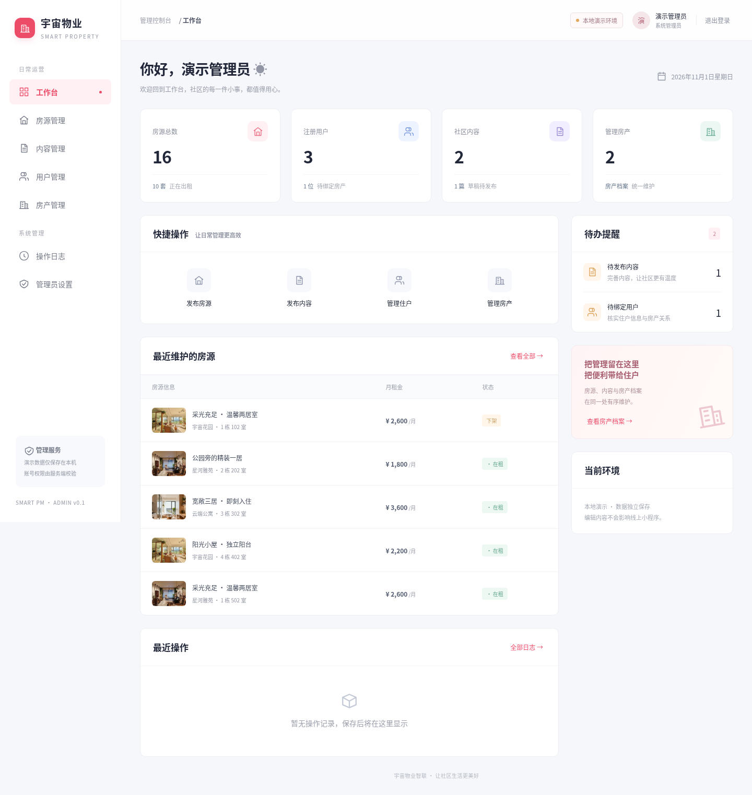
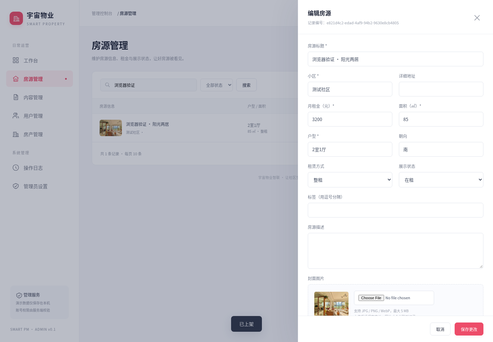

# 电脑端后台测试记录

## beta.10 Windows 路径修复

用户在 Windows 启动成功后首页返回“文件不存在”。原因是静态目录检查将 Windows 路径与硬编码 `/` 拼接比较。已改为 path.relative / path.isAbsolute 校验，并使用 Node 的 path.win32 与 path.posix 验证首页、脚本、样式和图片路径及目录越界。新增 6 项路径测试，后台共 24 项测试通过。该验证运行在 Linux，模拟 Windows 路径规则；仍需用户 Windows 实际启动复验。

## beta.9 首次交付记录

版本：项目 v0.1.0-beta.9 / 后台 0.1.0-beta.1。日期：2026-11-01。

## 已验证

- 小程序及复用云函数的本地回归测试：47 项通过，其中包括手动房产解绑后不被手机号登录覆盖。
- 后台 HTTP 集成测试：18 项通过，使用临时本地存储和独立监听端口。
- 服务端覆盖：未登录拒绝访问、Origin/CSRF 校验、角色权限、字段白名单、保存与持久化、状态筛选和分页、草稿、房产编号唯一、绑定/解绑、图片上传限制、账号停用后会话撤销、改密、登录限流。
- 使用实际安装的 CloudBase SDK、模拟请求传输验证查询、事务写入、业务与日志同步提交，以及写入错误时回滚。未调用真实云端。
- Playwright + Chromium 浏览器操作通过：登录演示工作台、新增房源、上传图片、搜索、上架、编辑侧栏、内容保存/预览、房产绑定、新建只读账号、退出后用该账号登录并验证菜单与编辑权限。
- 1024、1280、1920 像素视口宽度无整页横向溢出；浏览器没有 JavaScript 运行错误。
- 小程序静态检查通过，主包约 866 KiB。
- 原后端来源与独立修复记录、318 份切图校验通过。
- 锁定依赖安装后 npm audit 报告 0 项已知漏洞。

## 界面截图

截图使用临时演示数据，不代表真实运营数据。





## 验证边界

未在用户的 Windows 电脑执行启动脚本；浏览器测试在 Linux Chromium 完成。未连接真实微信云数据库、上传云函数、部署公网服务器或操作真实设备。云存储、云凭据、数据库权限、SDK 的真实云服务兼容性及小程序读回验证，需按 [部署说明](ADMIN-WEB.md) 完成现场联调。

## 重现

```sh
npm test
npm run check
npm run test:admin
cd admin-web
npm ci
npm run test:sdk
npx playwright install chromium
npm run test:browser
```

已有 Chromium 时可通过 CHROMIUM_PATH 指定路径。浏览器测试使用临时数据，不修改开发演示数据；结束后清理，截图保留在 admin-web/test-results/。
