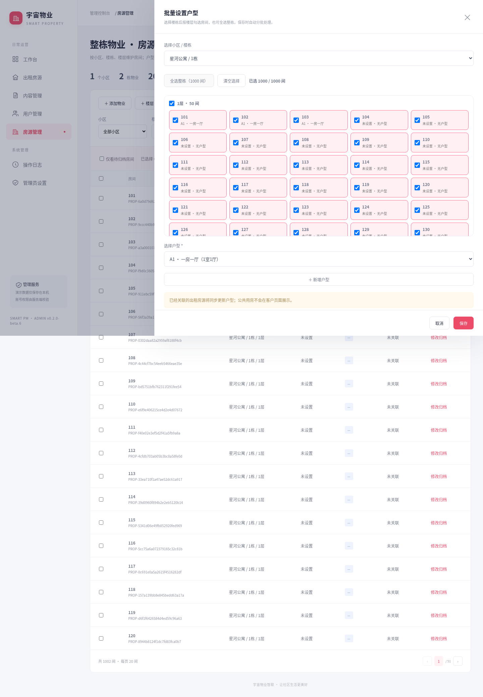
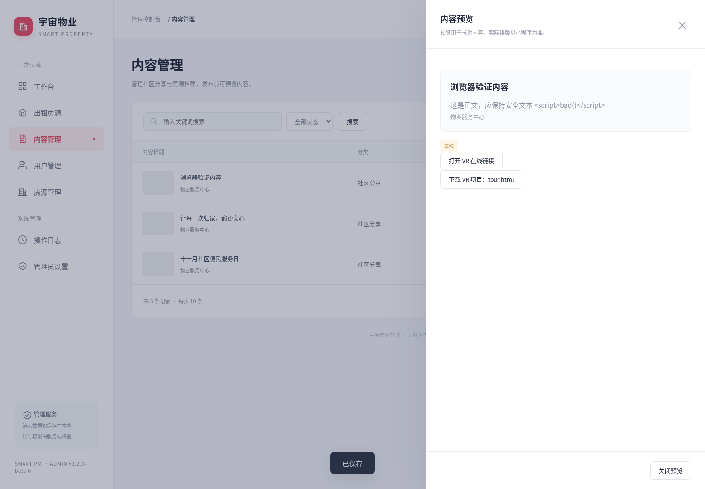

# 第一期电脑端管理后台部署与验收

交付：项目 **v0.1.0-beta.16** / 后台 **0.2.0-beta.6**。第二期手机管理页面复用本期 HTTP API 和权限逻辑。

本版新增整栋物业结构与批量户型，请先阅读 [房源数据结构与升级说明](PROPERTY-MODEL.md)。真实环境需额外创建空集合 `property_catalog`；旧数据逐步归档，不自动迁移。

## 1. 本地打开

Windows 安装 Node.js 20+，解压后双击 `admin-web/start-demo.cmd`，保持命令窗口开启，在浏览器访问 **http://127.0.0.1:4173**。点击“进入演示工作台”。不要双击 HTML 文件，不需要微信开发者工具。

终端方式：

```powershell
cd "C:\你的解压目录\SMART-PM-0.1.0-beta.16\admin-web"
npm start
```

默认 demo 模式不需要 npm install，不连接任何云端。演示数据、演示后台账号、上传图片存放于 `admin-web/.data/demo/`；和小程序演示数据是两套独立数据。刷新、重启保留修改。需要恢复演示数据时，先停止服务，把 `.data/demo` 改名备份，再启动，会创建新的演示数据。

页面左侧可进入工作台、房源、内容、用户、房产、操作日志和管理员设置。演示入口拥有全部演示权限，也可新增内容运营或只读账号，退出后用账号密码登录验证权限。

## 2. 数据与功能对应

| 页面 | 真实集合 / 存储 | 字段或行为 |
| --- | --- | --- |
| 房源管理 | houses | title、community、address、price、area、rooms、rentType、orientation、status、cover、images、description、tags |
| 内容管理 | content | title、type、description、image、author、enabled、sortOrder |
| 用户管理 | users | 读取姓名、手机号、houses；仅允许编辑姓名，绑定另走权限校验接口 |
| 房产管理 | rooms | houseId（创建后固定）、name、community、address、sortOrder |
| 业务日志 | admin_audit | 操作人、时间、动作、目标记录；与业务修改在同一数据库事务中保存 |
| 后台管理员 | 服务端 `.data/live/accounts.json` | 独立账号、scrypt 密码哈希、角色、启停状态及账号操作日志 |
| 图片 | 云存储 `admin/` 前缀 | 服务端上传，保存 cloud:// fileID；网页预览转换成临时 URL |

`status = 在租` 的房源会被现有 `getHouses` 返回。首页社区内容使用 `type = share` 且 `enabled = true`；正文写入小程序支持的 `description` 字段。`house` 内容分类保留供后续扩展，目前首页只取 share，租房页读取 houses。

房产档案 rooms 与出租房源 houses 分别维护，并非同一集合。后台不修改微信授权手机号，也不更改小程序用户的 role 或 OPENID。后台管理员身份与小程序管理员身份独立。

本期上传界面维护封面/内容主图；编辑房源会保留已有 images 图集。无硬删除入口，房源使用下架、内容使用撤回。

## 3. 连接真实云环境（服务端配置）

1. 在 `admin-web` 执行 `npm ci --omit=dev`。
2. 复制 `config.example` 为 `.env.local`，填入服务端环境变量。`.env.local` 已被 Git 忽略，Node 不会自动读取，必须使用下方 `--env-file` 命令。
3. 使用有权访问目标微信云环境的腾讯云账号所签发的服务端访问凭据。环境与账号关系及数据库/存储访问权限需在云控制台确认；仅知道小程序 AppID 不足以连接数据库。
4. 检查现有 `houses`、`content`、`users`、`rooms` 集合。缺少的集合只创建空集合；新增空的 `admin_audit` 集合供后台日志使用。保持日志集合仅服务端可写。不要运行 dbInit、不要清空旧集合。
5. 填写 `ADMIN_USERNAME`（3–40 位字母、数字、下划线或连字符）、`ADMIN_NAME`、`ADMIN_PASSWORD`（12–128 位）。执行一次：

```powershell
node --env-file=.env.local create-admin.mjs
```

6. 创建成功后从 `.env.local` 删除 `ADMIN_PASSWORD`。初始管理员存在时脚本会拒绝覆盖；后续在后台创建其他账号、重置他人密码或点击顶部“修改密码”。
7. 启动真实模式：

```powershell
node --env-file=.env.local server.mjs
```

8. 浏览器打开配置的 `ADMIN_ORIGIN`，用独立后台账号登录。确认页面环境标记为“真实云环境”。配置不完整、连接失败时直接报错，**不会退回演示数据**。

必填配置：

| 变量 | 含义 |
| --- | --- |
| ADMIN_MODE | live |
| CLOUDBASE_ENV_ID | cloud1-d6gs08jbb8aa7a138 |
| TENCENTCLOUD_SECRETID / TENCENTCLOUD_SECRETKEY | 服务端访问凭据，不填入网页代码或发到聊天中 |
| ADMIN_ORIGIN | 浏览器实际访问的完整 origin，协议/域名/端口需一致，不带路径或尾斜杠 |
| HOST / PORT | 默认 127.0.0.1 / 4173 |
| ADMIN_DATA_DIR | 可选，建议生产设置为受保护的持久目录；保存管理员哈希和账号日志 |

`.data/demo` 与 `.data/live` 默认分开。若自定义 ADMIN_DATA_DIR，也须为两种模式分别设置不同目录。服务进程对该目录需有读写权限，不得作为静态网站目录对外提供。不要把云访问凭据写入管理员数据库。

## 4. 房产绑定配套更新

本期后台在手动绑定/解绑时写入 `users.housesManaged = true`。配套修改 `cloudfunctions/phoneLogin/index.js`，让手机号再次登录时保留这些人工绑定，不被旧 `owners` 数据覆盖。

**在使用真实房产绑定前，先将本版本 phoneLogin 上传并部署：云端安装依赖。** 原始后端哈希保留，变更在 `docs/backend-changes.json` 中记录。未修改 owners 原始资料，也未启用真实开门。

旧房产编号即使在 rooms 中缺失，也允许从用户处解绑；新绑定必须选择存在的 rooms.houseId。

## 5. 部署到服务器

本后台需要 Node 服务，不能只上传 public 目录当作静态网站。第一期按**单服务进程**部署：账号文件通过本机串行写入，登录会话与限流保存在进程内；重启后重新登录。多实例部署需先把账号存储、会话和限流迁移到共享服务。

- 将 `admin-web` 部署到服务器，运行 `npm ci --omit=dev`，持久保存 ADMIN_DATA_DIR，做好备份。
- 使用进程管理器或系统服务运行 Node；反向代理配置 HTTPS，`ADMIN_ORIGIN` 填实际 HTTPS 域名。
- 默认 Node 监听本地地址，由代理转发；如容器必须监听 `0.0.0.0`，仅 live 模式允许，并由入口代理保护。
- HTTPS origin 自动启用 Secure Cookie；全部会话使用 HttpOnly / SameSite=Strict，写操作检查 Origin 和 CSRF token。
- 本期不对外提供真实开门或设备控制接口。

本轮没有服务器、域名或云访问凭据，因此未进行公网部署，也未执行真实数据库写入。

## 6. 验收顺序

1. 演示入口登录，查看统计；刷新后数据一致。
2. 新增草稿房源，上传封面，保存、搜索、编辑，再上架/下架；查看日志。
3. 新增 share 内容，预览正文与图片，再发布/撤回。
4. 新增房产，给演示用户绑定、解绑；确认编号不可修改、重复编号不能创建。
5. 新建内容运营与只读账号，退出后分别登录，验证写入权限和管理员菜单。
6. 本人修改密码，旧会话失效；管理员停用其他账号后，该账号原会话立即失效。
7. 接入真实环境后，先做只读核对，再用明确的测试记录验证房源/内容保存及小程序展示。
8. 上传新版 phoneLogin 后，用测试用户验证“后台解绑 → 手机再次登录 → 不恢复旧绑定”。

本地已覆盖权限拒绝、CSRF、字段白名单、分页、持久保存、上传、绑定、账号撤销和密码变更等自动化测试。浏览器用 Playwright 检查操作与 1024/1280/1920 宽度；这些不是实际云服务验收。

## 7. 当前范围与技术说明

- 房源与内容列表支持搜索、筛选、分页。当前云端适配器分批读取集合后在服务端筛选，单集合读取上限 20,000 条，超出明确报错。大规模运营前需改为云端索引查询和分页。
- 操作日志记录动作与目标，不记录密码、完整手机号或修改前后快照。账号日志在服务端，业务日志在数据库，界面合并展示；本期不是不可篡改的审计系统。
- 已上传但取消保存的图片不会自动删除；后续可增加孤立文件清理任务。
- 使用 @cloudbase/node-sdk 3.18.7；依赖锁定覆盖 axios 0.34.0 与 @cloudbase/database 2.0.0，以消除依赖审计报告中的问题。已检查 SDK 初始化、查询和事务序列化兼容性；真实云端兼容性仍须按上述步骤联调。
- 未完成云连接时，不应把本地演示界面的统计数字视为真实业务数据。

## beta.15 公共用房

在房源管理勾选同一楼栋的房间，点击“批量设置户型”→“＋ 新增户型”，填写名称、编码和“是否为公共用房”。新户型属于所选房间所在楼栋；已有户型也可从户型目录新增入口创建。

`property_catalog` 的 layout、`rooms` 和关联 `houses` 增加布尔字段 `isPublic`，缺失字段按 false 处理。选择公共户型后，房间及已关联出租房源在同一事务中同步为公共用房；切回普通户型可恢复按出租状态展示。价格、面积、住户绑定不变。后台仍保留全部记录并显示公共用房标记。新建户型成功但批量应用失败时，已创建的户型保留，页面自动选中它，可重试应用。

升级时停止旧后台并保留 `admin-web/.data`。真实客户侧隐藏规则需要在微信开发者工具中，将 `cloudfunctions/getHouses` 上传并部署（云端安装依赖）到 `cloud1-d6gs08jbb8aa7a138`，并重新预览/上传新版小程序。该接口在数据库查询中排除公共用房，计数和分页同步生效，详情请求会重新验证。未部署云函数时不能视为客户侧隔离已上线。本次交付未执行真实云部署。

## beta.16 整栋选房与 VR 内容

房源管理 → 批量设置户型：无需预先勾选表格。选择“小区 / 楼栋”，单间勾选、勾选整层或全选整栋，再选择已有户型或新增户型，确认后保存。当前户型显示在房号下方，支持跨楼层选择。切换楼栋会清空选择。后台逐批保存，每批 30 间；处理中显示累计数量，关闭/修改暂时锁定。中断时已完成部分保留，可按相同房间及户型重试。已验证 1000 间完整处理。

内容管理 → 新增/编辑内容：图片可继续使用，另可填写 VR 在线 HTTPS 链接，并上传一个 ZIP/HTML 项目附件（最多 50 MB）。链接与文件可以同时保存。上传后必须保存内容才能关联；“移除文件关联”也需保存，不删除存储中的原文件。后台预览可打开链接和下载项目，只读人员可下载、不能上传或修改。

项目附件保存在本地 `.data/demo/vr-files` 或云存储 `admin-vr/`，仅作为文件交付，不自动解压、不提供静态托管、不在后台直接执行 HTML。HTML 依赖其他资源时需完整 ZIP；若需在线浏览，请先通过 VR 平台发布，再填入链接。不会把 ZIP 下载地址当成可播放链接。

小程序发布内容详情中显示“VR 在线看房”，按内容 ID 重新读取已发布链接。微信公众平台需为对应 HTTPS 站点配置并验证业务域名；第三方平台不支持域名验证时，应使用支持小程序的发布方案。本次没有访问真实 VR 站点、配置业务域名或执行真机验证。升级保留完整 `admin-web/.data`，重新启动后台；小程序入口需重新编译并上传新版。无新增云函数部署。



