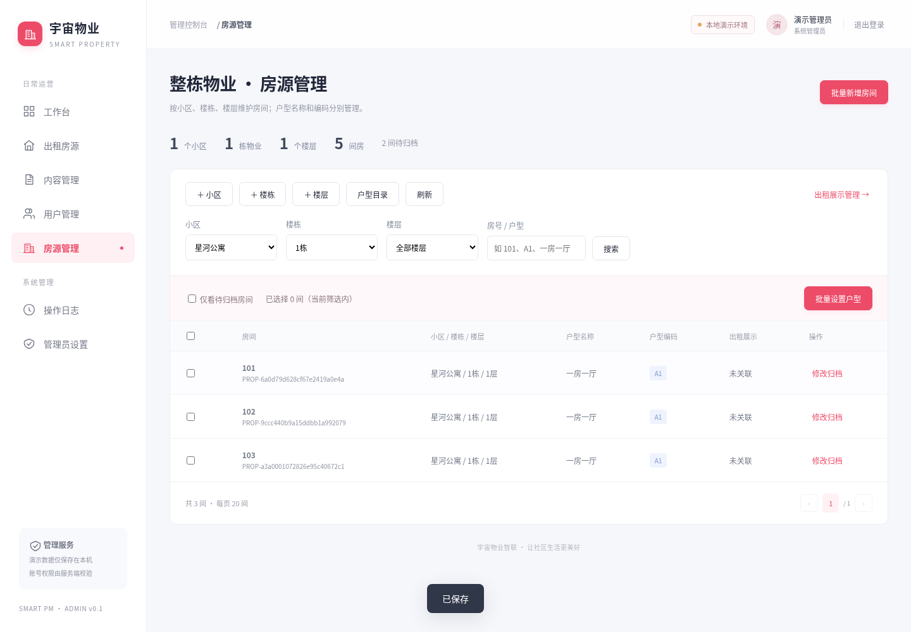
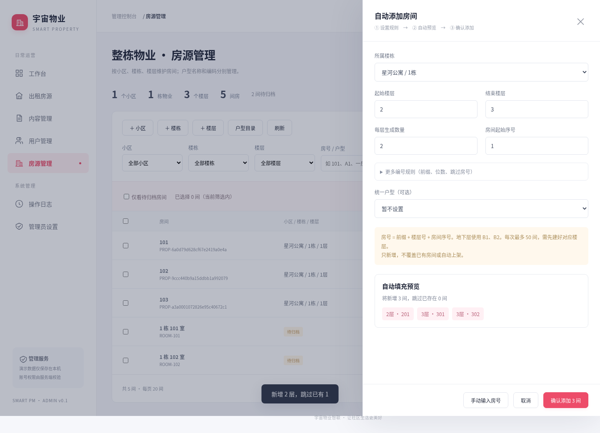
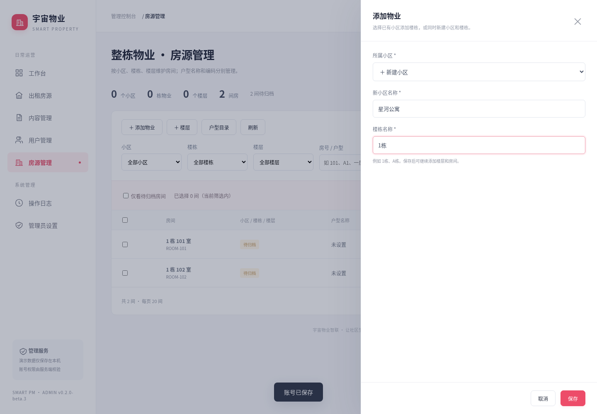

# 整栋公寓房源结构（beta.14）

后台版本 0.2.0-beta.4，项目版本 v0.1.0-beta.14。

## 用户确认的规则

- 物业层级：小区 → 楼栋 → 楼层 → 房间。
- 户型名称与户型编码独立：例如“一房一厅”与“A1”。
- 户型编码在楼栋内唯一；不同楼栋的 A1 可以表示不同户型。
- 房号、户型编码、用于住户/门锁绑定的房产编号是三个不同概念。

例如：

| 小区 | 楼栋 | 楼层 | 房号 | 户型名称 | 户型编码 |
| --- | --- | --- | --- | --- | --- |
| 星河公寓 | 1栋 | 1层 | 101 | 一房一厅 | A1 |
| 星河公寓 | 1栋 | 1层 | 102 | 一房一厅 | A1 |
| 星河公寓 | 2栋 | 1层 | 101 | 单间 | A1 |

## 数据模型

`property_catalog` 是新增目录集合，使用 kind 区分四类记录：

| kind | 字段 | 唯一范围 |
| --- | --- | --- |
| community | name | 小区名称 |
| building | parentId → 小区，name | 小区内楼栋名称 |
| floor | parentId → 楼栋，name、level、slots | 楼栋内楼层序号 |
| layout | parentId → 楼栋，code、name、bedrooms、livingRooms、rooms | 楼栋内 code，不区分英文字母大小写 |

`layout.name` 是可读户型名称，`layout.code` 是 A1/A2/B1 等编码；`layout.rooms` 由房间数、客厅数生成，例如 `1室1厅`，兼容现有小程序户型筛选。单间可填写名称“单间”、房间数 1、客厅数 0，生成 `1室0厅`。

`rooms` 作为真实房间档案，增加：

- communityId / buildingId / floorId / roomNo：固定层级引用与房号。
- community / buildingName / floorName：显示快照。
- layoutId / layoutName / layoutCode / rooms：所选楼栋户型及兼容描述。
- listingId：可选，指向出租展示记录。
- 原 `houseId` 保持原值，住户与门锁关联继续使用此值；新增房间自动生成稳定房产编号。

`houses` 继续作为小程序出租展示记录，保留租金、面积、状态、图片等原字段。明确关联房间时增加 `propertyRoomId`，并复制上述层级、户型字段。一个房间最多关联一条出租展示记录；未关联的历史房源仍可独立维护。

小程序仍通过现有 getHouses 读取 houses，按 rooms 筛选。不需要重建旧集合或修改现有云函数；本期户型编码在管理后台展示，小程序继续展示原有户型描述。

## 后台使用顺序

1. 进入左侧 **房源管理**（整栋物业页）。原来的出租列表现在叫 **出租房源**。
2. 点击“＋ 添加物业”：选择已有小区并填写楼栋名称，或选择“新建小区”同时填写小区名称和楼栋名称，一次保存。新建小区与楼栋在同一事务内提交，校验或保存失败时不会留下单独的小区；小区已存在时需选择已有小区，不能再次创建。同一小区内楼栋名称不得重复。保存后会自动筛选到新建楼栋，方便继续建档。“＋ 楼层”现在默认打开自动填充：填写起止层、名称规则（如 `{n}层`），可跳过指定层，预览后确认。每批最多 50 层，已有层自动跳过；“单层添加”保留原入口。
3. 打开“户型目录 → 新增户型”，选择楼栋，填写名称、编码、房间数与客厅数。A1 只能在同一楼栋创建一次。
4. 点击“批量新增房间”，选择楼栋与已有楼层范围、每层数量，自动生成 101、102、201、202 等编号。默认序号从 1 开始补足 2 位；“更多编号规则”可设置前缀、位数和跳过的完整房号。地下层自动使用 B1/B2 前缀，例如 B101。可统一选择所属楼栋的户型，实时预览新增/已存在数量，确认后按每批 25 间连续保存并显示进度。最多选择 100 层、每层最多 1000 间，单次计划总数最多 1000 间，不会自动上架。

   “手动输入房号”继续支持 `101,102,103` 或 `101-110`。自动填充跳过已有房间而不改原户型、租金等资料；手动批量输入仍对重复房号整批拒绝。排除房号后不会自动补足每层数量，以预览为准。重复提交安全，保存结果会显示实际新增和跳过数。
5. 按小区、楼栋、楼层筛选，勾选房间，再点击“批量设置户型”。可跨同栋楼的不同楼层，每批最多 30 间，不允许跨楼栋应用模板。
6. 到“出租房源”新增或编辑记录，在“关联物业房间”中选择已设置户型的房间。小区、户型由房间档案提供；租金、面积、图片与展示状态单独维护。

批量设置户型只更新 layoutId/layoutName/layoutCode/rooms。已关联的出租房源同步更新；租金、面积、上下架状态、住户绑定、门锁关联均不改动。

## 旧数据升级

先停止旧后台，备份并保留旧 `admin-web/.data/`。覆盖程序文件时不要删除该目录；若在新解压目录启动，把原 `.data` 完整复制到新 admin-web 下，以继续使用原演示数据或本地后台账号。

- 本地旧数据首次打开时只补充空的 property_catalog，不重新生成演示数据。
- 没有楼层引用的旧 rooms 在新页面显示为“待归档”。逐间点击“归档房间”，明确选择楼层、房号、户型；原 houseId 与 users.houses 均保持不变。
- 旧 houses 不按名称或地址猜测对应房间，需要在编辑页明确关联。已有户型、租金等记录不会自动覆盖。
- 同层同房号冲突会拒绝保存，不能通过覆盖已有房间解决冲突。
- 已关联出租记录的房间位置暂时锁定，可批量修改户型；本期不提供移动已关联房间、删除层级、目录重命名和编辑既有户型模板的入口。

## 真实云环境准备

在现有确认环境中**新增空集合 `property_catalog`**，然后部署新版网页服务即可。不要运行 dbInit，不要重建或清空 rooms、houses、users、owners。目录集合仅通过服务端管理接口写入。

本轮未创建真实云集合、未迁移线上数据、未改动微信云函数。若还未完成 beta.9 的手机号手动绑定兼容更新，仍按原部署说明更新 phoneLogin；此次结构升级没有新增云函数变更。

手动批量创建、房间归档、户型应用和关联出租记录均通过数据库事务写入业务记录与日志。自动填充房间则按每批 25 间分别提交，整份 1000 间计划不是一个事务：当前批失败会回滚，但先前已完成批次保留。日志失败也不提交对应批次。页面显示已确认处理数；中断后保持相同规则重试，从头检查并跳过所有已存在记录。响应丢失的批次可能已保存，重试不会重复创建。楼层 slots 索引用于事务内保证同层房号唯一，单层最多 1000 间。本地模式用串行写入和文件替换提供同样的整批保存语义。

## 验证

新增数据模型测试覆盖楼栋内编码唯一、层级校验、同层房号冲突、并发创建、跨楼栋整批拒绝、关联房源同步、旧绑定保留、旧数据兼容及云事务回滚。HTTP 测试验证权限拒绝及关联房源字段不能被客户端伪造。

浏览器已验证完整建档与批量设置流程，截图见下方。真实微信云数据库事务仍需现场联调。

## 自动填充界面

## 1000 间生成示例与限制

先建好 1–20 层，在自动添加房间中设置：起始层 1、结束层 20、每层数量 50、起始序号 1、序号位数 2。预览 1000 间后确认，后台连续完成 40 个批次。500 间也可使用 10 层 × 50 间。

每层达到 100 间及以上时，需要在“更多编号规则”中增加序号位数；例如 100 间用 3 位，1000 间且从 1 起编号时用 4 位。已有房间也计入本次计划总数，但会被跳过；排除项先从计划中移除。手动输入房号仍限制每批 50 间，户型批量应用仍为 30 间，本次提高的是自动填充上限。

保存期间请保持页面打开。发生错误时界面保留错误与进度，可点击重试；不要为了重试改变前缀或编号规则，否则会被视为新的房号。真实云端的总耗时取决于网络和数据库速度，本次仅验证本地存储与浏览器流程，未声称云端千间生成已验收。

## 小区与楼栋统一入口

