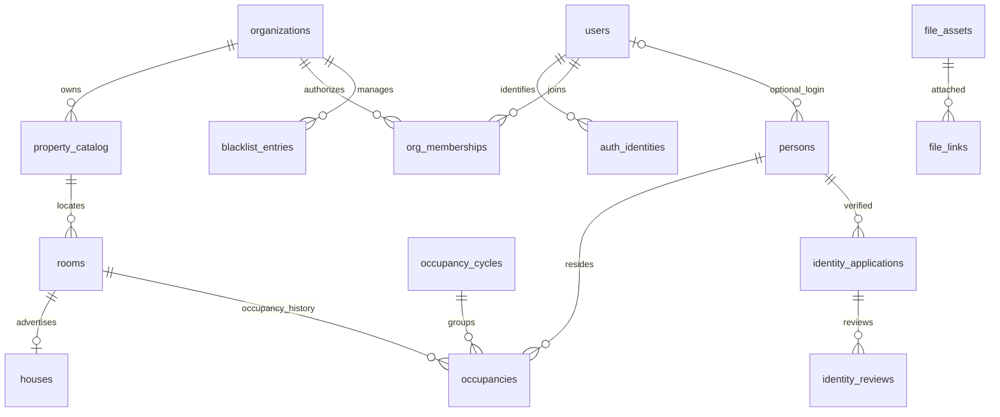

# DB-01：目标数据模型（评审稿）

基线和未决项见 [现状核对](CURRENT-STATE.md)。以下是待实施的增量设计，不是当前线上结构。保留微信云数据库文档模型，不引入 SQL 数据库。

## 1. 主键、组织边界与关联

- `userId` 是 API 对 `users._id` 的称呼，不再维护另一套可变主键；旧用户ID全部保留，新用户用随机ID。
- `roomId=rooms._id`，`listingId=houses._id`；旧 `houseId` 仅作为保留的业务房产号，不可混用。
- users 和身份映射是同一登录体系内的全局账户；业务记录包含 orgId。组织不能通过全局用户表枚举其他组织住户。
- 组织数据必须从服务端认证上下文限定；关系两端 orgId 必须相同；不能仅靠前端筛选。
- 时间统一为服务端 UTC 毫秒整数；有效区间采用 `[startsAt, endsAt)`，endsAt=null 表示未指定结束。状态有效不等于当前时间有效。
- 新/迁移记录采用 schemaVersion=2、revision整数、createdAt/updatedAt；修改期望 revision 不一致返回冲突。
- 不靠数据库外键：服务层必须在写事务中读取并验证所有关联对象；只读校验可能受并发修改影响，相关状态变更与业务创建需要共同写入guard/revision以序列化，不假定只读文档自动产生写冲突。审核历史追加，不覆盖。

Q02已确认：居住主体是组织内personId，可无登录账号。persons.userId可空，同组织一个用户最多绑定一个本人档案；不同组织可有独立档案，不共享证件资料。代理提交人记submittedBy，不能将其userId填为被代理人员的userId。无账号成员日后绑定账号必须验证本人身份并做冲突检查。

## 2. 字段表

下列为业务字段；各组织表共同包含 `_id,orgId,schemaVersion,revision,createdAt,updatedAt`，新增记录必须填齐。旧数据由明确的兼容适配处理，不能任意默认到当前组织。

| 集合 | 核心字段及类型 | 约束/用途 |
|---|---|---|
| organizations | name:string, status:active/suspended/archived, policyVersion:int | 初始化固定组织ID，禁止根据用户输入自动建组织 |
| users（全局） | name:string, phoneMasked:string, status:active/disabled/closed, schemaVersion, revision | `_id` 永久不变；phone旧字段仅受控兼容，不作为新查询唯一依据 |
| auth_identities（全局受限） | kind:phone/wechat, appId?:string, subjectDigest:string, keyVersion:int, userId:string, valueCiphertext?:string, verifiedAt:time, status:bound/released | phone 标准化含国家码后带密钥 HMAC；微信主体验证来自服务端 appId+OPENID，不信任请求体 |
| org_memberships | principalType:user/adminAccount, principalId, role:resident/admin/editor/viewer, status, permissions:string[] | 登录不授予后台权限；后台凭证仍单独存储，仅显式账号映射获得组织角色 |
| property_catalog（沿用） | kind,parentId,name；layout:code,bedrooms,livingRooms,rooms,isPublic；floor:level,slots兼容 | 增加 status:active/archived, archivedAt, archivedBy, archiveReason；parentId 同组织、kind 合法 |
| rooms（沿用） | houseId,communityId,buildingId,floorId,roomNo,layoutId,listingId?,isPublic,显示快照 | 增加 status及归档信息；保留旧ID和houseId；有效租住关系不存数组到本表 |
| houses（沿用） | propertyRoomId?,title,price,area,status,orgId,layout快照,isPublic,assetIds? | status 保留 在租/已租/下架；新加 lifecycle:active/archived；空propertyRoomId是旧独立房源，不自动关联 |
| content（沿用） | title,type,description,enabled,sortOrder,vrUrl,assetIds? | image/vrFile 保留兼容，附件挂接见文件表 |
| persons | userId?:string,nameMasked,status:active/archived,createdBy,createdByType | 组织内人员主键personId；无账号合法；完整姓名/证件走受限资料；审核后用身份摘要占位防同组织重复，未核验同名不自动合并 |
| occupancy_cycles | roomId,primaryOccupancyId,epoch:int,state:pending/active/ended,startsAt,endsAt,endedBy?,endReason? | 每次主租客入住一个周期；全部成员归属此周期；结束不可恢复，新入住新建周期 |
| occupancies | roomId,personId,cycleId,role:primary/member,state,startsAt,endsAt,addedBy,addedByType,sponsorOccupancyId?,identityApplicationId?,terminationReason? | 每条关系独立ID并归属cycleId；状态 invited/pending_review/active/ended/cancelled；结束后不复活，主租客再次入住建立新周期 |
| identity_applications | personId,submittedBy,submittedByType,method:manual/provider,provider?:string,state,documentVersion:int,documentType,identityDigest,keyVersion,privateDataRef,fileIds,submittedAt,reviewedAt?,providerRequestId? | 身份数据加密单独受限；state=draft/submitted/needs_info/approved/rejected/withdrawn；不存明文证件号到普通用户表 |
| identity_reviews | applicationId,documentVersion,decision,reasonCode,reason,actorId,actorType,decidedAt | 追加式；审核提交版本不得变化；审核人不可是申请人，不允许主租客代审批 |
| identity_private（受限） | applicationId,nameCiphertext,documentNumberCiphertext,encryptionKeyVersion | 密钥不在数据库/代码中；常规查询不返回；资料访问留审计 |
| blacklist_entries | subjectType:user/person/identity,subjectKey,keyVersion?,reasonCode,reason,evidenceFileIds,restrictions:string[],startsAt,endsAt,state:active/revoked,createdBy,revokedBy?,revokedAt? | 只限制新申请/激活；到期实时判断，不依赖定时任务；手机号仅辅助提示，不能单独自动拦截 |
| blacklist_decisions | entryIds,entryRevisions,occupancyId,decision:allow/deny,reason,reviewerId,decidedAt,expiresAt | 放行是针对一次申请和当时名单版本，不是永久解除名单 |
| eligibility_guards | subjectKey,epoch:int | 对每个org+人员/已绑定用户/身份固定ID；名单变更和关系激活都在事务中写epoch，使并发冲突可检测 |
| unique_claims | namespace,scope,keyDigest,ownerId,state:reserved/bound/released,keyVersion | 固定ID唯一占位；规则见第3节，不把敏感原值作为ID |
| room_primary_slots | roomId,currentCycleId?,currentOccupancyId?,currentPersonId?,endsAt?,epoch | 每个org+room一个固定ID，串行化主租客切换；不以查询结果为空代替唯一约束 |
| file_assets | storage:local/cloud/nas,objectKey,originalName,mimeType,size,checksum?,purpose,visibility:public/private,status:staged/ready/quarantined/retired | NAS未配置不可用；证件资料强制private；只保存对象定位，不保存临时下载URL |
| file_links | fileId,entityType,entityId,usage,sortOrder | 同组织关联；关联前核对文件存在、可访问、上传完成及用途 |
| admin_audit（沿用扩展） | actorType,actorId,action,entityType,entityId,requestId,beforeRevision,afterRevision,result,reasonCode | 业务变更与审计同事务；不记证件全文、图片内容、密码或授权code |
| operation_keys | actorId,route,key,bodyDigest,state,resultRef,expiresAt | 幂等记录与业务同事务；同key不同请求体返回冲突，不盲目重放 |

全局 auth_identities 不对组织管理员开放列表；居民的组织加入也不能让其成为管理员。persons分离已确认；证件资料保留期限须先解决Q03。

## 3. 唯一性与事务设计

### 3.1 唯一占位

候选公式：`_id=namespace + ':' + hash(scope + normalizedKey)`。手机号/身份证使用服务端带密钥 HMAC 与 keyVersion，非敏感层级键可用 SHA-256。不同namespace明确区分。

| 规则 | scope与key | 写入策略 |
|---|---|---|
| 手机号唯一 | loginRealm + 标准化手机号 | 读取固定 auth_identities ID，未占用才同时建用户与身份映射；停用不自动释放 |
| 微信身份唯一 | appId + 服务端OPENID | 同上；手机号映射与微信映射不一致返回身份冲突，不覆盖 |
| 户型编码唯一 | orgId+buildingId + 大写code | claim和目录对象同事务；新目录ID随机，旧确定性ID不改变 |
| 楼层唯一 | orgId+buildingId + level | 同上 |
| 房号唯一 | orgId+floorId + roomNo | 明确房号保留前导零、大小写敏感，沿用现有语义；更改前需人工确认规范 |
| 一房源对应一房间 | orgId+roomId | 保留双向关联，事务读取并校验双方；房源归档不自动释放占位 |
| 同一人员同周期关系唯一 | orgId+roomId+cycleId+personId | 同周期成员不可重复；有效周期唯一由主租客槽保障；更换主租客结束整个旧周期，新建关系 |
| 人员本人账号绑定唯一 | orgId+userId（非空） | 账号绑定与人员关系事务创建；空账号不占用手机号/用户唯一键 |
| 已核验人员唯一 | orgId+证件类型+身份HMAC | 同组织相同已核验身份不自动建第二人员；冲突人工处理，跨组织不共用资料 |
| 当前主租客唯一 | orgId+roomId | room_primary_slots 串行化激活/结束；无需条件唯一索引 |

房产号 houseId 继续保留全系统唯一，因为旧设备按此匹配。多组织切换前扫描重复房产号，不能按orgId掩盖旧设备歧义。

主租客有效期预订的重叠排他约束本期不实现：可保存未来待审申请，但到生效时重新核验并争用主租客槽。不得宣称已支持未来时段排他预订。

### 3.2 关键事务

**登录：** 先从微信服务换取手机号（事务外）；服务端标准化。事务读手机号映射、微信映射及用户状态；仅一个映射存在时，验证绑定策略后才能补另一个；映射各指不同用户则409。事务内同时建用户/映射/幂等与脱敏审计。旧无映射用户必须经迁移或冲突流程，不能忽略旧用户直接新增。外部请求不可放在可能重试的事务回调中。

**审核：** 事务读取申请及documentVersion，校验submitted和审核权限；更新申请结论、revision并追加审核记录/审计。补充资料产生新版本，不能修改已提交的版本内容。approved不是入住许可，仍需激活检查。

**激活关系：** 事务读取组织和管理员授权（或有效主租客关系）、物业祖先及房间状态、候选人员及可选绑定账号、实名申请版本、主租客槽、关系占位、相关名单/复核结论、人员、绑定用户及身份 eligibility_guards；校验入住周期有效、期限、组织、批准身份归属及名单版本后写关系、占位、guards与审计。主租客添加成员的激活还须重新验证 sponsorOccupancyId 仍有效，不能仅检查邀请时资格。

名单先按org+subject查候选并记录guard版本，再在事务内读相同guard和候选记录。若版本与预读不一致，整个预读+事务重新执行；黑名单新增/解除/改有效期都写同一guard。不存在guard时使用固定ID创建并验证冲突行为。切勿只在事务外查询名单。

**整户退租/主租客更换（已确认）：** 全部人员都绑定cycleId，包括管理员添加成员。事务结束旧occupancy_cycle并释放/替换room_primary_slot，写主租客结束记录、审计及幂等操作；换主租客则同事务创建新的周期/主租客关系。旧周期不能恢复，旧成员不自动带入新周期。

有效关系定义必须同时满足：occupancy.state=active、关系时间有效、cycle.state=active且周期时间有效、room_primary_slot.currentCycleId=cycleId、房间/组织有效。结束周期后旧成员立即全部失效，即使成员行仍暂时state=active。读取接口显示effectiveState=ended，effectiveEndsAt取关系与周期结束时间较早值；后台任务分批补写成员历史，并使用cycleId与revision防止误改新周期。任务可重放、失败可恢复，不能以批处理完成作为失效时点。

成员邀请/审核后的激活必须写相同周期epoch，退租也写epoch，防止激活与退租并发穿透。无账号成员同样要求实名申请approved及身份名单检查；主租客只能代提交本有效周期的成员资料，退租后不再有该房成员资料管理权。实名结论历史可保留，但不会自动产生新周期的住户关系。账号权限与居住有效性不等同。

**归档：** 存在有效关系或未处理房源时建议拒绝。预检查后写祖先/房间的生命周期revision；创建/激活也需争用相同生命周期guard（可在组织或楼栋维度设置固定文档），防止并发检查后新增。大范围归档分为archiving操作状态和可恢复任务，不能一次跨数千文档事务；具体方案DB-02实现前补充。

旧 floor.slots 仍需同步直到旧写入路径停用；不能同一时期让新claim与旧slots各自成为唯一来源。切换后逐步退出slots，不立即删除。

## 4. 索引候选与云端验证门槛

以下是查询索引建议，不是已创建索引或已确认平台支持的DDL。唯一性以固定ID占位+事务为主；不依赖未验证的稀疏/部分唯一索引。

| 集合 | 等值过滤前缀 | 排序/范围 |
|---|---|---|
| property_catalog | orgId,kind,parentId,status | name或level，_id游标 |
| rooms | orgId,buildingId,floorId,status | roomNo,_id |
| houses | orgId,lifecycle,status,isPublic | updatedAt,_id；价格/户型过滤另建实际所需索引 |
| org_memberships | orgId,principalType,principalId,status | _id |
| occupancies | orgId,roomId,state；另orgId,personId,state | startsAt,_id |
| identity_applications | orgId,state | submittedAt,_id；另orgId,personId |
| persons | orgId,userId（非空）；orgId,status | _id |
| occupancy_cycles | orgId,roomId,state | startsAt,_id |
| identity_reviews | orgId,applicationId | decidedAt,_id |
| blacklist_entries | orgId,subjectType,subjectKey,state | endsAt（null由应用明确处理） |
| file_links | orgId,entityType,entityId | sortOrder,_id |
| admin_audit | orgId,entityType,entityId | createdAt,_id |

DB-02/03在隔离云环境验证：不存在文档并发创建、冲突回调重试/回滚、SDK错误形态、原子审计、文档大小与事务限制、查询索引可用性、客户端安全规则。引用90条是当前应用上限，新增控制记录/审计须计入预算，保持小事务。云失败不得切回无锁本地执行。

## 5. 权限边界

- 普通住户：本人资料和有效关联房间；主租客：额外邀请本房成员，但不能批准实名、分配管理角色、看黑名单证据。
- editor/viewer：保留原内容/房源操作权限；没有隐含实名资料读取或审批权。
- org admin：限定组织；实名审核、证件读取、黑名单维护用显式权限点，所有敏感读取留痕。
- 客户公开查询：通过可信站点/小程序到组织的配置映射确定可公开组织，过滤归档与公共用房；不任意接受组织ID扩展访问范围。
- 云集合安全规则默认禁止客户端直写核心集合；所有服务端SDK仍必须显式鉴权。后台云凭证有访问能力不代表调用者有权限。
- 设备权限单独制定兼容切换方案，黑名单只影响新申请，不能和旧public设备标志混淆。整户退租影响居住有效性；设备服务切换后须按周期检查，仍需专项设备验收，不能继续只依赖滞后数组。

## 6. 第三方与文件扩展

实名 provider 接口：start(applicationId,documentVersion)、query(requestId)、verifyCallback(signature,payload)；manual是本期唯一启用实现。第三方未配置返回PROVIDER_DISABLED，不伪造成功，不上传资料。外部结果必须绑定申请人/版本，由服务端验证，前端成功提示不是审核结果。

文件 storage 接口：upload、head、authorizedDownload、retire；nas只定义适配配置，未实现返回STORAGE_UNAVAILABLE。证件文件不放VR/图片公开路由，下载短期凭证不得持久化到业务表。文件删除与业务归档分离，资料保留期限Q03确认后再做清理任务。
