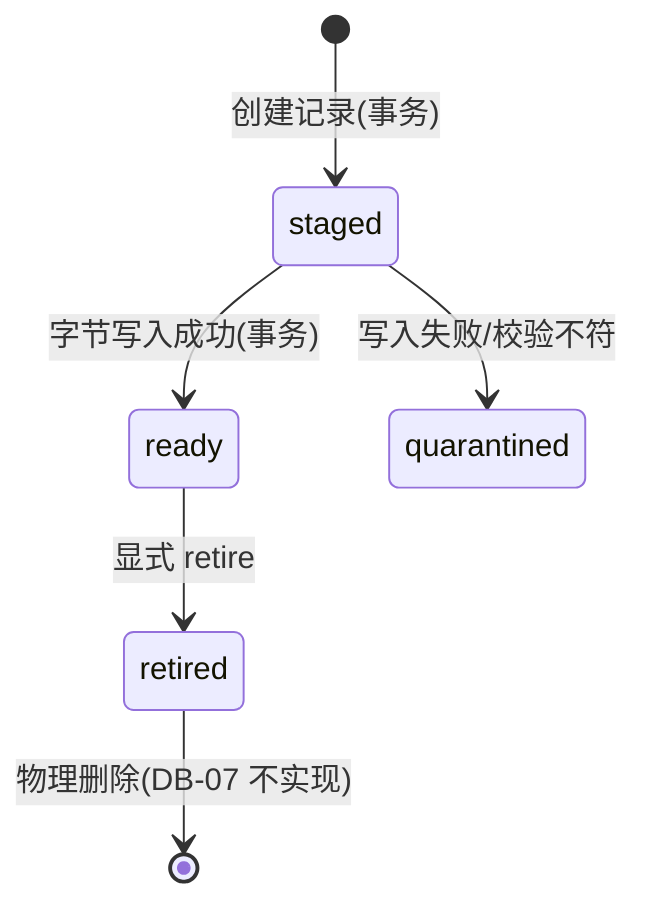
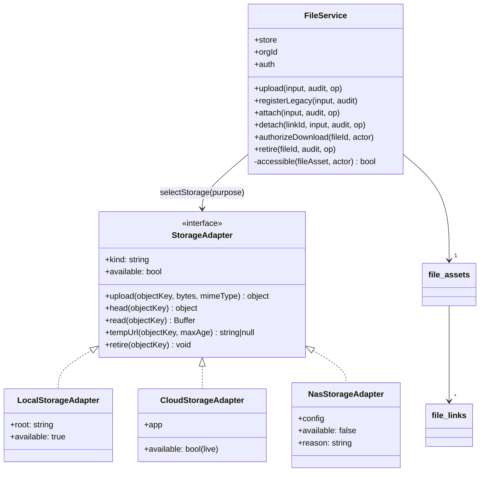
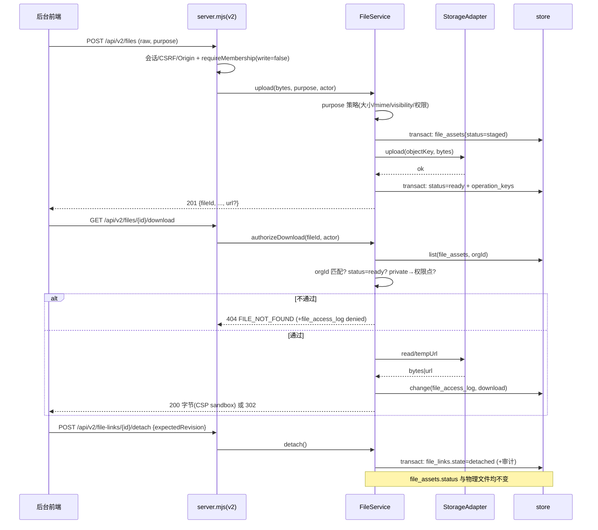
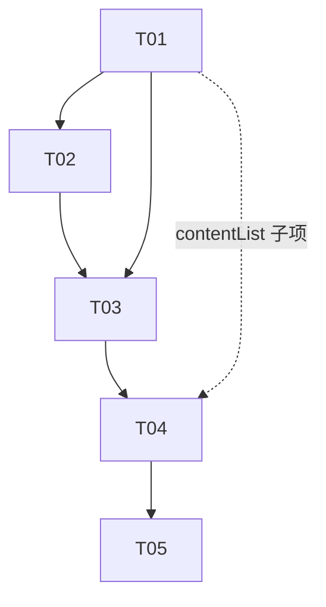

# DB-07 实施交接：统一文件资源与 NAS 扩展接口

状态：设计待评审，**未写业务代码**。基线提交 `8b2d183`，分支 `feat/db-07-file-assets`。
依据：`docs/database/DATA-MODEL.md` §2/§6、`API-CONTRACT.md` §7/§8、`MIGRATION-PLAN.md` §2/§5（R10）、`CURRENT-STATE.md` §1/R10、`DB-02-IMPLEMENTATION.md` §2。

范围：仅 `admin-web` 服务端。**不改**登录、人员身份、物业归档、门锁逻辑；**云函数仅收敛 `contentList` 的鉴权与字段白名单**（§5.1），其余云函数与小程序页面不动；NAS 只落接口与配置位，不连接任何设备。

---

## 1. 现状摘要（文件:行号）

### 1.1 文件怎么存的

| 类别 | 存储位置 | 证据 | 是否登记到数据库 |
|---|---|---|---|
| 后台图片（房源封面/内容图） | live：`store.app.uploadFile` → `admin/<uuid>.<ext>`，返回 cloud fileID；demo：写 `<dir>/uploads/<uuid>.<ext>` 返回 `/uploads/<uuid>.<ext>` | `admin-web/server.mjs:542-581`（嗅探 `:546-566`，live `:568-574`，demo `:576-580`） | **否**，URL 直接内嵌业务记录 |
| VR 附件 | live：`admin-vr/<uuid>.<ext>`；demo：`<dir>/vr-files/<uuid>.<ext>`（mode 0o600） | `server.mjs:486-507`（live `:493-499`，demo `:500-506`） | **否**，`content.vrFile` 内嵌 |
| 业务字段 | `houses.cover/images`、`content.image`、`content.vrUrl`、`content.vrFile` | `admin-web/lib/model.mjs:72-75`、`:85-87`；校验 `imageURL` `:45-55`、`vrFile` `lib/vr.mjs:22-45` | — |
| 集合白名单 | 无 `file_assets` / `file_links` / 任何文件表 | `admin-web/lib/store.mjs:5-17` | — |

### 1.2 访问入口与公开性（安全现状盘点）

| 入口 | 鉴权 | 证据 | 公开性 |
|---|---|---|---|
| `GET /uploads/*` 静态 | **无会话、无角色**（在 `/api/` 分支之外）；仅 demo + 严格正则 `^\/uploads\/[a-f0-9-]+\.(png\|jpg\|webp)$` | `server.mjs:713-735`（限制 `:715-721`） | **完全公开** |
| `GET /api/image-url?id=cloud://…` | 仅需登录会话，任何角色（含 viewer）；`getTempFileURL` maxAge 600 | `server.mjs:582-590` | **无文件归属/用途校验**（见 §1.3） |
| `GET /api/vr-download?id=` | `authorize(role,'content')`；带 `orgId` 的 content 一律 404（DB-02 R2-02 修复） | `server.mjs:509-541`（`:510`、`:517`） | 登录可读 |
| `POST /api/uploads`、`/api/vr-upload` | `authorize(role,'uploads',true)`；editor 可写 | `server.mjs:543`、`:487`；`model.mjs:22-24` | — |
| 客户侧 | `contentList` 返回完整 content 文档（含 `image`/`vrFile`）；`getHouses` 返回完整 houses 文档（含 `cover`/`images`） | `cloudfunctions/contentList/index.js:16-23`、`cloudfunctions/getHouses/index.js:15` | 客户可拿到 URL 字符串 |
| 小程序消费 | 只消费 https `vrUrl`，不下载附件 | `miniprogram/pages/vr/index.js:8-9`、`pages/home/index.js:37` | — |
| 后台前端 | `image()` → `image-url?id=`；VR 用 `/api/vr-download?id=` | `admin-web/public/app.js:112-128`、`:519-526` | — |

### 1.3 三个关键发现（决定本方案形状）

1. **`/api/image-url` 对任意 `cloud://` fileID 都能换临时 URL**（`server.mjs:582-590`），不校验文件属于哪条业务记录、是否为私密资料。任何已登录后台账号（含 viewer）即可换取 `admin-vr/…` 等任意对象→ 这是需求 7 的直接靶点，必须加登记/前缀双重拦截。
2. **`/uploads/*` 是零鉴权公开静态路径**（`server.mjs:715-721`），只靠"demo 模式 + uuid 文件名"兜底。私密资料一旦落到 `admin/` 前缀就等于公开。
3. **文件没有任何落库记录**（`store.mjs:5-17` 白名单里没有文件集合），因此"下载鉴权"无处附着 —— 必须先建单一事实源 `file_assets`，否则所有拦截只能靠 URL 字符串猜。

### 1.4 可直接复用的既有机制

| 机制 | 位置 | DB-07 用法 |
|---|---|---|
| v2 信封、requestId、错误码映射 503 | `server.mjs:269-411`（错误 `:393-410`） | 文件路由原样套用 |
| 组织上下文 + 成员校验 | `org.mjs:138-155`（写需 admin `:152`） | 下载用 `{write:false}`；写接口按 §5 分级 |
| 事务内复查组织/成员 | `property-v2.mjs:164-172` | 文件写事务 `authRefs()+authCheck()` 同构 |
| 幂等 `operation_keys` + `OpReplay` | `property-v2.mjs:15-62`、`server.mjs:320-353` | 上传/关联/解绑/retire 全部复用 |
| 事务自动写审计 | `store.mjs:163-168`、`:196-201`、`:260-268` | 关联/解绑/retire 自动留痕 |
| 集合按需初始化 | `store.mjs:122` `property_catalog \|\|= []` | 新增三个集合同样处理 |
| 旧记录隔离约定（legacy 无 orgId / v2 不可见） | `DB-02-IMPLEMENTATION.md:20` | 未归属旧文件 `orgId=null`，v2 不可见 |

---

## 2. 数据模型

两个新业务集合 + 一个审计集合，均加入 `store.mjs:5-17` 白名单与 `seed()`，并在 `init()` 补 `||= []`（`store.mjs:122` 同款）。所有记录带 `orgId, schemaVersion=2, revision, createdAt/updatedAt`。

### 2.1 `file_assets`（单一事实源）

| 字段 | 类型/取值 | 说明 |
|---|---|---|
| `_id` | `file-<uuid>` | 随机，不使用确定性 ID |
| `orgId` | string \| **null** | `null` = legacy 未归属（DB-08 迁移前由旧入口产生的文件），v2 列表不可见 |
| `storage` | `local` \| `cloud` \| `nas` | 由适配器写入，不由客户端指定 |
| `objectKey` | string | 定位符：cloud=cloudPath；local=相对路径；nas=预留 |
| `bucket/prefix` | `public` \| `private` | 由 objectKey 前缀派生，冗余存储用于快速拦截 |
| `originalName` / `mimeType` / `size` / `checksum` | string / int / sha256 hex | `checksum` 迁移期可空 |
| `purpose` | `listing-image` \| `content-image` \| `vr-attachment` \| `identity-document` \| `evidence` \| `other` | 决定大小、格式、**visibility 与可用 storage** |
| `visibility` | `public` \| `private` | `identity-document`/`evidence` 服务端强制 `private`，客户端传入无效 |
| `status` | `staged` → `ready` \| `quarantined` \| `retired` | 见 §2.4 生命周期 |
| `uploadedBy` | `{actorType, actorId}` | `adminAccount`/`user` |
| `legacyUrls` | string[] | 兼容映射：旧 `/uploads/…`、`/vr-files/…`、`cloud://…` |
| `retentionUntil` | int \| null | Q03 未定 → 恒 null，不驱动任何删除 |

索引候选（沿用 `DATA-MODEL.md:126`）：`file_links(orgId, entityType, entityId | sortOrder,_id)`；新增 `file_assets(orgId, purpose, status | createdAt,_id)`、`file_access_log(orgId, fileId | createdAt,_id)`。

### 2.2 `file_links`（业务附件关联，多对多 + 元信息）

| 字段 | 说明 |
|---|---|
| `_id` | `link-<sha256(orgId, entityType, entityId, fileId, usage)>`，固定 ID 复用（DB-02 claim 同构，`claims.mjs:7-8`） |
| `orgId` / `fileId` / `entityType` / `entityId` | `entityType ∈ houses\|content\|property_catalog\|rooms\|identity_application\|blacklist_entry`；关联前事务内校验双方 `orgId` 相同，不符 `ORG_MISMATCH` |
| `usage` | `cover\|gallery\|vr\|identity-doc\|evidence\|other` |
| `sortOrder` / `state` | `state: attached\|detached`（**解绑只改 state，不删记录**，见 §6） |
| `attachedBy` / `detachedBy` / `revision` | 审计由 store 自动写入 |

### 2.3 `file_access_log`（下载留痕）

`{_id, orgId, fileId, action: download\|denied, actorType, actorId, entityType?, entityId?, createdAt}`。用 `store.change("file_access_log", null, …)` 写入（与既有审计同事务语义）。

### 2.4 生命周期（对应需求 8）



- **解绑（detach）只改 `file_links.state`，永不触碰 `file_assets.status` 与物理对象。**
- 无 `attached` 关联的 `ready` 文件为 orphan 候选，仅由 `scripts/file-retention.mjs --dry-run` 报告；`FILE_RETENTION_DAYS` 未配置 = **不清理任何物理文件**（Q03 未定，`MIGRATION-PLAN.md:44` "禁止先删除原件"）。

---

## 3. 核心接口（`/api/v2`，信封与错误码同 `server.mjs:269-411`）

| 接口 | 权限（§5） | 请求 → 返回 |
|---|---|---|
| `POST /api/v2/files` | 组织成员；`authorize(role,'uploads',true)` | raw body（5 MB/50 MB 按 purpose），query `purpose,name,entityType?,entityId?,usage?` → 201 `{data:{fileId,storage,objectKey,purpose,visibility,status:'ready',size,mimeType,originalName,url?}}`。**`private` 不返回 `url`**；`public` 返回旧格式 url 供旧前端直接使用 |
| `GET /api/v2/files` | 组织成员 | `purpose,visibility,entityType,entityId,cursor,limit` → `{data:[…],requestId,nextCursor}`，`orgId` 过滤先于分页（`store.list(name, orgId)`，`store.mjs:130-135`） |
| `POST /api/v2/file-links` | 业务编辑权 | `{fileId,entityType,entityId,usage,sortOrder}` → 201 `{data:{linkId,fileId,entityType,entityId,usage,state:'attached',revision}}`；事务内校验 `file_assets.status==='ready'`、双方 orgId 一致、**private 不得挂公开展示 usage**（§5） |
| `GET /api/v2/file-links` | 组织成员 | `entityType,entityId,cursor,limit` → 只返回 `state==='attached'` |
| `POST /api/v2/file-links/{id}/detach` | org admin | `{expectedRevision}` → 200 `{data:{linkId,state:'detached'}}`；**file_assets 与物理文件不变**（需求 8） |
| `GET /api/v2/files/{id}/download` | 逐次鉴权（§5） | → 200 字节流（`Content-Disposition: attachment`，CSP `sandbox`，同 `server.mjs:531-539`）或 302 到 ≤300s 签名 URL |
| `POST /api/v2/files/{id}/retire` | org admin | `{reason}` → 200 `{data:{fileId,status:'retired'}}`；**不删物理对象** |

错误码：`PARAM_ERROR` / `UNAUTHORIZED` / `FORBIDDEN` / `FILE_NOT_FOUND`(404，无权限与不存在同态) / `FILE_FORBIDDEN`(403，公开接口拦截) / `FILE_NOT_READY` / `PURPOSE_FORBIDDEN` / `ORG_MISMATCH` / `REVISION_CONFLICT` / `STORAGE_UNAVAILABLE`(503) / `IDEMPOTENCY_*`。

**上传两阶段（满足"断点失败不产生 ready"）**：① 事务创建 `staged`（含 size/checksum/objectKey）→ ② `adapter.upload()` → ③ 成功事务改 `ready`（校验实际 size），失败事务改 `quarantined`。② 之前崩溃的记录永远停在 `staged`，`attach` 因 `status!=='ready'` 被拒。

---

## 4. 存储适配层（`admin-web/lib/storage.mjs`）

统一接口对齐 `DATA-MODEL.md:144`（upload / head / authorizedDownload / retire）；**鉴权留在服务层**，适配器只做传输，保证"鉴权先于读取"可被测试断言（DB-02 R2-02 的教训，`DB-02-REVIEW.md:47-53`）。



| 适配器 | 实现 | `available` |
|---|---|---|
| `LocalStorageAdapter` | demo 默认；写 `<root>/<objectKey>` mode 0600；`tempUrl` 恒 `null`（强制代理下载） | 恒 true |
| `CloudStorageAdapter` | live 默认；`uploadFile` / `downloadFile` / `getTempFileURL`（复用 `server.mjs:494-499`、`:523`、`:586-588` 的调用形态） | `mode==='live' && app` |
| `NasStorageAdapter` | **只持有配置对象，无任何协议实现、无新依赖**；`upload/head/read/tempUrl/retire` 一律 `failCode('STORAGE_UNAVAILABLE', …, 503)` | **恒 false** |

**"未配置 NAS 明确不可用"的三道闸门**：

1. `NAS_ENABLED !== 'true'` → 不可用；
2. 模块常量 `NAS_ADAPTER_IMPLEMENTED = false`（DB-07 只预留接口，实现需后续任务单独评审）→ 即使 `NAS_ENABLED=true` 仍不可用；
3. 任一适配器方法被调用且 `available===false` → 抛 `STORAGE_UNAVAILABLE` 503，**并且绝不回退到公开路径**（`API-CONTRACT.md:92`）。

选择逻辑：`selectStorage({mode, purpose, config})` = `FILE_STORAGE_<PURPOSE>` → `FILE_STORAGE_DEFAULT` → (demo→local / live→cloud)。若解析结果为 `nas`，直接 503，**不做 local/cloud 兜底**。

配置位（`admin-web/config.example` 追加，值只从环境变量读取，不入库、不进日志）：

```text
FILE_STORAGE_DEFAULT=            # 空：demo=local，live=cloud
# FILE_STORAGE_IDENTITY_DOCUMENT=nas   # 示例：私密资料指定 NAS → 未实现即 503，不回退
NAS_ENABLED=false
NAS_HOST= / NAS_SHARE= / NAS_BASE_PATH= / NAS_USERNAME= / NAS_PASSWORD=
FILE_RETENTION_DAYS=             # 空 = 不自动清理任何物理文件
FILE_LEGACY_IMAGE_FALLBACK=deny  # 未登记旧图片默认拒绝；迁移期用 scripts/file-inventory.mjs 盘点后按需登记（allow 仍为显式可配置值）
```

---

## 5. 权限模型与拦截点

**密级判定**：`visibility` 由 `purpose` 派生，服务端强制，不接受客户端入参；`identity-document`、`evidence` → `private`。

| 动作 | public | private |
|---|---|---|
| 上传 | 组织成员 + `authorize(role,'uploads',true)`（editor 亦可，`model.mjs:22-24`） | org admin 角色（写入按角色，**无需任何读取权限点**，role=admin 兜底）；读取才需 readPermission：`identity-document` → `identity.readPrivate`、`evidence` → `blacklist.read`（三次复审后证件读取权限点由 `identity.review` 改为 `identity.readPrivate`，与 DB-04 证件审查权限区分） |
| 关联/解绑/retire | 组织成员写权限 | org admin |
| 下载 | 任意组织成员（含 viewer） | 仅上表对应权限点；否则 404 `FILE_NOT_FOUND`（无权限与不存在同态，防枚举） |

**关联（attach）额外约束（结构性兜底，见 §9.8）**：`visibility=private` 的文件**不得挂到** `entityType ∈ houses|content` 的公开展示 usage（`cover`/`gallery`/`vr`），只能挂到 `identity_application` / `blacklist_entry`，或 `other` 非展示用途。理由：`contentList` 本轮虽已收敛（§5.1），但 `getHouses`（`getHouses/index.js:46-56`）仍无字段白名单，且 `contentAdmin` 存在写入旁路（§9.8），故在系统边界内仍禁止"私有文件进入客户可见记录"，使剩余缺口无法被 DB-07 放大。**本条不因 contentList 收敛而撤销。**

**拦截点（需求 7）** —— 记录判定 + 路径前缀双保险：

| 入口 | 拦截规则 | 证据位置 |
|---|---|---|
| `/api/image-url` | ① 补 `authorize(account.role,'content')`（三种角色均通过，零兼容影响，仅补齐"未调用 authorize"的缺口）；② `objectKey`/`legacyUrls` 命中 `file_assets` 且 `visibility==='private'` → 403 `FILE_FORBIDDEN`，不签发 URL（**与 fallback 开关无关**）；③ 未命中但 id 含 `private/` 前缀 → 403；④ **未命中且非图片类型**（扩展名不在 `png|jpg|jpeg|webp`，命中则含 `admin-vr/*.zip|html`）→ 403 `FILE_FORBIDDEN`（**这是"图片接口只服务图片"的作用域约束，不是密级判定**）；⑤ 未命中且为旧图片 `admin/<uuid>.(png|jpg|webp)` → 按 `FILE_LEGACY_IMAGE_FALLBACK` 处理（**默认 `deny`**：未登记一律 403，上线前用 `scripts/file-inventory.mjs --apply` 批量登记公开图片） | 改 `server.mjs:582-590` |
| `/api/vr-download` | **保持 legacy-only**：不新增 purpose/引用对象判定，保留"带 `orgId` 404"（`server.mjs:517`）与 `server-v2.test.mjs:342-424` 的"legacy 200"语义；只做最小加法——`vrFile.url` 命中 `file_assets` 且 `private` → 404。因 `vr-attachment` 登记为 `public`，R3 回归不回退 | 改 `server.mjs:509-541` |
| `/uploads/*` 静态 | 保留 demo-only + 正则（`server.mjs:717`，live 一律 404）、静态分支仍不查会话；新增：按 `objectKey` **或 `legacyUrls`** 命中 `file_assets` 且 `private` → 404。命中场景是"已登记为私密的旧路径文件"，不是"private 前缀文件落错目录"（见 §10 第 5 条的正负对照） | 改 `server.mjs:715-721` |
| 旧上传路由 | `/api/uploads`（`server.mjs:542`）与 `/api/vr-upload`（`:486`）**只产出 public**，且额外登记一条 `file_assets`（`legacyUrls`）；私密 purpose 一律走 `/api/v2/files` | 改 `server.mjs:486-581` |

**ObjectKey 前缀约定（互斥，便于快速判定）**：公开 `admin/<uuid>.<ext>`、`admin-vr/<uuid>.<ext>`（沿用现有，旧 URL 可继续解析）；私有 `private/<orgId>/<purpose>/<uuid>.<ext>`。

**`admin-vr/` 的定性（评审已定：vr-attachment = public）**：`admin-vr/` 是**公开**前缀，`vr-attachment` 的 `visibility=public`（§6.4）。`/api/image-url` 拒绝 `admin-vr/*.zip|html` 的依据是「图片接口只服务图片」的**作用域约束**，不是密级；VR 附件仍照原样经 `/api/vr-download?id=` 下载（legacy 语义不变）。两处不冲突：一个管作用域、一个管密级。

### 5.1 客户侧 `contentList` 收敛（本轮新增范围，评审已批准）

现状：`cloudfunctions/contentList/index.js:23-25` 无身份校验、无字段白名单，向未登录调用返回完整文档（含 `vrFile.url`），是对象定位泄露路径。

**调用方（实测代码，非文档推断）**

| 调用方 | 来源 | 依赖 |
|---|---|---|
| home 页 | `miniprogram/pages/home/index.js:24` `api.listContent('share')` | 是 |
| vr 页 | `miniprogram/pages/vr/index.js:6` `api.listContent('share')` | 是（只用 `_id`/`vrUrl`） |
| **life 页** | `miniprogram/pages/life/index.js:41` `api.listHouses(query)`（外层 `loadHouses()` 在 `:28`）→ 云函数 **`getHouses`** | **否 —— 修正评审假设：life 页不依赖 `contentList`** |
| demo 模式 | `miniprogram/services/api.js:46` `isDemo()` 短路走本地 `demo.js`，不调云函数（`listContent` 在 `:45`） | 否 |

**三态鉴权**（`cloud.getWXContext().OPENID` → `users` → `org_memberships`）

| 态 | 判定 | 返回 |
|---|---|---|
| 未登录 | 无 OPENID（含服务侧调用） | 字段集 A（不含任何文件引用） |
| 非本组织成员 | 有 OPENID 但 `org_memberships` 无 `status=active` 记录（含 users 无记录） | 字段集 A |
| **本组织成员**（**按数据行判定，不是按调用者整体判定**） | 有 OPENID，且其 active 成员关系的 orgId 集合中**包含该条 content 自身的 `orgId`**。调用者可同时隶属多个组织，故同一响应里不同行的成员态可以不同 | 字段集 A **+ `vrFile`**，仅当其 `url` 命中 `file_assets` 且 `visibility==='public'`；指向 private 或未登记 → 剔除。`content.orgId` 缺失 / 非字符串（legacy 内容）→ **一律按非本组织成员处理，不含 `vrFile`** |

> OPENID→users 的匹配字段沿用现有登录约定（`cloudfunctions/phoneLogin/index.js` 按 OPENID 查 users），DB-03 切换后改走 `auth_identities`；具体字段名**需人工确认**。返回结构 `{code:0,data,total}` 必须保持（`contentList/index.js:25`），否则 `api.js:47` 的 `r.data||[]` 会坏。

**白名单依据：消费页面实际读取的字段清单**（实测代码，非文档推断）

| 页面 | 从 content 记录读取的字段 | 证据 |
|---|---|---|
| home | `_id\|id`、`title\|name`、`cover\|image\|coverImage\|images[0]`、`author`（string 或 `.name`）、`avatar\|author.avatar`、`likes\|likeCount`、`tags`、`description\|content\|summary`、`houseId`、`vrUrl` | `home/index.js:26-38`；渲染 `home/index.wxml:17-23`（cover/title/tags/avatar/author/displayLikes/description/vrUrl） |
| vr | `_id\|id`、`vrUrl` | `vr/index.js:6-9` |
| life | **不消费 `contentList`**（走 `getHouses`）；参考字段：`_id\|id,title\|name,cover\|image\|coverImage\|images[0],area\|buildingArea,rooms\|layout,orientation\|direction,rentType,price,address,community,tags` | `life/index.js:28-43` |

**字段集 A（白名单）**

| 处理 | 字段 |
|---|---|
| 保留 | `_id,type,title,name,description,content,summary,image,cover,coverImage,images,author,avatar,likes,likeCount,tags,sortOrder,enabled,houseId,vrUrl` |
| 剔除 | `vrFile`（未登录/非成员态一律剔除；成员态仅限 public）、`assetIds`/`fileIds`/`file_links` 等一切文件引用、`orgId`、实名相关字段 |

上表"保留"列已覆盖 home 与 vr 两页读取的全部字段；**剔除 `vrFile` 不影响现有页面**（两页都不消费它，VR 页只用 https 的 `vrUrl`）。

**兼容性核对**：home 渲染所需全部字段（`home/index.js:26-38`、`home/index.wxml:17-23`：`id/cover/title/tags/avatar/author/likes/description/houseId/vrUrl`）均在白名单内；vr 页只用 `_id`/`vrUrl`。**剔除 `vrFile` 不影响任何现有页面**（两页都不消费它）。返回结构 `{code:0,data,total}` 必须保持不变（`contentList/index.js:25`），否则 `api.js:47` 的 `r.data||[]` 会坏。

---

## 6. 兼容方案（需求 5：不断现有页面）

1. **旧字段零改动**：`houses.cover/images`、`content.image`、`content.vrUrl`、`content.vrFile` 的校验与读写保持原样（`model.mjs:72-87`、`vr.mjs:22-45`），后台页面与小程序不受影响。
2. **旧 URL 映射**：`file_assets.legacyUrls[]` 保存旧 URL；提供 `registerLegacy()`（登记引用，**不搬迁物理文件**，`MIGRATION-PLAN.md:29/44`），供 DB-08 批量登记与运行时按需登记。
3. **旧上传双写**：`/api/uploads`、`/api/vr-upload` 在写字节后追加一条 `file_assets`（`purpose` 由 query 指定，缺省 `content-image` / `vr-attachment`，`visibility=public`），返回体**仅追加** `fileId` 字段，旧前端读 `url` 不变。
4. **VR 兼容**：`vr-attachment` 定为 `public`（与客户可见内容一致，`contentList` 本就暴露其 URL，且 `/vr-files/` 不静态暴露），既登记受控又保留 `/api/vr-download?id=` 原行为 —— 见 §9 待确认 6。
5. **未归属文件**：旧入口产生的记录 `orgId=null`，v2 列表不可见，只能通过旧入口或 DB-08 显式迁移纳入（与 `DB-02-IMPLEMENTATION.md:20` 的 legacy/v2 隔离同构）。
6. **本地适配器不在 live 启用**：`selectStorage` 在 live 模式下只返回 `cloud`（或 nas→503），保持 `server.mjs:657-663`「live 业务图片不得以 `/` 开头」的约束不被绕过；`/uploads/*` 仍严格 demo-only（`server.mjs:715-721`）。

---

## 7. 时序图



---

## 8. 任务分解

| ID | 任务 | 涉及文件 | 依赖 | 优先级 | **共享文件** |
|---|---|---|---|---|---|
| **T00** | **存量文件盘点脚本** `scripts/file-inventory.mjs`：`--dry-run` 为默认（不带参数即 dry-run，绝不写 DB、绝不连网络、绝不删任何文件），仅 `--apply` 才写库；遍历 `houses.cover/images`、`content.image`、`content.vrUrl`、`content.vrFile`（含 `vrFile.url`）中的 URL/cloudPath，逐条判定 ①是否已在 `file_assets` 登记（按 `legacyUrls`/`objectKey` 命中）②按前缀推导的 visibility ③建议动作（登记 / 人工复核） | **新增** `scripts/file-inventory.mjs` | — | **P0**（deny 默认值的前置条件，不可延后） | **否**（纯新增脚本） |
| T01 | 集合与配置基线：store 白名单/seed/init 三个新集合；config.example 配置位 | `admin-web/lib/store.mjs`（`:5-17`、`seed()`、`init():122`）、`admin-web/config.example` | — | P0 | **是（store.mjs）** |
| T02 | 存储适配层：三适配器 + `selectStorage` + NAS 三道闸门 | 新增 `admin-web/lib/storage.mjs` | T01 | P0 | 否 |
| T03 | 文件服务层：purpose 策略、mime 嗅探、upload/registerLegacy/list/attach/detach/authorizeDownload/retire、事务内 authCheck | 新增 `admin-web/lib/files.mjs` | T01, T02 | P0 | 否 |
| T04 | **既有入口接入与收敛**：① server.mjs v2 文件路由 + §5 四处拦截改造；② **`cloudfunctions/contentList` 收敛**（三态鉴权 + 字段白名单，§5.1） | `admin-web/server.mjs`（改 `:486-590`、`:715-721`）；`cloudfunctions/contentList/index.js:16-25` | T03（子项②仅依赖 T01，可并行） | P0 | **是（server.mjs）** |
| T05 | 测试与验收：服务层 + HTTP 层用例，全量回归 | 新增 `admin-web/tests/files.test.mjs`、`admin-web/tests/server-files.test.mjs` | T04 | P1 | 否 |



**提交分组（共享文件改动单独成提交）**

| 提交 | 内容 | 说明 |
|---|---|---|
| C0 | T00 | 纯新增脚本，零共享文件（最先做） |
| C1 | T01 | **共享**：`store.mjs`（仅新增集合与初始化，不改既有语义） |
| C2 | T02 + T03 | 纯新增 `lib/*.mjs`，零共享文件 |
| C3 | T04（server.mjs 部分） | **共享**：`server.mjs`（v2 路由新增 + 四处拦截改造） |
| C4 | T04（contentList 部分）+ T05 | 云函数收敛 + 纯新增测试 |

**上线部署流程（fallback 默认 deny 的前提）**：① `node scripts/file-inventory.mjs`（不带参数即 dry-run）看影响面 → ② 需要时 `--apply` 批量登记公开图片 → ③ **再上线前须以 §10 第 14 条为准验证盘点覆盖率 = 100%，覆盖率不足则不允许切 deny 上线**。T00 不依赖任何实现，**最先做**。

**盘点脚本报告产物**：stdout 表格 + `docs/database/DB-07-FILE-INVENTORY.md`（未登记条数、所属业务记录 ID、按前缀推导的 visibility、建议动作）。**脚本不自动提交 git**，报告由人工确认后决定是否入库。

依赖包：**无新增**。`@cloudbase/node-sdk@3.18.7`（已有，`admin-web/package.json`）覆盖云存储；NAS 零依赖。

---

## 9. 待确认 / 风险

| # | 事项 | 现状与建议 |
|---|---|---|
| 1 | **已确认：默认 `deny`**（未登记的旧 cloud 图片一律不签发临时 URL；`allow` 保留为显式可配置值）。风险与前置动作：`admin-web/public/app.js:117-127` 的 `resolveImages()` 用 try/catch 静默兜底，403 只把 `img.alt` 置为「图片暂不完整」——**失败无声、不抛错、不打日志**。故迁移前必须先跑一次盘点（T00）并按需 `--apply` 登记，否则存量旧图片会在后台页面静默裂图（见 §6 兼容风险）。**存量连续性由 §10 第 13 条保障**（盘点覆盖率 100% 的可测断言） |
| 2 | 次高风险：editor 写权限与 `requireMembership({write:true})` 冲突 | `org.mjs:152` 仅 admin 可写；文件写接口需按 §5 用 `{write:false}` + `authorize()` 分级，与 v2 既有"写即 admin"不一致，必须显式说明理由并把 private purpose 收紧到 admin |
| 3 | Q03 资料保留期限未定 | `retentionUntil` 恒 null；只做 `--dry-run` 报告，不自动删除任何物理文件 |
| 4 | 云 fileID 实际前缀 | `private/` 判定按 cloudPath 而非 fileID 全串；线上实际形态**需人工确认** |
| 5 | DB-04/06 权限点尚未实现 | 本期用 `membership.permissions` 预留，role=admin 兜底；权限点落地后自动生效 |
| 6 | `vr-attachment` 定为 `public` | **评审已定 = public**（§5）。理由：其 URL 本就随 content 下发给客户，且 `/vr-files/` 不静态暴露 |
| 7 | **本轮收敛 `contentList`** | 三态鉴权 + 字段白名单，方案见 §5.1（白名单依据为 home/vr 两页实测字段清单）。`getHouses`（`getHouses/index.js:46-56`）仍无字段白名单，**列为遗留缺口**，建议单列后续任务（服务 life/rental 页，改动面更大） |
| 8 | `contentAdmin` 云函数写入旁路 | `cloudfunctions/contentAdmin/index.js:51-64` 的 `action:'save'` 直接写 `content` 任意字段，绕过 `validate()`。兜底两条：① 下载逐次鉴权，fileId 泄露也不等于可下载；② private 不得 attach 到 content/houses 展示 usage（§5）。云函数纳入同一服务层属 DB-08/切换门槛 |

> 交叉参考：改造前兼容性基线（含 15 行入口全景表与 30 条可勾选断言）见 `docs/database/DB-07-COMPAT-BASELINE.md`（QA 产出，实测 133/0）。本方案 §10 与基线 §4-A/B/D 不冲突；基线 §4-C 的红线条目对应本方案 §5 与 §10 第 3–5、8 条。

---

## 10. 验收标准（对应测试）

| # | 标准 | 测试位置 |
|---|---|---|
| 1 | NAS 未配置：`available=false`；`upload/head/read/tempUrl/retire` 均 503 `STORAGE_UNAVAILABLE`；`NAS_ENABLED=true` 时仍不可用；**用例执行期间无任何网络连接** | `tests/files.test.mjs` |
| 2 | purpose=nas 的上传 503，且**不回退**到 local/cloud（文件表无新增记录） | 同上 |
| 3 | **（红线，与 fallback 开关无关）** 已登记为 `private` 的文件经 `/api/image-url` → 403 `FILE_FORBIDDEN` 且不返回 URL。参数化：`FILE_LEGACY_IMAGE_FALLBACK` 取 `allow`/`deny` 两值各跑一次，**本条预期值不变** | `tests/server-files.test.mjs` |
| 3b | **（fallback 语义，单独成条）** 未登记的旧 cloud 图片 `admin/<uuid>.png`：**默认 `deny` → 403**；`allow` → 200 有 URL（两值各跑一次）。用例**自带 fileID 构造**，不依赖现有 fixture（live 云存储分支零覆盖，`server.test.mjs:236-253` 只覆盖 demo `/uploads/`） | 同上 |
| 3c | **（作用域，非密级）** `admin-vr/<uuid>.zip` 经 `/api/image-url` → 403；正向对照：`admin-vr/<uuid>.html` 经 `/api/vr-download?id=` 仍 200。**实现前提**：`server.mjs:582-590` 现状不校验扩展名，本条是新增规则；**扩展名解析只取 cloudPath 末段**，不解析 `cloud://env.bucket/…` 全串，避免把 `admin-vr/x.html` 误判为图片或把 `.png` 私密对象放行 | 同上 |
| 4 | 已登记为 private 的文件经 `/api/vr-download` → 404 | 同上 |
| 4b | **（demo 模式，含正负对照）** `/uploads/*` 静态。**构造方式**：① 先 `POST /api/uploads` 上传一张图片拿到 `/uploads/<uuid>.png`（或直接写入 store 的 `file_assets`）；② 用 `registerLegacy()` / 直接置该记录 `visibility='private'`、`legacyUrls=['/uploads/<uuid>.png']`；③ 断言 `GET /uploads/<uuid>.png` → 404。**正向对照**（必须有，否则是永真断言）：同一目录未改密的 public 旧图片 `GET` → 200。依据：private 本地 objectKey 为 `private/<orgId>/…` 本就不落 `/uploads/`，live 模式该路径一律 404（`server.mjs:717`），静态分支不查会话 | 同上 |
| 4c | 盘点脚本：`node scripts/file-inventory.mjs --dry-run` **零写入**（执行前后 `file_assets` 条数不变、无文件落盘），报告含未登记图片数与所属业务记录 ID；`--apply` 只登记 `visibility=public` 的公开图片 | `scripts`(手工/冒烟) |
| 5 | 无组织/他组织账号下载 → 404 同态，与他组织文件不存在不可区分 | 同上 |
| 6 | viewer 可下载 public；viewer 下载 private → 404；admin 下载 private → 200 | 同上 |
| 7 | editor 可上传 `content-image`；editor 上传 `identity-document` → 403。**组织上下文须用 `{write:false}` + `authorize()` 分级**（§9.2 / `org.mjs:152`），否则 editor 先被成员校验挡掉，测不到真实预期 | 同上 |
| 8 | `identity-document` 强制 `visibility=private` 且 objectKey 为 `private/` 前缀（客户端传 public 无效） | `tests/files.test.mjs` |
| 8b | private 文件 attach 到 `houses`/`content` 的 `cover`/`gallery`/`vr` usage → 403 `PURPOSE_FORBIDDEN`（结构性兜底，§5） | 同上 |
| 9 | 断点：适配器 upload 抛错 → `status` 为 `quarantined`（非 ready），随后 attach 被拒 | 同上 |
| 10 | detach 后：`file_links.state==='detached'`，`file_assets.status` 仍 `ready`，**物理文件仍存在**（fs 断言） | 两者 |
| 11 | 旧回归：`/api/uploads`、`/api/vr-upload`、`/api/vr-download` 行为不变；**原 82 项逐项仍通过**（用例全名基准见 `DB-07-COMPAT-BASELINE.md` 附录，可机器比对）+ **新增 N 项通过**，不用总数掩盖退化；根目录 `npm test` 51 项不退化；`npm run check` **由实施方补跑并记录本次实际输出**（不写死历史数字） | 全量 |
| 12 | v2 信封、`Idempotency-Key` 重放/冲突/过期、CSRF/Origin 与 DB-02 一致 | `tests/server-files.test.mjs` |
| 13 | **contentList 收敛（§5.1）**：未登录态与非本组织成员态返回**不含** `vrFile`/`fileIds`/`orgId`；本组织成员态返回 `vrFile` 仅限 `visibility=public`（指向 private 或未登记则剔除）；**跨组织隔离（按数据行判定）**：A 组织成员调用时，B 组织 content 的 `vrFile` 必须被剔除（成员态以该条 content 自身的 `orgId` 是否在调用者 active 组织集合内为准，不是「任意组织成员」）；`content.orgId` 缺失/非字符串 → 按非成员处理；返回结构仍为 `{code:0,data,total}`（`api.js:21` 依赖 `code`、`api.js:47` 依赖 `data`）；home 与 vr 两页读取字段全部在白名单内（`home/index.js:26-38`、`home/index.wxml:17-23`、`vr/index.js:6-9`） | 云函数冒烟 + 字段断言 |
| 14 | **存量图片显示连续性（deny 成立的前提，非可选项）**：在 `FILE_LEGACY_IMAGE_FALLBACK=deny` 下，① `node scripts/file-inventory.mjs --dry-run` 对**测试 fixture 中全部存量 `cloud://` 图片**的判定结果里「未登记」条数为 **0**；② 对其中任意一条走 `GET /api/image-url?id=<该 cloudPath>` → **200 且返回非空 `url`**。理由：`admin-web/public/app.js:117-127` 的 `resolveImages()` 由 `try/catch` 包裹，403 落到前端只把 `img.alt` 置为「图片暂不可用」，**不抛 toast、不打日志**；若盘点覆盖率不足 100%，deny 会造成一批**静默裂图**，且现有 133 项测试全跑 demo 本地模式、live 云存储分支零覆盖，发现不了这个退化 | `tests/server-files.test.mjs` + `scripts`(冒烟) |

---

## 11. 实现期裁定（T01–T03 落地后补充）

本章为实现期发现的口径补充，**纯追加、不修改前 10 章**；与前文冲突时**以本章为准**。

| # | 冲突点 | 裁定 |
|---|---|---|
| 11.1 | 公开 objectKey 前缀未区分 storage（§5 前缀表是 live cloudPath 口径） | 前缀**按 storage 分叉**：local(demo) `uploads/`、`vr-files/`；cloud(live) `admin/`、`admin-vr/`；private 恒 `private/<orgId>/<purpose>/…`（与 storage 无关）。**拦截点的前缀判定同步按 storage 分叉**，否则 `/uploads/*` 拦截漏判。T05 按 storage 分别断言，不跨 storage 断言"所有 public 以 `admin/` 开头" |
| 11.2 | cloud 的 `uploadFile` 返回 fileID ≠ objectKey(cloudPath) | 新增 **`file_assets.cloudFileId?: string`**（仅 `storage==='cloud'` 且上传成功后写入），**不复用 `legacyUrls`**（后者语义为"改造前旧 URL 兼容映射"，混入会污染 §10 第 14 条覆盖率统计与盘点脚本判定）。只存对象定位，**绝不落库临时下载 URL**（`DATA-MODEL.md:144`）。live 分支在隔离环境探针确认 fileID 真实形态前不得宣称可用（§9.4） |
| 11.3 | `identity_application` / `blacklist_entry` 集合本期不存在 | **失败关闭**：attach 的 `entityType ∈ {identity_application, blacklist_entry}` → 400 **`ENTITY_NOT_SUPPORTED`**（集合 DB-03/04 才建，本期没有可挂的实体），不静默跳过实体侧 orgId 复查。**区分两种拒绝**：`entityType` 不在 `ENTITY_TYPES` 白名单内属无效入参，仍返回 `PARAM_ERROR`（`files.mjs:632`），与本条无关；本条只针对**白名单内但集合尚未建立**的那两类。**关键推论**：本期因此**无需**把两集合加入 `store.mjs` 白名单，**C1 共享文件不再改动**；且"无法做跨组织 `ORG_MISMATCH` 校验"的缺口随之消失。DB-04/06 建集合后再加入白名单并补跨组织复查 |
| 11.4 | detach/retire 权限 §3 与 §5 表述不一致 | **以 §5 为准**：public 允许 admin/editor（对齐 `model.mjs:22-24` 既有 editor 可写语义），private 事务内 `authCheck({requireAdmin:true})`。§3 接口表"org admin"为简写 |
| 11.5 | §2.1 的 `bucket` / `prefix` 语义矛盾 | 保留 **`bucket`**（密级副本 `public`\|`private`，供拦截点快速判定），**删除 `prefix`**：前缀一律由 `objectKey` 首段实时计算，避免派生字段漂移 |
| 11.6 | **命中集合**（实现期新增，前文未覆盖） | 任何"是否已登记 / 是否命中 `file_assets`"的判定，命中集合 = **`objectKey` ∪ `legacyUrls` ∪ `cloudFileId`**。适用于 §5 四处拦截点、`scripts/file-inventory.mjs`（T00）、§10 第 4c/14 条。**遗漏 `cloudFileId` 会让 live 下按 fileID 查询被误判为"未登记"，在 deny 下即 403 → 存量图片静默裂图**，正落在 §10 第 14 条要防的点上 |
