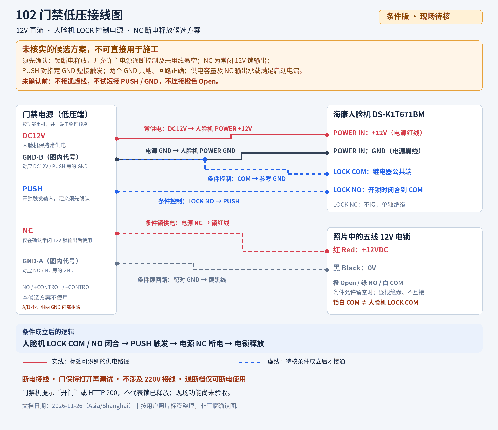

# 102 门禁低压接线图（NC 断电释放候选方案）

日期：2026-11-26，Asia/Shanghai。

**本版为接线文档定稿，现场条件尚未核实，不可直接据此施工，也不是厂家确认图或开门验收结论。** 本图依据用户提供的海康人脸机、门禁电源及五线电锁照片标签整理；未操作设备、修改开关或连接真实云。



[查看可缩放 SVG 原图](assets/hk-102-lock-wiring-2026-11-26.svg)

## 1. 使用前必须确认的条件

以下条件不能仅凭照片、端子名、“开门”提示或 HTTP 200 推定为已满足：

1. 这把电锁确实断电释放，并且厂家允许通过主电源通断控制开锁；橙、绿、白三根线分别绝缘悬空时，断电释放及恢复供电后的动作符合要求。
2. 门禁电源的 NC 是常闭 12V 锁输出，并已确认它的配对回路地；不能把未经核实的干接点 NC 当作带电输出。
3. PUSH 是与指定参考 GND 通过干接点短接触发的开锁输入；不能把电压输入或其他接口直接对地短接。
4. 电源的两个 GND 已按说明书或在断电状态测量确认共地，并已确认哪个是 NC 锁回路地、哪个是 PUSH 参考地。图内 A/B 只是区分位置的代号，不是厂家端子名，也不证明内部相通。
5. 已核对人脸机、电锁额定与启动电流、电源总容量及 NC 输出承载能力。照片未提供的参数不自行填写。

条件未确认时，不接图中虚线，不试短接 PUSH 与 GND，不试接电锁橙色 Open。若锁实际为通电开锁、需独立电压触发或需不同控制方式，本方案不适用，须按锁与电源的说明书重新确认。

## 2. 端子和线束识别

| 设备 | 照片或用户登记信息 | 本图的处理 |
|---|---|---|
| 人脸机 | 用户登记为海康 DS-K1T671BM；电源线标为 +12V/GND；LOCK 线束标为 NC/COM/NO | POWER 电源线与 LOCK 干接点分开，按实际标签识别，不按继电器线颜色猜测 |
| 门禁电源 | 低压端可见 NO、GND、NC、DC12V、GND、PUSH、+CONTROL、-CONTROL | 图中按功能重排，不代表物理端子顺序；不画市电接线 |
| 电锁 | Red=+12VDC；Black=0V；Orange=Open；Green=NO；White=COM | 红黑为供电标识；Open 触发极性以及绿白接点用途仍未确定 |

GND-A 指照片中 NO/NC 旁的 GND，GND-B 指 DC12V/PUSH 旁的 GND；这只是识别位置的辅助名称，最终按实际电源说明书确认参考地。

## 3. 接线表

**下面的锁供电及控制线仅适用于第 1 节全部条件成立后的候选方案。**

| 编号 | 起点 | 终点 | 条件或说明 |
|---|---|---|---|
| P1 | 电源 DC12V | 人脸机 POWER IN +12V 电源红线 | 人脸机保持常供电；核对实际额定电源 |
| P2 | 电源配对 GND | 人脸机 POWER IN GND 电源黑线 | 图中使用 GND-B，须核对电源说明书 |
| L1 | 电源 NC | 电锁红线 +12VDC | 仅在 NC 确认为常闭 12V 输出且锁支持图示断电控制后连接 |
| L2 | NC 输出的配对 GND | 电锁黑线 0V | 图中使用 GND-A，不能仅凭名称假定回路正确 |
| C1 | 人脸机 LOCK COM | 电源 PUSH 的参考 GND | 图中使用 GND-B；确认干接点输入及参考地后连接 |
| C2 | 人脸机 LOCK NO | 电源 PUSH | COM/NO 闭合用于触发电源，不向 PUSH 注入 12V |

人脸机 LOCK NC 本方案不接，单独绝缘。电源 NO、+CONTROL、-CONTROL 本方案不使用。

电锁橙色 Open、绿色 NO、白色 COM 仅在厂家确认允许留空后，逐根绝缘、不互接。不能把电锁白色 COM 与人脸机 LOCK COM 当作同一端子，也不能把锁的绿白接点凭名称判定为门磁或直接接电源。若厂家要求其中某线参与控制，应停止套用本表。

## 4. 条件成立后的工作逻辑

```text
人脸机 LOCK COM / NO 闭合
        ↓
电源 PUSH 收到已确认类型的开锁触发
        ↓
电源 NC 暂时断电
        ↓
断电释放型电锁释放
```

“锁供电采用 NC”不等于“人脸机 LOCK 也必须采用 NC”。本方案由电源负责切换锁供电，人脸机使用 COM/NO 干接点发控制信号。只给人脸机接电源和网线而不连接相应 LOCK 输出，不会自动把开锁信号传到电源。

## 5. 接好后仍不释放时

- 保持门打开，先确认锁和电源型号、控制类型及机械状态，不继续盲换 NO/NC 或试接橙线。
- 由会使用万用表的人员，在直流电压档测锁红黑之间的待机值及开门期间变化；只测 12V 低压端，短脉冲可能漏采。不要带电使用通断档或电流档跨接电源。
- 若测得锁端持续约 12V，沿 LOCK 干接点、PUSH 输入和电源 NC 输出逐段查证，不能仅凭提示音、继电器声或一次读数认定故障。
- 若锁端电压确实降至接近 0V 仍不释放，核查锁是否为断电释放型、是否存在机械侧向受力、是否满足厂家的其他控制条件；不能直接判锁损坏。
- 所有改线都在断电后进行；不要在带电状态拔线试短接，也不要通过切断人脸机常供电模拟开门。

## 6. 状态及范围

截至用户同步的 2026-11-26 记录，两次普通开门逻辑调用虽返回 HTTP 200，但设备状态码未解析，保留 UNKNOWN_NO_RETRY；现场是否实际释放仍待用户反馈。本图不把这些协议结果改写为开门成功。

本次仅发布接线文档，不修改 102 云端绑定、worker 配置、派发开关或任何设备参数，不运行开门、登记、worker 领取、E1/E2、真实云或支付操作。既有 NO-GO、上传、部署和发布冻结保持；GitHub 文档发布不构成这些执行动作的授权。
