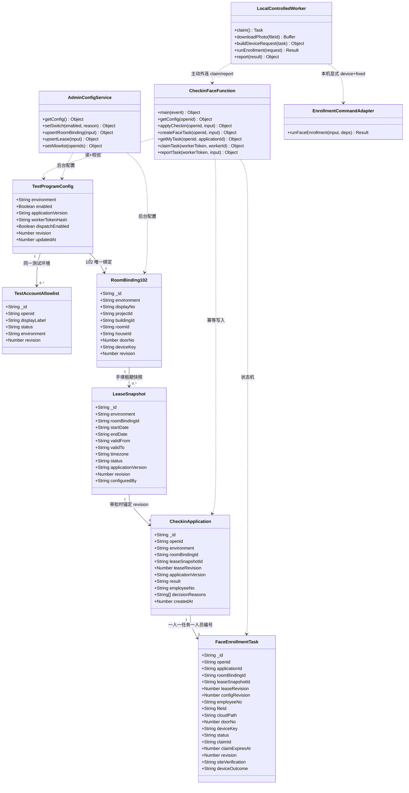
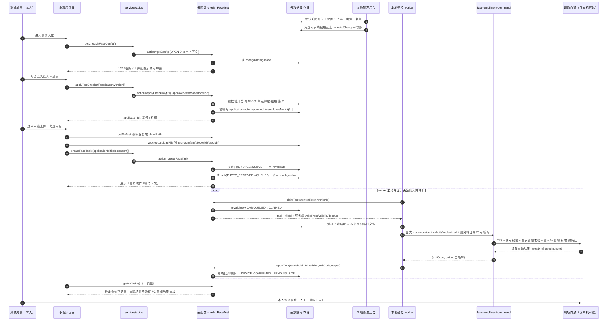
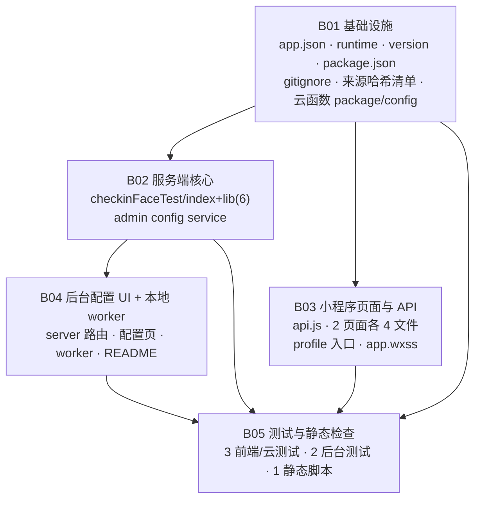

# 入住＋人脸登记体验版：实施清单与设计方案（2026-11-24）

> 本文是给工程师的**实施依据与清单**，不是完成声明。唯一需求来源是任务卡
> `docs/tasks/MINIPROGRAM-CHECKIN-FACE-EXPERIENCE-TASK-2026-11-24.md`（源提交 `2bbd85d`）。
> 基线：`6ecb337d4d7e84de6080af53e335b75ec7f46875`，worktree
> `.tmp-checkin-face-experience`，分支 `release/miniprogram-checkin-face-test-2026-11-24`。
> 本文只做只读调研与方案落盘；未写业务代码、未改现有文件、未提交 git。

---

## 0. 基线核对（设计前提，均已实读）

| 事实 | 证据 | 对设计的约束 |
|---|---|---|
| `app.json` 只有 9 个页面，无入住/人脸页 | `miniprogram/app.json` | 必须新增 2 个页面并注册路由；`tabBar` 不改 |
| `runtime.js` 为 `mode:'live'`、`cloudEnv:'cloud1-d6gs08jbb8aa7a138'`、`allowDeviceOperations:false` | `miniprogram/config/runtime.js` | 不得改成 `true` 开远程开门；新增 UI 开关只是展示，不参与审批 |
| `api.js` 用 `wx.cloud.callFunction`，只接受 `result.code === 0` | `miniprogram/services/api.js` 的 `call()` | 新云函数统一返回 `{code,data,msg}`，`code:0` 为成功 |
| 23 个云函数均无入住/人脸链路 | `cloudfunctions/` 目录清单 | 新增独立测试云函数，不改既有导入函数 |
| `backend-provenance.json` 登记全部导入文件哈希；`verify-import.mjs` 逐条断言 `changes[name].originalSha256 === provenance.files[name]` | `scripts/verify-import.mjs` 第 8–13 行 | **不能**把本任务新增云函数塞进 `backend-changes.json`（见 §9 C1） |
| 登记命令默认 `mode='simulation'`、`validityMode='unlimited'`、`doorNo=1`；`room` 仅备注 | `admin-web/lib/face-enrollment-command.mjs` 的 `normalizeInput`；`docs/HIKVISION-FACE-ENROLLMENT-COMMAND.md` | 必须由本任务自有 worker 显式传 `mode:'device'` + `validityMode:'fixed'` + 服务端日期 + 服务端门号，禁止直接把命令默认值当设备成功 |
| 全天权限计划必须先读设备、验证周/假日/时段/次数后才出具指纹；`unlimited` 不会被当作全天 | `admin-web/lib/face-access-plan.mjs`、`face-enrollment.mjs#validate/grantAccess/#verify` | 新路径只传 `validityMode:'fixed'`，计划仍复用已核验的 `loadAllDayPlan` |
| 设备查询确认分 `ready`（建模入库已确认）与 `pending-site`（仅关联已确认） | `face-enrollment.mjs#verify`、`face-enrollment-command.mjs#safeEnrollment` | 两者都必须显示为「待现场刷脸验证」，不得显示为现场识别通过 |
| 设备秘密只在本机：密码走 stdin，证书本机文件，输出白名单不含秘密 | `admin-web/face-enroll.mjs`、`Invoke-FaceEnrollment.ps1`、`HIKVISION-FACE-ENROLLMENT-COMMAND.md` | 小程序、云函数、发布包、日志一律不得出现设备地址/账号/密码/证书/私钥 |
| 打包器要求干净工作树、`mode` 与 `--live` 匹配、`allowDeviceOperations===false`，并跑 `npm test`/`npm run check`/`npm run test:admin` | `scripts/package-release.py` | 版本发布前先提交；上传体验版由负责人在开发者工具完成，打包器只产出源码包 |
| DB-05 occupancy 是未合并工作线，依赖 Org/PropertyV2/Identity/Verification/Blacklist 与 `LocalStore` | `git show b9ee061 --stat`、`c7516e6:admin-web/tests/occupancy.test.mjs` | 不 merge/cherry-pick/整条搬入；仅按任务卡做独立测试命名空间 |

---

## 1. 实施清单（逐文件）

共 **44 个文件**：新增 35、修改 9。批次 B01–B05 与 §8 依赖图一致；「依赖」列为必须先完成的批次。

### ① 小程序页面／路由／资料入口（13 个）

| # | 相对路径 | 新增/修改 | 具体要做什么 | 依赖 |
|---|---|---|---|---|
| 1 | `miniprogram/app.json` | 修改 | 在 `pages` 追加 `pages/checkin/index`、`pages/face-enroll/index`；**不改** tabBar、`window`、`sitemapLocation` | B01 |
| 2 | `miniprogram/pages/checkin/index.js` | 新增 | 页面逻辑：`onLoad` 拉 `getConfig`；只有 `enabled && configured && accountEligible` 才显示「自动通过」；未填租期显示「待配置」；提交只发 `{applicationVersion}`；本地 busy 锁防重复提交；不得持有房号/日期/admin 字段 | B03 |
| 3 | `miniprogram/pages/checkin/index.json` | 新增 | 页面配置，与既有页面同风格（`navigationStyle` 继承全局即可） | B03 |
| 4 | `miniprogram/pages/checkin/index.wxml` | 新增 | 展示项目/楼栋/展示房号 `102`（只读）、租期起止或「待配置」、租期内每日 24 小时、主入住人确认勾选、提交按钮；所有事件绑定必须在 js 中存在 | B03 |
| 5 | `miniprogram/pages/checkin/index.wxss` | 新增 | 状态徽标、待配置提示、禁用态样式；仅 class 选择器 | B03 |
| 6 | `miniprogram/pages/face-enroll/index.js` | 新增 | `onLoad` 取 `applicationId` → `getMyTask`；本人用途确认勾选项；`wx.chooseMedia` 后 `wx.cloud.uploadFile` 到服务端下发的 `cloudPath`；再调 `createFaceTask`；轮询只读 `getMyTask`；无自动重发 | B03 |
| 7 | `miniprogram/pages/face-enroll/index.json` | 新增 | 页面配置 | B03 |
| 8 | `miniprogram/pages/face-enroll/index.wxml` | 新增 | 自动显示服务端房号与租期；六态文案严格按 §5.4；「待现场刷脸验证」只作为中状态呈现，不写「识别通过」 | B03 |
| 9 | `miniprogram/pages/face-enroll/index.wxss` | 新增 | 六态样式与只读字段样式 | B03 |
| 10 | `miniprogram/pages/profile/index.js` | 修改 | `menus` 增加 `{id:'checkinTest',name:'测试入住'}`（仅 `runtime.checkinFaceTestEntry===true` 且已登录时可见）；`openMenu` 跳转 `/pages/checkin/index` | B03 |
| 11 | `miniprogram/pages/profile/index.wxml` | 修改 | 用 `wx:if` 控制新入口显示 | B03 |
| 12 | `miniprogram/pages/profile/index.wxss` | 修改 | 新增入口行样式（沿用 `.menu-row`） | B03 |
| 13 | `miniprogram/app.wxss` | 修改 | 新增共享 `.test-badge` / `.status-pill` / `.pending-config` 样式，不改既有类 | B03 |

### ② 前端 API 与配置（5 个）

| # | 相对路径 | 新增/修改 | 具体要做什么 | 依赖 |
|---|---|---|---|---|
| 14 | `miniprogram/services/api.js` | 修改 | 用既有 `call()` 增加 `getCheckinFaceConfig()`、`applyTestCheckin({applicationVersion})`、`uploadTestFace({applicationId,cloudPath,filePath})`（封装 `wx.cloud.uploadFile`，返回 fileID）、`createFaceTask({applicationId,fileId,consent})`、`getFaceTask(applicationId)`。**所有新函数做严格字段白名单**：出现 `approved`/`testMode`/`mode`/`validityMode`/`roomNo`/`roomId`/`houseId`/`doorNo`/`employeeNo`/`validFrom`/`validTo`/`status` 直接本地抛错，不下发云端 | B01 |
| 15 | `miniprogram/config/runtime.js` | 修改 | 仅新增 `checkinFaceTestEntry: true`（纯 UI 显隐）。`mode`、`cloudEnv`、`allowDeviceOperations:false` **原样保留**；注释明确该字段不是服务器审批依据 | B01 |
| 16 | `miniprogram/config/version.json` | 修改 | 发布批次由负责人定时改 `version`/`channel`/`releaseDate`（建议新体验版单独版本号）；与 17、18 必须同步 | B01 |
| 17 | `miniprogram/config/version.js` | 修改 | 由 `npm run version:sync` 生成，禁止手改 | B01 |
| 18 | `package.json` | 修改 | 同步 `version`；新增脚本 `check:checkin-face`（调 `scripts/checkin-face-static-check.mjs`）、`worker:checkin-face`（调 worker）；不改 `engines`/既有 scripts 语义 | B01 |

### ③ 服务端：测试入住／租约／人脸任务／受控派发（20 个）

**云函数 `checkinFaceTest`（9 个，全部新增）** —— 单一入口 + action 白名单，避免把审批逻辑散落到多个函数：

| # | 相对路径 | 新增/修改 | 具体要做什么 | 依赖 |
|---|---|---|---|---|
| 19 | `cloudfunctions/checkinFaceTest/index.js` | 新增 | `exports.main`：解析 `action`，分派到 `validate`/`workflow`；异常统一 `{code,msg}`；**禁止** `console.log` 任何请求体/输出体/文件/`workerToken`；小程序 action 取 `getWXContext().OPENID`，worker action 只认 token | B02 |
| 20 | `cloudfunctions/checkinFaceTest/package.json` | 新增 | 依赖 `wx-server-sdk:^3.0.0`，与既有云函数一致 | B01 |
| 21 | `cloudfunctions/checkinFaceTest/config.json` | 新增 | `{"permissions":{"openapi":[]}}`，与既有函数同形 | B01 |
| 22 | `cloudfunctions/checkinFaceTest/lib/context.js` | 新增 | 调用者身份与权限：`OPENID` 必填校验；worker token 用 SHA-256 后与 `test_program_config.workerTokenHash` 常量时间比较；action 白名单分「小程序／worker」两组 | B02 |
| 23 | `cloudfunctions/checkinFaceTest/lib/store.js` | 新增 | 集合名常量、`_id` 确定性生成（`env|102`、`env|openid|appVersion|leaseRev`、`env|applicationId`、`env|env` 等）、事务封装、revision CAS（`expectedRevision` 不符即拒绝）、审计写入 | B02 |
| 24 | `cloudfunctions/checkinFaceTest/lib/config.js` | 新增 | 读测试开关/名单/102 绑定/租约快照；`revalidateForApply()` 与 `revalidateForDispatch()` 两道门；**按确定性 `_id` 单点读取，禁止按 `displayNo` 查询后取第一条**；缺配置一律失败关闭 | B02 |
| 25 | `cloudfunctions/checkinFaceTest/lib/dates.js` | 新增 | Asia/Shanghai 日期边界：`YYYY-MM-DD` 起 → `<起>T00:00:00`，止 → `<止>T23:59:59`，均为设备本地墙上时间字符串；`Intl.DateTimeFormat(timeZone:'Asia/Shanghai')` 仅用于快照生成/审计；禁止 UTC 偏移、`+1 day`、`unlimited` 兜底 | B02 |
| 26 | `cloudfunctions/checkinFaceTest/lib/workflow.js` | 新增 | 状态机与幂等：`applyCheckin`/`createFaceTask`/`getMyTask`/`claimTask`/`reportTask`；claim 时二次校验并原子占用；租期/审批/配置 revision 变化使排队任务失效；过期 claim → `UNKNOWN_RESULT`，不重排 | B02 |
| 27 | `cloudfunctions/checkinFaceTest/lib/validate.js` | 新增 | 严格入参白名单与额外字段拒绝；fileID 前缀归属校验；`reportTask` 输出白名单校验（mode/validityMode/日期/门号/employeeNo/指纹/steps 与服务端快照逐项相等） | B02 |

**本地管理后台配置（5 个）**

| # | 相对路径 | 新增/修改 | 具体要做什么 | 依赖 |
|---|---|---|---|---|
| 28 | `admin-web/lib/checkin-face-test-config.mjs` | 新增 | `AdminCheckinFaceTestConfig` 服务：`getConfig` / `setSwitch(default false)` / `upsertRoomBinding(102 唯一)` / `upsertLease(手填起止)` / `setAllowlist`；用注入的 `app.database()` 直写新集合并写 `admin_audit`；不接触设备秘密；输入校验失败不写库 | B02 |
| 29 | `admin-web/server.mjs` | 修改 | 新增 admin-only 路由（沿用现有 session+CSRF+origin 校验）：`GET /api/checkin-face-test/config`、`PUT /api/checkin-face-test/switch|room|lease|accounts`；非 admin 返回 403；不改既有 `/api/face/*` 行为 | B04 |
| 30 | `admin-web/public/checkin-face-test.html` | 新增 | 配置页：开关、102 唯一绑定表单、租期起止手填表单、测试账号名单；页面明示「默认关闭」「不填租期不自动通过」 | B04 |
| 31 | `admin-web/public/checkin-face-test-config.js` | 新增 | 配置页前端：带 CSRF 调上述路由；展示配置 revision 与上次审计；不展示设备密码/证书 | B04 |
| 32 | `admin-web/public/index.html` | 修改 | 增加配置页入口链接（仅 1 处） | B04 |

**本地受控 worker（4 个）**

| # | 相对路径 | 新增/修改 | 具体要做什么 | 依赖 |
|---|---|---|---|---|
| 33 | `tools/checkin-face-worker/worker-runtime.mjs` | 新增 | 读本地 `*.local.json`（Git 忽略）与环境变量中的 worker token；构造 `runFaceEnrollment` 入参：显式 `mode:'device'`、`validityMode:'fixed'`、`validFrom/validTo` 来自任务、`doorNo` 来自绑定、`employeeNo` 来自任务、`consent:true`；缺任一项抛错退出；脱敏日志 | B04 |
| 34 | `tools/checkin-face-worker/claim-and-enroll.mjs` | 新增 | 主动外连云函数 `claimTask` → 受控下载照片 → 写本机受限临时 JPEG（用后清零删除）→ 调 `admin-web/face-enroll.mjs` 或 `runFaceEnrollment` → `reportTask`。退出码 2/4/5 与未知结果只上报不重跑；不开监听端口、不反代 admin loopback | B04 |
| 35 | `tools/checkin-face-worker/worker-config.example.json` | 新增 | **仅非机密**示例：`environment`、`cloudEnv`、`workerId`、`workerTokenEnv`、`deviceKey`；注明账号/密码/证书路径/型号/门号只在 local 文件，示例留空 | B04 |
| 36 | `tools/checkin-face-worker/README.md` | 新增 | 本地操作说明：负责人如何填 local 配置、如何启停 worker、退出码语义、真机刷脸单独回报、禁止事项 | B04 |

**来源登记与忽略（2 个）**

| # | 相对路径 | 新增/修改 | 具体要做什么 | 依赖 |
|---|---|---|---|---|
| 37 | `docs/checkin-face-experience-source-hashes.json` | 新增 | 登记本任务**新增**云函数每个文件的实际 SHA-256（路径、sha256、用途、基线 SHA）。不写入 `backend-changes.json`，理由见 §9 C1 | B01 |
| 38 | `.gitignore` | 修改 | 增加 `tools/checkin-face-worker/*.local.json`、`tools/checkin-face-worker/.data/`、`tools/checkin-face-worker/.cache/`；保证设备材料永不入包 | B01 |

### ④ 测试（6 个）

| # | 相对路径 | 新增/修改 | 具体要做什么 | 依赖 |
|---|---|---|---|---|
| 39 | `tests/checkin-face-api.test.cjs` | 新增 | API 适配层：严格白名单、伪造字段不下发、`code!==0` 抛错不降级、uploadFile cloudPath 来自服务端、无设备字段 | B05 |
| 40 | `tests/checkin-face-pages.test.cjs` | 新增 | 页面：待配置不提交、六态映射、只读房号/租期、无日期自动填充、入口显隐、重复点击 busy 锁 | B05 |
| 41 | `tests/checkin-face-cloud-workflow.test.cjs` | 新增 | 云函数逻辑（mock DB）：自动通过正反例、102 唯一绑定、租期边界、归属、幂等/竞态、开关关闭、全天规则、report 校验、未知结果不重排 | B05 |
| 42 | `scripts/checkin-face-static-check.mjs` | 新增 | 静态扫描：小程序/云函数/包内无设备秘密关键字；新路径无 `unlimited`、无省略 `mode`；客户端载荷无 `approved/testMode/roomNo`；无 DB-05 occupancy import；`allowDeviceOperations:false` 保持 | B05 |
| 43 | `admin-web/tests/checkin-face-config.test.mjs` | 新增 | 后台配置服务：默认关闭、102 唯一性、租期手填与日期边界、名单、审计、越权/非法输入失败关闭 | B05 |
| 44 | `admin-web/tests/checkin-face-worker.test.mjs` | 新增 | worker：显式 mode/validityMode、缺日期拒绝、退出码映射、不自动重试、输出脱敏、秘密不入参数 | B05 |

---

## 2. 数据模型

### 2.1 服务端可信生成 vs 禁止客户端提交

| 字段 | 来源 | 客户端是否可提交 |
|---|---|---|
| `openid`、调用者身份 | `cloud.getWXContext()` | ❌ 禁止 |
| `environment` / 测试命名空间 | 服务端常量 + 后台配置 | ❌ |
| `switch.enabled` | 本地管理员后台（默认 false） | ❌ |
| `allowlist` | 本地管理员后台按 openid 配置 | ❌ |
| `roomBinding._id`、`roomId`、`houseId`、`projectId`、`buildingId`、`doorNo`、`deviceKey` | 后台唯一绑定（102） | ❌ |
| `lease.validFrom/validTo`（设备本地时间）、`startDate/endDate`、`leaseRevision` | 负责人手填 + `dates.js` 生成 | ❌ |
| `application.result`、`decisionReasons`、`employeeNo` | 服务端审批/生成 | ❌ |
| `task.status`、`claimId`、`revision`、`siteVerification` | 服务端状态机 | ❌ |
| `mode:'device'`、`validityMode:'fixed'` | 本地 worker 显式构造，服务端 report 校验 | ❌ 小程序永不提交 |
| `applicationVersion` | 客户端**唯一允许**提交的业务字段（版本不匹配即拒绝） | ✅ |
| `fileId` | 客户端上传成功后返回，服务端校验归属 | ✅（限本人 cloudPath 前缀） |
| `consent` | 本人勾选 | ✅（必须 true） |

### 2.2 类图



### 2.3 任务状态机（严格单向，禁止跳步）

```
PHOTO_RECEIVED → QUEUED_FOR_DISPATCH → CLAIMED → DEVICE_PROCESSING
    → DEVICE_CONFIRMED → PENDING_SITE_VERIFICATION   （终态：待现场刷脸）
    ↘ FAILED_REVIEW / UNKNOWN_RESULT / INVALIDATED     （终态：待人工核查，不自动重发）
```

- `DEVICE_CONFIRMED` 仅在 `exitCode===0`、`outcome==='device-enrollment-confirmed-pending-site'`、`mode==='device'`、
  `validityMode==='fixed'`、日期/门号/employeeNo/全天计划指纹全部与快照一致、且
  `enrollment.faceAssociationConfirmed===true`、`steps.verify.state==='success'` 时进入。
- `pending-site`（设备不支持建模查询）与 `ready`（建模已确认）都只能显示「待现场刷脸验证」，差别仅在内部字段 `faceModelingVerified`。
- `UNKNOWN_RESULT` 保留 taskId/employeeNo 与残留设备事实，不换人员号、不删除、不自动重发。

---

## 3. API 契约

统一响应：`{code:0, data:{...}, msg:''}`；失败 `code` 为非 0，`msg` 为可展示原因。所有 action 均**拒绝未知字段**（不是忽略）。

### 3.1 小程序侧（`wx.cloud.callFunction({name:'checkinFaceTest', data:{action,...}})`）

| action | 入参（白名单） | 出参要点 | 权限/校验点 | 幂等键 |
|---|---|---|---|---|
| `getConfig` | `{}` | `enabled`、`configured`、`accountEligible`、`room{displayNo:'102',roomId,houseId}`、`lease{status,startDate,endDate,validFrom,validTo,timezone:'Asia/Shanghai',dailyHours:'24x7'}`、`applicationVersion` | OPENID 必填；不返回名单、token、deviceKey、门号以外设备信息 | 只读 |
| `applyCheckin` | `{applicationVersion}` | `applicationId`、`result:auto_approved`，房号/租期快照 | OPENID → 名单；开关 enabled；`RoomBinding102` 按 `_id` 单点命中且 displayNo==='102'；租期 status active 且当前时间落在快照内；版本一致；**禁止客户端 `approved/testMode/roomNo` 参与判据** | `env\|openid\|applicationVersion\|leaseRevision\|roomRevision` |
| `createFaceTask` | `{applicationId,fileId,consent}` | `taskId`、`status`、`room`、`lease`、`cloudPath` | application 属本人且 `auto_approved`；fileID 前缀 `test-face/{env}/{openid}/{applicationId}/`；服务端下载校验 JPEG≤200KiB；二次 revalidate；`employeeNo` 沿用 application | `env\|applicationId`（重传只换 photo，不改 employeeNo；已 CLAIMED 则拒绝） |
| `getMyTask` | `{applicationId}` | 六态之一 + 只读展示字段 | 属本人；只读；轮询不产生写操作 | 只读 |

**自动通过判据（全部满足才 `auto_approved`）**：`switch.enabled===true` ∧ `openid∈active allowlist` ∧
`applicationVersion === config.applicationVersion` ∧ 102 绑定存在且唯一 ∧ `lease.status==='active'` ∧
当前 Asia/Shanghai 时间在 `[startDate 00:00:00, endDate 23:59:59]` ∧ 无同名并发申请。
任一不满足：普通账号返回 `pending_review` 且不写测试集合（见 §9 C2）；测试账号返回明确错误码
`TEST_DISABLED` / `ACCOUNT_NOT_ALLOWED` / `ROOM_NOT_UNIQUE` / `LEASE_UNCONFIGURED` / `LEASE_EXPIRED` / `VERSION_MISMATCH`。

### 3.2 worker 侧（同一云函数，token 鉴权，非 OPENID）

| action | 入参 | 出参 | 校验点 |
|---|---|---|---|
| `claimTask` | `{workerToken,workerId}` | `{task\|null}`，task 含 `fileId/employeeNo/doorNo/deviceKey/validFrom/validTo/cloudPath/claimId/revision` | token 常量时间比对；`dispatchEnabled`；**claim 前重跑** revalidate（开关/名单/审批/租期/config revision）；CAS `QUEUED→CLAIMED`；租期变化→`INVALIDATED`；不返回任何设备秘密 |
| `reportTask` | `{workerToken,taskId,claimId,revision,exitCode,output}` | `{taskId,status}` | 同 token；claimId+revision CAS；输出按 §2.3 白名单逐项比对；重复上报同结果幂等；不接受新 employeeNo、不接受新日期、不接受 `unlimited`；4/5/未知→`FAILED_REVIEW`/`UNKNOWN_RESULT`，**无 requeue action** |

### 3.3 本地后台侧（admin session + CSRF + origin）

`GET /api/checkin-face-test/config`；`PUT /api/checkin-face-test/switch|room|lease|accounts`。
所有写操作：admin 角色、CSRF 匹配、审计记录（操作者、旧值、新值、原因、revision）；开关默认 false，
`lease` 只接受负责人手填的 `YYYY-MM-DD` 起止，不接受「一年/长期/自动今天」选项。

---

## 4. 调用时序



**竞态分支**：claim 与 report 两次 revalidate 任一发现租期变更、审批撤销、开关关闭、配置 revision 变化 →
task 置 `INVALIDATED`，不派发/不继续；`exitCode 4/5`、输出校验失败或 claim 超时 → `FAILED_REVIEW`/`UNKNOWN_RESULT`，
保留 employeeNo 与设备事实，不换号、不重发、不删除。

---

## 5. 受控／隔离设计

1. **测试开关默认关闭**：代码层 `enabled` 缺省 false；配置文档不存在时也按关闭处理；开启必须后台 admin 写审计。关闭后新自动通过立即停止，既有人脸/人员/权限不删。
2. **命名空间**：所有集合 `_id` 与环境前缀绑定（`{env}|...`），照片路径 `test-face/{env}/{openid}/{applicationId}/`；服务端只按确定性 `_id` 读 102 绑定，**禁止按 `displayNo` 查询取第一条**，多条同号直接 `ROOM_NOT_UNIQUE`。
3. **普通账号原流程**：非名单账号不写测试集合、不自动通过；不修改任何既有住户/审核规则。
4. **设备秘密边界**：设备 origin、username、password、证书路径、私钥、pin 只存在 worker 的 Git 忽略本地文件与内存中；不进小程序、云函数、发布包、日志、任务输出；worker token 是独立随机凭据，非设备秘密，可单独轮换。
5. **普通远程开门仍关闭**：`runtime.allowDeviceOperations` 保持 false；新链路不调用 `unlock`/`unlockDevice`；不开放远程开门、不批量设备操作。
6. **云端不直连私网**：worker 只做**出站**调用云函数 claim/report；不开监听端口、不反代 admin loopback、不在小程序跑 Node HTTPS adapter。小程序只与微信云正式通道交互。
7. **全天与长期区分**：新路径固定 `validityMode:'fixed'`；每天 24 小时由已核验 `loadAllDayPlan` 证明并绑门；`unlimited` 只保留给既有 PC 默认路径，不在新路径出现。
8. **不伪造现场结果**：上传成功≠设备下发；CLI 退出 0 + `device-enrollment-confirmed-pending-site`≠现场识别；`siteVerification` 永远 PENDING 直至本人现场回报。
9. **隔离前提**：若不能证明独立测试云或可验证的命名空间/授权隔离，**不得**把自动通过规则部署为生产全局能力；按 §8 第 8 项报缺项。

---

## 6. 测试策略（对齐任务卡 §6）

| §6 验收事实 | 测试文件 | 关键断言（合成，不依赖真机/真设备） |
|---|---|---|
| 自动通过正反例 | `tests/checkin-face-cloud-workflow.test.cjs` | 名单+102+有效租期+版本一致 → `auto_approved`；普通账号、伪造 `approved/testMode/roomNo`、错房、开关关闭、过期/缺失配置 → 不通过且错误码正确 |
| 房号来源 | 同上 + `tests/checkin-face-pages.test.cjs` | 只按确定性 `_id` 读取；客户端改房号不改变任务 roomId；同号多条 → `ROOM_NOT_UNIQUE`，不取第一条 |
| 租期 | 同上 + `admin-web/tests/checkin-face-config.test.mjs` | 手填 `2026-12-01..2026-12-05` → `T00:00:00` / `T23:59:59`，Asia/Shanghai；未填→`待配置`；过期/取消/越界→拒绝；没有 `unlimited`、没有 +1 天、没有默认一年 |
| 上传与归属 | 同上 + `tests/checkin-face-api.test.cjs` | 跨用户 openid、跨 applicationId 的 fileID 被拒；未通过/已取消租约不建任务；设备秘密字段不出现在任何请求 |
| 幂等与竞态 | `tests/checkin-face-cloud-workflow.test.cjs` | 重复 apply/create 返回同一 id、同一 employeeNo；并发 claim 仅一个成功；排队后租期 revision 变化→`INVALIDATED`；未知结果不 requeue |
| 测试范围 | 同上 + `scripts/checkin-face-static-check.mjs` | 关闭开关后新申请不通过；`allowDeviceOperations:false`；无 DB-05 import；无生产全局放行 |
| 全天规则 | `admin-web/tests/checkin-face-worker.test.mjs` + 云函数 workflow | worker 请求显式 `mode:'device'` + `validityMode:'fixed'`；缺日期/模式直接拒绝；report 输出日期与快照不一致被拒；`unlimited` 不进入新路径 |
| 状态展示 | `tests/checkin-face-pages.test.cjs` | 六态文案逐项断言；上传成功不显示「已识别」；pending-site/ready 都显示「待现场刷脸验证」；失败与待核分离 |
| 发布可用 | 人工（负责人） | 由 §8 受阻项记录，不写进合成测试通过数 |

建议命令（Git Bash；`$NODE` 为指定 Node）：

```bash
NODE="C:/Users/Administrator/.workbuddy/binaries/node/versions/22.22.2-6/node.exe"
"$NODE" --test tests/checkin-face-api.test.cjs tests/checkin-face-pages.test.cjs tests/checkin-face-cloud-workflow.test.cjs
"$NODE" scripts/checkin-face-static-check.mjs
npm test
npm run check
npm run check:checkin-face
npm --prefix admin-web test
# 依赖安装后（当前 worktree 无 node_modules）：
npm run verify:backend
# 提交完成、工作树干净、版本已同步后：
python3 scripts/package-release.py --live
```

不搬用旧 246/51/54 等数字；每条命令记录退出码与原始输出。真机结果单独列，与合成测试通过数分开。

---

## 7. 依赖图与实现顺序（给工程师的批处理顺序）



**实现顺序建议**

1. **B01**：先钉死路由位、配置位、版本位、忽略规则与来源登记骨架（9 文件）；不改 `mode`/`allowDeviceOperations`。
2. **B02**：先写 `dates.js` + `validate.js` + `config.js`（失败关闭），再 `workflow.js`（状态机/幂等），最后 `index.js` 路由和 admin 配置服务。
3. **B03**：按 §3.1 契约接 API，再做两页面；页面只渲染服务端返回值。
4. **B04**：后台配置页与 worker；worker 的最后一步才接 `runFaceEnrollment`，并强制显式 mode/validityMode。
5. **B05**：按 §6 表格逐条写测试；先跑新测试，再跑既有全套与打包。

---

## 8. 受阻项／需负责人项（代码可先做的部分已标注）

| # | 缺项 | 代码可先做 | 只能等负责人 | 缺失时的失败关闭表现 |
|---|---|---|---|---|
| 1 | 租期起止手填 | 后台表单、日期校验、快照与设备边界映射、页面「待配置」 | 上线时手填具体起止 | `LEASE_UNCONFIGURED`，页面显示待配置，不默认一年/长期/今天 |
| 2 | 102 唯一绑定（项目/楼栋/roomId/houseId/deviceKey/doorNo） | 确定性 `_id`、唯一性校验、配置页 | 提供真实稳定 ID 与测试门映射 | `ROOM_NOT_UNIQUE` / `ROOM_UNCONFIGURED`，绝不取 `users.houses[0]` 或历史 owners |
| 3 | 测试账号名单（openid） | 名单集合、admin 配置接口、校验逻辑 | 测试成员登录后由本地管理员登记 | `ACCOUNT_NOT_ALLOWED` |
| 4 | 测试成员授权与扫码 | 无 | 平台添加体验成员、扫码登录 | 真机流程无法开始；合成测试照常 |
| 5 | 开发者工具上传体验版 | 干净提交、包哈希、版本同步 | 本机登录、编译、上传、指定体验版 | 仅完成本地打包，不声称已发布 |
| 6 | 平台当前体验版与回退锚点核对 | 无 | 今天核对现有体验版 ID 与可恢复版本 | 回退锚点缺失时不得上传 |
| 7 | 真机刷脸 | 状态展示与人工记录位 | 本人在现场完成并单独回报 | `PENDING_SITE_VERIFICATION`，永不显示识别通过 |
| 8 | 设备可信材料（origin/账号/密码/公开证书/型号/门号/全天模板号） | worker 读取、显式参数构造、受限临时文件 | 在可信执行端本地提供；不得贴聊天/入 Git | worker 不启动；仅合成 simulation 测试，不记作设备成功 |
| 9 | 测试隔离结论（独立云 or 可验证命名空间） | 代码层命名空间与默认关闭开关 | 负责人确认是否与生产云共用 | 不能证明隔离则不部署自动通过规则到生产云 |
| 10 | 新增云函数哈希登记口径 | 采用 `docs/checkin-face-experience-source-hashes.json` | 负责人裁定是否调整 `backend-changes.json`/校验脚本 | 见 §9 C1；未裁定前不改既有 provenance 文件 |

---

## 9. 契约矛盾与需要裁定的事项（不自行改判）

### C1（实质工具冲突）：新增云函数无法按字面登记进 `docs/backend-changes.json`
- 任务卡 §5.4 要求「云函数变更按项目要求登记 `docs/backend-changes.json` 的实际源哈希」。
- 证据：`scripts/verify-import.mjs` 第 8–13 行对 `changes` 每条执行
  `assert.equal(change.originalSha256, provenance.files[name], ...)`；`docs/backend-provenance.json` 只含
  mini-shop 导入文件。把本任务新建的 `checkinFaceTest` 写进 `backend-changes.json` 会因
  `provenance.files[name] === undefined` 直接断言失败。
- 本方案采取的安全路径：**不修改任何既有导入云函数**；新函数写入独立清单
  `docs/checkin-face-experience-source-hashes.json`（含实际 SHA-256）。若负责人坚持原字面要求，需先裁定
  是否调整 `verify-import.mjs`/`backend-provenance.json` 的语义，工程师不自行改校验器。

### C2（需求与基线差距）：「普通账号保持原审核流程」在基线中不存在
- 任务卡 §1/§4 要求普通账号保持原审核流程；但基线 `app.json` 无入住页，23 个云函数无入住/审核 action，
  `services/api.js` 也无相关 API（§0 已核）。
- 本方案不擅自新建一套正式审核流程；普通账号返回 `pending_review`，不写测试集合，页面提示走既有线下/后台审核。
- 需负责人确认这是否满足「保持原审核流程」，或是否授权另建正式审核（后者超出本卡范围）。

### C3（默认值风险，非矛盾）：登记命令默认与任务要求相反
- `face-enrollment-command.mjs#normalizeInput`：`mode` 缺省 `simulation`、`validityMode` 缺省 `unlimited`、`doorNo` 缺省 1；
  `docs/HIKVISION-FACE-ENROLLMENT-COMMAND.md` 明确 `room` 仅为备注、不绑定账号/房产。
- 因此 worker 必须**显式覆盖全部四项**并做 report 端反校验；不能靠命令默认值，也不能把 `room='102'` 当作绑定证据。

### C4（发布工具约束，非矛盾）：打包器不执行平台上传
- `scripts/package-release.py` 要求干净工作树、`--live` 与 `mode:'live'` 匹配、`allowDeviceOperations===false`，
  并在 manifest 写 `platform_upload:'not_performed'`。
- 所以工程师只负责提交+打包+哈希；体验版上传、体验成员与正式审核禁止等由负责人在开发者工具完成并留证。

---

## 10. 回退锚点设计

| 锚点 | 回退动作 | 不做什么 |
|---|---|---|
| 体验版 | 上传前记录当前体验版版本/包哈希；需要时恢复旧体验版 | 不提交正式审核、不发正式版 |
| 测试开关 | `enabled=false`（默认态），新自动通过立即停止 | 不删既有人脸/人员/权限 |
| UI 入口 | `runtime.checkinFaceTestEntry=false` 重新打包；服务端仍独立失败关闭 | 不改 `mode`/`allowDeviceOperations` |
| 派发 | `dispatchEnabled=false`、吊销 worker token、停 worker；排队任务置人工核查 | 不开公网端口、不反代 admin |
| 租期 | `lease.status='cancelled'`；新申请拒绝，既有设备权限按固定 `validTo` 自然到期 | 不批量删设备人员、不延长期限 |
| 配置 | 每次写操作在 `admin_audit` 留旧值/新值/revision，可按 revision 恢复 | 不覆盖既有云函数、不跑 dbInit/contentInit/chatInit/syncDevices |
| 数据对象 | 保留本次新建测试对象与审计、原报告、旧工件及新旧引用，单独列清单 | 额外清理需另行授权，不碰正式住户 |

---

**文档状态**：方案与清单已钉死；未写业务代码、未改 `app.json`/任何现有文件、未执行 git 写操作。工程师按 B01→B05 实施，负责人按 §8 提供缺项后进入验证与体验版发布。
