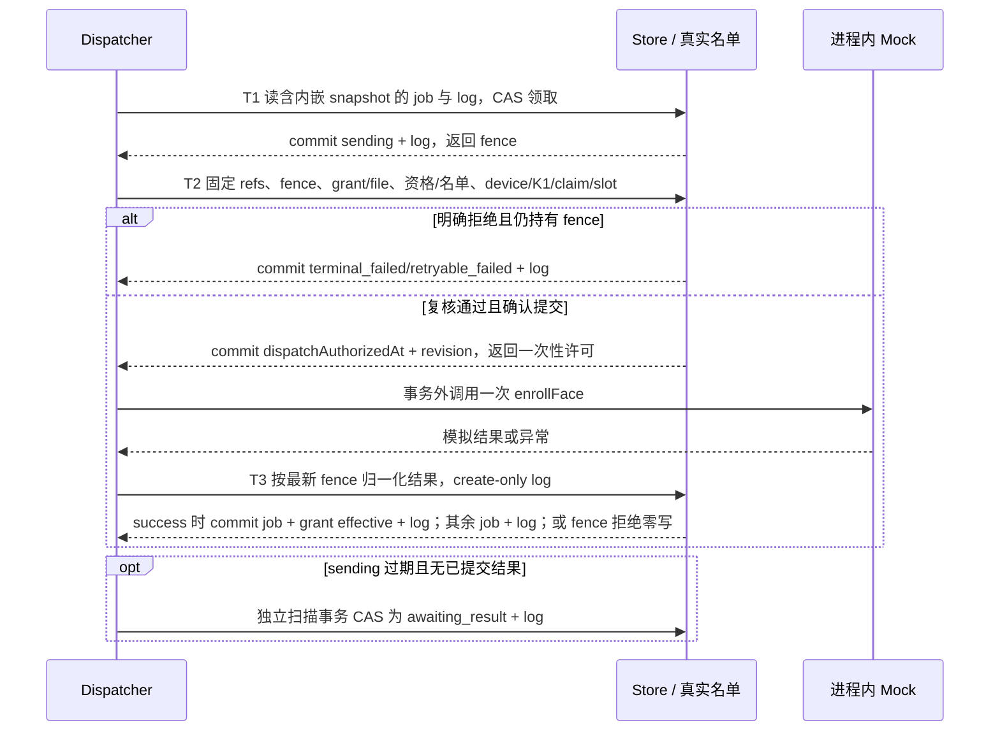

# HK-AI-04 H3 租约、Mock 派发与结果迁移契约

设计返工提案，待 Codex 批准。代码证据固定在 `90cc8486a19d408be0e3c501d9f5ec61ba13e929`。本版只修订设计与未来测试矩阵，不包含 H3 生产代码。任务卡与审批记录独立固定在各自文档提交。

## 当前证据

- [任务卡](https://github.com/1997dmsu-sketch/SMART-PM/blob/f97489fb00ad605edf893653614a5707722a89da/docs/tasks/HK-AI-04-H3-LEASE-DISPATCH-DESIGN-TASK-2026-11-12.md) 和 [H2-d 最终批准](https://github.com/1997dmsu-sketch/SMART-PM/blob/f97489fb00ad605edf893653614a5707722a89da/docs/tasks/HK-AI-04-H2D-FINAL-APPROVAL-90CC848-2026-11-12.md) 将本轮限定为设计。
- [设计复审 `c27f8c3`](https://github.com/1997dmsu-sketch/SMART-PM/blob/c27f8c3b369b77e124a456596df9144da4963d0f/docs/tasks/HK-AI-04-H3-DESIGN-REVIEW-CCD6D08-2026-11-12.md) 与 [越界实现复审 `35028b7`](https://github.com/1997dmsu-sketch/SMART-PM/blob/35028b7ed8c1fd4fd594f070adb914af1511fdc0/docs/tasks/HK-AI-04-H3-IMPLEMENTATION-REVIEW-9E5FF91-2026-11-13.md) 冻结了本次返工边界；`9e5ff91` 不作为实现基线。
- service 第 126–174 行按权限、K2 与重放、凭证及文件、资格复核处理。第 299–425 行规划 refs、使用真实名单并复核 device/K1/claim/slot。第 428–480 行同事务提交 grant、job、slot、queued 日志、operation key 及必要域写入，grant 为 pending，job 为 queued/test/mock/simulated，attempts 为 0，租约为 null。第 482–525 行每轮 prepare 绑定 token，合法重放返回原结果且授权核心写集为空。见 [service](../../admin-web/lib/face-service/service.mjs)。
- collections 第 55–97 行通用 validator 仅检查基本形状与枚举。第 395–408、447–467 行提供安全整数、确定性日志 ID 和 leasePatch，递增结果还需校验溢出。第 520–620 行校验设备、claim、slot 及域关系。见 [collections](../../admin-web/lib/face-service/collections.mjs)。
- DTO 第 42–109 行定义 job 枚举、错误类、上下文和 enroll 六字段。现有 DTO 时间只要求有限数，H3 加强为安全整数。state 第 20–43 行定义 grant/job 边，第 64–115 行要求同一 org/device/grant/credential/job/action 的 succeeded job 和受信 device_ack/device/device_verified，同时业务授权有效，才投影 deviceEffective。见 [DTO](../../admin-web/lib/face-service/dto.mjs)、[状态机](../../admin-web/lib/face-service/state.mjs)。
- Mock 第 26–63、135–183、192–203 行定义场景、调用记录与分类。缓存按 org/action/actorType/actorId/key 并核对规范输入摘要，同键异摘要冲突。calls 记录新操作的 action/jobId/orgId，明确 pre-send 失败也计调用且不缓存，未知及终态可能缓存 null。缓存为进程内 Map，重复调用和重启均须由平台控制。duplicate_callback、revoke_fail 属于其他路径，本设计仅 enroll。见 [Mock](../../admin-web/lib/face-service/mock-provider.mjs)。
- qualification 第 42–144 行规划固定资格引用，eligibility 第 139–202、212–399 行取事务快照、验证人员到 guard 与有效期。真实名单入口及提交竞态证据见 D 矩阵第 1401–1482 行，完整扫描与内容级快照证据见验收第 78–87、118–156 行。见 [资格预读](../../admin-web/lib/face-service/qualification.mjs)、[资格校验](../../admin-web/lib/face-service/eligibility.mjs)、[H2-d 用例](../../admin-web/tests/face-grant-d-matrix.test.mjs)、[H2-d 验收](HK-AI-04-H2D-ACCEPTANCE-EVIDENCE-2026-11-12.md)。
- LOCK-01 第 143 行冻结业务撤权先于异步设备清理。04A 第 37–60 行 Q04–Q09 冻结独立对账权限、三次重试与退避、保留关系、Mock 与回调边界。见 [LOCK-01](https://github.com/1997dmsu-sketch/SMART-PM/blob/9f642bf0716f43c5cfd7c11b7e19f3a062a1da67/docs/tasks/LOCK-01-HIKVISION-FACE.md)、[04A 复审](https://github.com/1997dmsu-sketch/SMART-PM/blob/5e5c9676403f1efb79794c7843dae40c267b10a2/docs/tasks/HK-AI-04A-REVIEW-2026-11-05.md)。

## Q01 固定资格基线

不新增 snapshot 集合或 ref。未来 createGrant 首次成功时，把最小、不可变、白名单化的 `dispatchSnapshot` 内嵌在本来就要写入的 job 中，与 grant/job/slot/queued log/operation key 原子提交。合法 replay 返回原结果且不得改写 job 或内嵌 snapshot。这样不会给已冻结的 H2 事务读集增加 ref：58 个名单候选仍为 90 refs 并成功，59 个仍为 91 refs 并在事务前 400。基线只允许以下引用及版本，派发时按内嵌固定 ID 点查。

| 引用 | 固定字段与复核 |
| --- | --- |
| 组织与发起授权 | orgId、creatorActorId、membershipId，组织及成员 revision（如存在）。实时检查 active、组织和 actor 绑定及 device.access.manage。内部 dispatcher 权限另行验证 |
| 人员与实名 | personId/personRevision、绑定 userId 或 null、userRevision（如存在）、identityApplicationId/identityRevision。实时检查账号 active、同一申请 approved、实名绑定完整 |
| 入住与目录 | occupancyId/occupancyRevision、cycleId/cycleRevision/cycleEpoch、roomId/roomRevision、floorId/floorRevision、buildingId/buildingRevision、communityId/communityRevision。复核层级、有效期、状态与人员归属 |
| 入住占位与主租 | occupancyClaimId、primarySlotId、primaryOccupancyId/primaryRevision、sponsorOccupancyId/sponsorRevision（可空）。复核 claim owner、当前 slot 三元绑定、主租及 sponsor 状态。claim/slot 有 revision 时固定并复核 |
| 生命周期与名单 | lifecycleGuardId、guardRevision/guardEpoch 或明确记录缺席。名单固定 restriction=occupancy.activate 与 org/person/occupancy/identity 查询绑定，每次使用真实名单适配器的当轮 token、动态 refs 及 guard revision/epoch；名单结果以当轮事务裁决 |
| 授权与凭证 | grantId/grantRevision、credentialId/credentialRevision、sourceFileId/sourceFileRevision；有效期从同 revision 的 grant 读取。复用文件 binding 检查 |
| 设备与授权槽 | deviceId/deviceRevision、K1 headId/headRevision、versionId/keyVersion、ownerClaimId/ownerClaimRevision、grantSlotId/grantSlotRevision。检查域绑定、设备 active/face、claim active/owner/boundDevice 和 slot activeClaimId=grantId |

有 revision 的记录固定值且要求变更单调递增。无 revision 的记录在事务内按固定 ID 核对绑定和状态；无法证明关键 ABA 安全的记录禁止派发。运行时所需的实名摘要等只在共享资格 helper 的受限事务内存里比较，禁止复制进 `dispatchSnapshot`、job 其他字段、结果及日志。内嵌对象固定 `schemaVersion=1`，规范 JSON 编码后不得超过 16 KiB；超限在 createGrant 事务前 `PARAM_ERROR/400`。未知字段、整条源记录、图片、摘要、凭据、设备序列号和原始幂等键一律拒绝。

共用 prepareGrantEligibility、planEligibilityRefs、snapshotEligibility、validateEligibility、文件绑定和设备校验。未来抽取共享编排入口，创建时从事务内已复核记录生成投影，派发先用固定 refs 对照持久基线，再用同一 helper 验证当轮预读与事务记录，禁止用新发现的引用或新 revision 覆盖创建基线。并入真实名单动态 refs 后遵守去重与 90 refs 上限。H3 的候选扫描在查询阶段必须排除缺少合法 `dispatchSnapshot` 的旧 H2 job；直接按 ID 请求旧 job 返回 DISPATCH_SNAPSHOT_REQUIRED 且整库零写。H3 不迁移、不补写旧 job；迁移另开受控任务。禁止按 person 搜索任意 approved 申请。

## Q02 领取与 fencing

H3 Mock 阶段复用现有 `store.transact`，不得新增纯事务旁路或改写共享 Store 契约。成功的 T1/T2/T3/重排/过期迁移保留现有一条 `admin_audit`，job、grant（仅成功激活时）与确定性 operation log 在同一事务提交。拒绝、过期候选失效和 CAS 失败必须在 build 中抛错回滚，不能靠返回空写集实现零写；此时 job、grant、log 与 `admin_audit` 均内容级不变。create-only 日志通过同事务读取目标日志缺席后写入，并由 LocalStore 合成测试验证。见 [事务实现](../../admin-web/lib/store.mjs) 第 199–237、319–356 行。

只有同 org 的合法 queued enroll/test/mock/simulated job 且内嵌 snapshot 绑定有效、到达 nextAttemptAt（初次为 null）、无活动租约才可领取。短事务 T1 点读 job 与目标日志，验证 job 内 snapshot，比较调用方 expectedRevision，执行 leasePatch，原子写 sending、attempts+1、revision+1、leaseGeneration+1、租约及日志。attempts 为领取次数，初始 0，范围 0–4。generation 初始 0，只在领取时递增。每个 worker 进程实例使用唯一不透明 owner，重启更换。fence 为 orgId/jobId/owner/generation/attempts 加当前期望 revision，后续 T2 生成的提交 revision 交给 T3。revision 对每次 job 写入递增。

时间由 dispatcher 注入的受控 `now()` 在每次事务 attempt 的 build 内重新采样，必须为非负安全整数且不得回拨；`now < leaseExpiresAt` 有效，等号已过期。固定租期 60 秒，Mock 等待上限 10 秒。T2 至少剩余 10 秒才可授权调用，否则按 Q03 明确未发送终结。T2 提交后调用前再次保守采样，窗口不足则尝试用仍有效的 fence 提交明确未发送结果，否则由扫描处理。H3 禁止续期和同 owner 重入。callback 可重复执行，只构造写计划，唯一已确认提交的 T1 获胜；T1/T2 提交确认丢失时停止本次调用。跨 org/缺失统一 NOT_FOUND。旧 worker、过期、错 owner/generation/attempt/revision、重复结果一律 LEASE_FENCE_REJECTED，零写且零日志。该时钟与单进程隔离语义只批准 LocalStore/Mock；Cloud/live、多 worker dispatcher 固定 NOT_CONFIGURED，服务端时钟与提交确认另开 Store 能力任务。

## Q03 发送前重验

T2 为独立短事务。顺序为 job/fence → grant/credential/file 与授权主体 → 完整资格与真实黑名单 → device/K1/owner claim/slot。使用与 T1 不同的事务。复用 BlacklistService.prepareEligibility/evaluateEligibility（blacklist.mjs 第 545–588、607–667 行），并按同一 token 合并候选及 guard refs；不直接调用会追加 guard 写的 H2 withEligibility 包装层。完整事务读集包含缺席 refs。BLACKLIST_RETRY 整轮重建 token 和 refs，最多三轮且每轮重验 fence；三轮耗尽仍保留 BLACKLIST_RETRY，不改写为 ADAPTER_UNAVAILABLE。权限和错误优先级在事务内裁决。成功时只写 job.dispatchAuthorizedAt 和 revision，返回一次性进程内调用许可和 DTO。只有确认 T2 提交的当前执行栈可用许可，使用前即消费，不能从数据库重建或转交。T2 再入返回 LEASE_FENCE_REJECTED。T2 校验与 Mock 调用间仍有竞态窗口；T3 只在 grant 仍满足 Q05 条件时激活，绝不恢复后来失效的业务资格。

| 首个失败 | 固定返回或规范化原因 | 处理 |
| --- | --- | --- |
| job/fence/不可见 | INVALID_JOB、LEASE_FENCE_REJECTED、NOT_FOUND | 零写 |
| grant revoked/expired/suspended、未到期起点、已到有效期终点 | GRANT_INACTIVE | sending → terminal_failed |
| credential 状态或 revision、文件变更 | CREDENTIAL_CHANGED、FILE_BINDING_CHANGED | sending → terminal_failed |
| 组织/成员/权限变化 | FORBIDDEN | sending → terminal_failed |
| 人员、实名、入住、周期、目录、主租、guard 的确定性失效 | 共享 helper 错误类，基线版本冲突映射 REVISION_CONFLICT | sending → terminal_failed |
| 真名单明确 deny/review | BLACKLIST_DENIED、BLACKLIST_REVIEW_REQUIRED | sending → terminal_failed |
| 三轮名单竞态耗尽或可确认未发送的适配暂时不可用 | BLACKLIST_RETRY、ADAPTER_UNAVAILABLE | attempts<4 时 sending → retryable_failed；attempts=4 时 terminal_failed + RETRY_EXHAUSTED，reasonCode 保留原码 |
| device/K1/claim/slot 变化 | 复用 DEVICE_CLAIM_INVALID、DEVICE_CLAIM_CONFLICT、域错误，slot 绑定变化为 GRANT_SLOT_CONFLICT | sending → terminal_failed |
| 环境配置未通过 | NOT_CONFIGURED | sending → terminal_failed，CONFIGURATION_BLOCKED 告警 |
| 许可提交前剩余时间不足，或确认当前执行栈未调用 | PRE_SEND_WINDOW_CLOSED | sending → terminal_failed，前提仍持有有效 fence |

确定性业务拒绝仅追加一条终态日志、清租约、写规范化结果，grant 不写、无自动或人工重试、Provider 0 次。可确认未调用的瞬态失败进入统一 retryable_failed 预算和 Q07 退避，Provider 0 次。事务异常、超时或无法证明是否调用按 Q06 处理。

## Q04 Provider 输入与上下文

| 字段 | 唯一来源 |
| --- | --- |
| personId | 已核验的 grant、credential、person 三方绑定 |
| deviceId | 同组织已核验的 device，与 grant/job 一致 |
| grantId | 已核验的 grant 文档 ID |
| sourceFileId | credential 与 file binding 同一内部文件 ID |
| validFrom、validUntil | 当前已核验的 grant 安全整数区间，要求 validFrom ≤ now < validUntil |
| context.actorType、actorId | 固定 system、部署内稳定的合成服务 actor，跨 worker 一致；agent 留待审批 |
| context.permissions | 可信运行身份的 Set，固定最小集合 device.access.manage；人工重试入口另核 device.operation.retry |
| context.orgId、executionMode | 已核验的 job.orgId、固定 test |
| context.idempotencyKey | 固定版本前缀加对规范序列 [orgId, jobId, enroll, attempts] 的 SHA-256 十六进制编码，符合 DTO；同 attempt 作用域不随 worker 改变 |

只允许注入进程内 Mock，provider=mock、evidenceScope=simulated；该二字段为平台断言，不扩展 DTO。禁止图片字节、objectKey、checksum、设备凭据、原始用户幂等键、原始响应以及透传对象。新 attempt 仅由已证实未发送的重试产生新键。Provider 方法入口调用计数与 Mock.calls 分别断言；禁止依靠缓存 null 或进程内去重恢复调用。H3 无 health、queryOperation、网络或真实 Provider preflight。

## Q05 结果与 grant 投影

T3 独立短事务按 fence 点读 job、grant 与目标日志，接受当前执行栈归一化结果。调用超时、取消等待、格式异常或任意未能证明发送阶段的异常，保守归 UNKNOWN_RESULT；仅信任已知 Mock 的明确错误契约。结果写入 job 内嵌 result（许可标记在 T2 拒绝、T3 和扫描时清除，下一次 T1 领取清除上一 attempt 的 result，历史留在日志），日志同事务 create-only，全部清除活动租约和授权标记。Mock success 仅当 grant 仍是当前 job 对应、revision 与 T2 fence 一致、state=pending、有效期有效且绑定未变时，在同一事务原子写 job succeeded + grant effective + 结果日志；此时 `businessAllowed=true`，但不生成 `device_verified` 或受信 `device_ack`，所以 `deviceEffective=false`。credential、slot 与 operation key 均零写。

若 Provider 返回 success 期间 grant 已 revoked/expired/suspended、不再 pending、revision 或绑定变化，T3 不得复活授权：job 转 terminal_failed，reasonCode=`GRANT_INACTIVE_AFTER_SEND`，alertCode=`SIMULATED_RESULT_DISCARDED`，grant 保持当前状态。该规则仅适用于 Mock/simulated；真实设备清理留给 H4。告警记录在同一迁移日志内。

| 结果 | job 目标 | grant | 再发送 |
| --- | --- | --- | --- |
| success，grant 仍为同 revision 的有效 pending | succeeded | 原子 pending → effective | 否 |
| success，但 grant 已失效、改变或不再 pending | terminal_failed / GRANT_INACTIVE_AFTER_SEND | 当前状态保持，绝不复活 | 否 |
| 明确 pre-send RETRYABLE，预算尚有 | retryable_failed | 保持 | 仅 Q07 |
| RETRYABLE，预算耗尽 | terminal_failed，RETRY_EXHAUSTED 告警 | 保持 | 否 |
| UNKNOWN_RESULT | awaiting_result，RESULT_UNKNOWN 告警 | 保持 | 永不自动，H3 也无人工重发 |
| TERMINAL | terminal_failed | 保持 | 否 |
| NOT_CONFIGURED | terminal_failed，CONFIGURATION_BLOCKED 告警 | 保持 | 否 |

## Q06 过期与崩溃

扫描候选只读，提交事务重新点读同 org job 和 awaiting_result 目标 log，核对候选 state=sending、owner、generation、attempts、revision、expiresAt，且 now ≥ expiresAt。用当前 revision+1 写 awaiting_result、LEASE_EXPIRED_UNKNOWN 告警和确定性日志，清租约。并发扫描仅一次成功。T3 若先在有效期内提交，扫描比较失败零写；等号由扫描取得资格。即使未记录 dispatchAuthorizedAt，只要存在已领取租约且缺少已提交的明确 pre-send 结论，就按结果不明处理。崩溃于 T1/T2 提交后、调用中、收到结果但未提交 T3 时均不可重排。query/reconcile 留给后续单独获批的 H4/对账设计，需证据、权限与不可变审计，H3 无相应迁移。

## Q07 重试

初次发送外最多三次重试。attempts=1/2/3 的 Mock pre_send RETRYABLE，或 T2 中可确认 Provider 0 的 BLACKLIST_RETRY/ADAPTER_UNAVAILABLE，均在当轮结果事务以采样的 now 加 30 秒/120 秒/600 秒写 nextAttemptAt。到期边界 now ≥ nextAttemptAt，自动调度和人工操作争用同一 CAS。短事务读 job 和目标日志，校验组织、权限、expectedRevision、retryable_failed 和预算后写 queued 并追加日志；保留原 attempt 及 due 时间供领取复核，领取时清 due 并扣下一次预算。人工需 device.operation.retry 且遵守同一退避；重试请求成功排队后无需再接受第二次人工请求。attempts=4 仍为上述瞬态错误时直接从 sending 写 terminal_failed，保留原 reasonCode 并追加 RETRY_EXHAUSTED 告警，避免非法 retryable_failed→terminal_failed。保留原平台 job、grant、operation key 与 requestDigest。重排不调用 Provider。

## 字段白名单

| 对象 | 白名单与约束 |
| --- | --- |
| job | 存储元数据 _id、orgId、revision、credentialId、grantId、deviceId、action、state、executionMode、provider、evidenceScope、dispatchSnapshot、attempts、leaseGeneration、leaseOwner、leaseExpiresAt、dispatchAuthorizedAt、nextAttemptAt、result、createdAt、updatedAt |
| lease | job 内 leaseOwner、leaseExpiresAt、leaseGeneration；fence 另外包含 orgId/jobId/attempts/revision。仅 sending 有活动 owner 和 expiresAt，generation 保留 |
| job.dispatchSnapshot | schemaVersion、createdAt 与 Q01 表逐项所列固定 ID/revision/epoch；restriction 固定；规范 JSON ≤16 KiB。无独立 _id、集合或 ref，禁止存整条源记录 |
| result | attempt、outcome、errorKind、reasonCode、finishedAt；outcome 与目标状态严格绑定；成功错误字段 null，错误类仅 PRE_SEND_BLOCKED、RETRYABLE、UNKNOWN_RESULT、TERMINAL、NOT_CONFIGURED |
| operation log | _id、orgId、jobId、action、fromState、state、actorType、actorId、at、revision、attempt、leaseGeneration、evidenceScope、errorKind、reasonCode、alertCode。actor 为内部服务或经授权人工操作主体。初始 H2 queued 日志继续兼容原形状 |

新增写入严格拒绝未知字段、隐式类型转换和空白 ID。ID 使用有界不透明值。revision/schemaVersion/keyVersion 为正安全整数，时间、generation、epoch、attempts 为非负安全整数，必需递增或相加的值在运算前检查上界。reasonCode/alertCode 为枚举短码（最多 64 字符），禁止异常 message/stack、原始错误、Provider payload、私密文件位置、凭据和个人材料。每条迁移以 deterministicLogId(jobId, targetState, 新 job revision) create-only，首次 queued 仍用 occurrence=1；同 ID 已存在即回滚，不覆盖。T2 授权标记只改 revision，不属于状态迁移。任务（含内嵌 snapshot）、结果、operation key 和日志按同一保留组处理，operation key 不得早于任务历史删除，合成数据清理期限留待批准。

## 状态迁移与事务时序

| 来源 → 目标 | 条件 | 原子写集 |
| --- | --- | --- |
| 无 → queued | H2 创建首次提交 | H2 原写集；snapshot 内嵌于既有 job，不增加 ref |
| queued → sending | T1 CAS，租约有效参数，预算充足 | job + 一条 sending log |
| sending → succeeded | T3 Mock success 且 grant 仍为有效 pending | job + grant effective + 一条目标 log |
| sending → retryable_failed / terminal_failed / awaiting_result | T2 拒绝、T3 失败/未知或过期扫描，按 Q03/Q05/Q06 限定 | job + 一条目标 log；grant 零写 |
| retryable_failed → queued | 到期、权限与 CAS | job + 一条 queued log |
| queued / retryable_failed → cancelled | 基线允许，H3 无取消入口 | 后续审批 |
| awaiting_result → succeeded / retryable_failed / terminal_failed | 基线允许，H3 无对账入口 | 后续审批 |
| succeeded / terminal_failed / cancelled | 终态 | 无 |

## 测试矩阵

以下均为未来合成用例。本轮只设计。每行 Provider 数为所述阶段对 enrollFace 方法入口的增量，已完成阶段的次数按前置状态计。Z 表示全库内容级零变化（完整记录、排序后的 ID 与计数均相同，含 `admin_audit`）。J 表示更新指定 job、create-only 一条确定性目标日志及现有一条 admin audit；A 表示只写 job 授权时间/revision 及现有一条 admin audit；S 表示 T3 原子写 job succeeded、grant effective、一条结果日志及一条 admin audit；H 表示 H2 原创建写集，其中 snapshot 内嵌于既有 job，不增加集合/ref。写入行同时断言白名单、revision 增量、恰好一条对应日志/审计、其余记录内容级不变；竞态注入的外部写以注入后快照为对照。调用成功链以 T1、T2、T3 分段断言 J/A/S。除 S 外，dispatcher 不改写 grant、凭证、文件、名单、设备与 claim。H2 合法重放的 Z 断言针对授权核心写集，既有名单 guard/audit 行为单独维持基线。

| ID | 前置状态 | 竞态或故障注入点 | 期望 | Provider | 写集 |
| --- | --- | --- | --- | ---: | --- |
| D01 | queued | T1 正常提交 | sending，attempt=1 | 0 | J |
| D02 | queued | 两个 owner 同 revision 并发 T1 | 一胜一拒 | 0 | J |
| D03 | queued | 事务 callback 回滚并重跑 | 仅最终提交一条 sending log | 0 | J |
| D04 | succeeded | 再次领取 | INVALID_JOB | 0 | Z |
| D05 | queued 损坏 | 缺 grantId | INVALID_JOB | 0 | Z |
| D06 | queued | 跨组织请求 | NOT_FOUND | 0 | Z |
| D07 | queued update | T1 错 action | INVALID_JOB | 0 | Z |
| D08 | queued | 空白 owner | INVALID_JOB | 0 | Z |
| D09 | queued | 小数 now 或不安全 expiresAt | INVALID_JOB | 0 | Z |
| D10 | queued | revision 非安全整数或将溢出 | INVALID_JOB | 0 | Z |
| D11 | queued | attempts 负数或非安全整数 | INVALID_JOB | 0 | Z |
| D12 | sending | 旧 worker 在新 generation 回写 | LEASE_FENCE_REJECTED | 0 | Z |
| D13 | sending | 回写时 now 等于 expiresAt | LEASE_FENCE_REJECTED | 0 | Z |
| D14 | sending | 错 generation 回写 | LEASE_FENCE_REJECTED | 0 | Z |
| D15 | sending | 错 owner 回写 | LEASE_FENCE_REJECTED | 0 | Z |
| D16 | sending | 同 owner 重入或请求续期 | LEASE_FENCE_REJECTED | 0 | Z |
| D17 | sending | T2 通过，Mock pre_send_fail | retryable_failed，退避 30 秒 | 1 | A+J |
| D18 | sending | T2 通过，Mock post_send_unknown | awaiting_result，告警 | 1 | A+J |
| D19 | sending | T1 确认后进程退出，过期双扫描 | awaiting_result，仅一次提交 | 0 | J |
| D20 | sending 已授权 | 调用一次后崩溃，T3 缺失，随后过期 | awaiting_result | 1 | J |
| D21 | sending | T2 通过后 Mock success；分别保持 grant pending、并发 revoked/expired/suspended/改绑 | 前者 succeeded + grant effective + businessAllowed=true + deviceEffective=false；后者 terminal_failed / GRANT_INACTIVE_AFTER_SEND，绝不复活 | 1 | A+S/J |
| D22 | sending | T2 通过，Mock terminal_fail | terminal_failed | 1 | A+J |
| D23 | sending | Mock 契约返回 NOT_CONFIGURED | terminal_failed，配置告警 | 1 | A+J |
| D24 | sending | 已合法领取后运行配置切换为 live 或非 Mock | terminal_failed / NOT_CONFIGURED，配置告警 | 0 | J |
| D25 | sending 已授权 | T3 callback 重跑或重投 | 仅一次结果日志，重投 fence 拒绝 | 0 | J |
| D26 | 已合法创建 | 相同 createGrant 请求重放 | 原 grantId/jobId，job 内嵌 snapshot 逐字节不变 | 0 | Z |
| D27 | sending | 并发执行两次 T2，同 owner | 仅一份许可，随后至多一次调用 | 1 | A+J |
| D28 | sending | T1 后人员归档 | 确定性 terminal_failed / INVALID_STATE | 0 | J |
| D29 | sending | T1 后固定实名申请撤销，另一个申请 approved | 确定性 terminal_failed / IDENTITY_NOT_APPROVED | 0 | J |
| D30 | sending | T1 后入住关系 revision 变化 | 确定性 terminal_failed / REVISION_CONFLICT | 0 | J |
| D31 | sending | T1 后周期 epoch 变化 | 确定性 terminal_failed / REVISION_CONFLICT | 0 | J |
| D32 | sending | T1 后目录父级或 revision 变化 | 确定性 terminal_failed / REVISION_CONFLICT | 0 | J |
| D33 | sending | T1 后真实名单已有明确 deny 决定 | 确定性 terminal_failed / BLACKLIST_DENIED | 0 | J |
| D34 | sending | T1 后文件 revision 变化 | 确定性 terminal_failed / FILE_BINDING_CHANGED | 0 | J |
| D35 | sending | T1 后设备绑定变化 | 确定性 terminal_failed / DEVICE_CLAIM_INVALID | 0 | J |
| D36 | sending | T1 后 owner claim 释放 | 确定性 terminal_failed / DEVICE_CLAIM_INVALID | 0 | J |
| D37 | sending | T1 后 grant slot activeClaimId 变化 | 确定性 terminal_failed / GRANT_SLOT_CONFLICT | 0 | J |
| D38 | sending | T1 后 grant revoked | 确定性 terminal_failed / GRANT_INACTIVE | 0 | J |
| D39 | sending | T1 后 grant expired 或有效期终点到达 | 确定性 terminal_failed / GRANT_INACTIVE | 0 | J |
| D40 | sending | T1 后 grant suspended | 确定性 terminal_failed / GRANT_INACTIVE | 0 | J |
| D41 | retryable_failed attempt=1 | T3 后 29999/30000 ms 重排 | 前者拒绝，后者 queued | 0 | Z/J |
| D42 | retryable_failed attempt=2 | T3 后 119999/120000 ms 重排 | 前者拒绝，后者 queued | 0 | Z/J |
| D43 | retryable_failed attempt=3 | T3 后 599999/600000 ms，人工与自动竞争 | 前者拒绝，后者一胜 | 0 | Z/J |
| D44 | sending attempt=4 | 可确认未发送的 BLACKLIST_RETRY/ADAPTER_UNAVAILABLE，及 Mock pre_send RETRYABLE 两子例 | terminal_failed；前者 reasonCode 保留原码，后者 PROVIDER_PRE_SEND；均 RETRY_EXHAUSTED，之后重试零写 | 0/1 | J |
| D45 | sending | 在源记录与返回对象注入合成敏感字段和值 | Provider 入参、结果、日志和内嵌 snapshot 均无标记，按白名单裁决 | 1 | A+S |
| D46 | queued | 监测事务深度，强制 T1/T2/T3 callback 重跑 | 唯一调用发生在 T2 确认后、T3 前且事务深度为零 | 1 | J+A+S |
| D47 | sending | T1 后撤销发起成员权限 | terminal_failed / FORBIDDEN | 0 | J |
| D48 | sending | T1 后 lifecycle guard 从缺席变为存在 | terminal_failed / REVISION_CONFLICT | 0 | J |
| D49 | sending | T1 后 member 对应主租房间 slot 解绑 | terminal_failed / SPONSOR_INACTIVE | 0 | J |
| D50 | queued 旧 H2 | 没有内嵌 snapshot | 候选扫描排除；直接请求 DISPATCH_SNAPSHOT_REQUIRED | 0 | Z |
| D51 | sending 已授权 | 结果事务与过期扫描竞争 | 有效期内结果先提交则扫描零写；否则仅 awaiting_result | 0 | J |
| D52 | sending | 目标日志 ID 已存在 | 事务回滚，日志保留原内容 | 0 | Z |
| D53 | awaiting_result | 调度轮询或人工重试 | INVALID_JOB | 0 | Z |
| D54 | retryable_failed 已到期 | 人工缺 device.operation.retry | FORBIDDEN | 0 | Z |
| D55 | sending | T2 提交确认丢失，扫描至到期 | 无许可消费，awaiting_result | 0 | A+J |
| D56 | sending | T1 后 K1 版本与设备不一致 | terminal_failed / DEVICE_DIGEST_CONFIG_CHANGED | 0 | J |
| D57 | sending 已授权 | 调用后返回异常形状或超时 | awaiting_result，晚到回调零写 | 1 | J |
| D58 | queued | T1 提交后响应丢失，同 owner 重入 | 不恢复许可，到期 awaiting_result | 0 | J+J |
| D59 | 未创建 | 同一 operation key 并发创建；另测 58/90 与 59/91 | 原结果一致且只有一个含内嵌 snapshot 的 job；58/90 成功，59/91 事务前 400 | 0 | H/Z |
| D60 | sending | T1 后房间归档 | terminal_failed / ROOM_ARCHIVED | 0 | J |
| D61 | sending 已授权 | 错 revision 或 attempt 回写 | LEASE_FENCE_REJECTED | 0 | Z |
| D62 | sending | T2 时剩余窗口不足但租约尚有效 | terminal_failed / PRE_SEND_WINDOW_CLOSED | 0 | J |
| D63 | sending | fence 拒绝分支必须抛错回滚 | LEASE_FENCE_REJECTED，job/log/admin_audit 内容级零变化；成功迁移恰增一条 audit | 0 | Z |
| D64 | sending | T2 读取缺席名单 guard 后、提交前插入 guard 及命中名单 | 当轮回滚并刷新 token，新裁定 BLACKLIST_REVIEW_REQUIRED | 0 | J |
| D65 | sending 已授权 | T2 已确认但保守剩余时间不足，租约仍有效 | terminal_failed / PRE_SEND_WINDOW_CLOSED，无 Mock 调用 | 0 | J |
| D66 | queued | Cloud/live、多 worker 或无受控单调时钟；LocalStore/Mock 正例 | 前三者 NOT_CONFIGURED 且零写；仅单进程 LocalStore/Mock 可启用 | 0 | Z |

## 阶段边界与返工后的固定提案

H2 的授予、幂等、真实名单、归属与权限顺序作为基线。H3 编码卡须在本设计通过后单独发出。H4 负责后续撤权、清理、结果对账与可信设备证据的审批。HTTP 注册、UI、server 接线、真实 Provider preflight、网络回调、设备连接及写操作均在本轮范围外。

本版按 `c27f8c3` 与 `35028b7` 固定以下提案，等待 Codex 终审，不再把已退回方案作为可选项。

1. snapshot 内嵌既有 job；旧 H2 job 在候选阶段排除且不迁移。无版本见证、无法证明 ABA 安全的记录禁止派发。
2. 固定 60 秒租约、10 秒调用窗口、禁止续期；仅单进程 LocalStore/Mock 使用注入单调时钟并复用 `store.transact` 与现有 audit。Cloud/live、多 worker 固定 NOT_CONFIGURED。
3. 发起成员持续授权；固定 system actor 与最小权限；人工重试事务内复核 `device.operation.retry`。
4. Mock success 在 grant 未变化时原子激活为 effective；并发失效时不复活。UNKNOWN_RESULT 与过期进入 awaiting_result，对账留给 H4。
5. 初次发送外最多三次重试，人工遵守相同退避；确定性业务失败终结，确认未发送的瞬态失败可重试，错误码不改写；告警写入不可变日志。

设计终审通过后严格拆分：

- **H3-a**：job 内嵌 snapshot、validator、租约/fence/状态迁移 helper 与 LocalStore/Mock 合成测试；不调用 Provider。
- **H3-b**：发送前复核、事务外 Mock 调用、T3 job+grant 原子结果、退避与过期扫描；继续不注册 HTTP、不接 Cloud/live 或真实设备。
