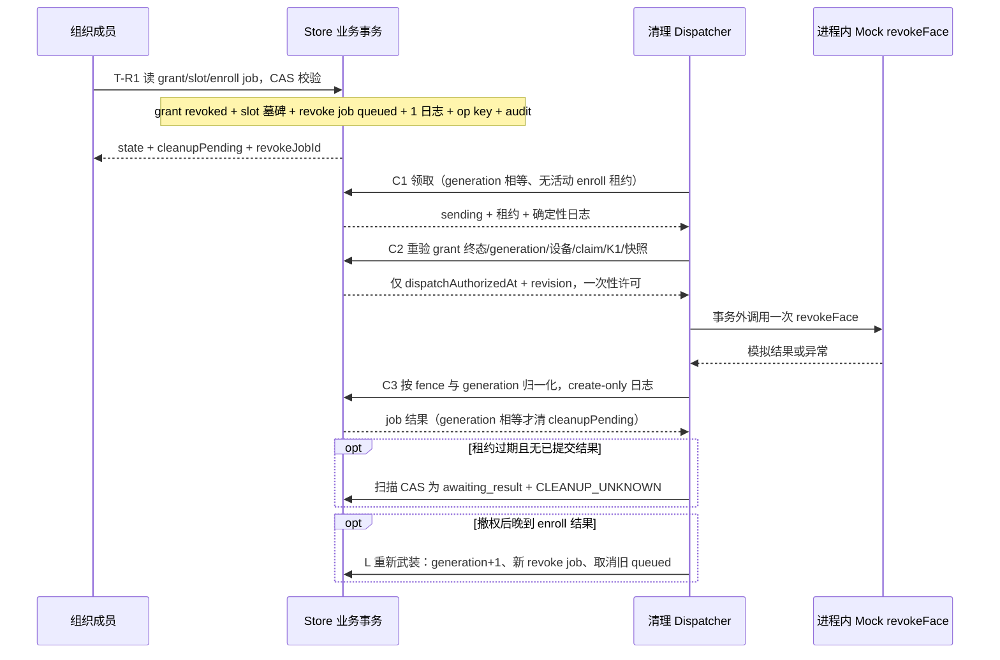
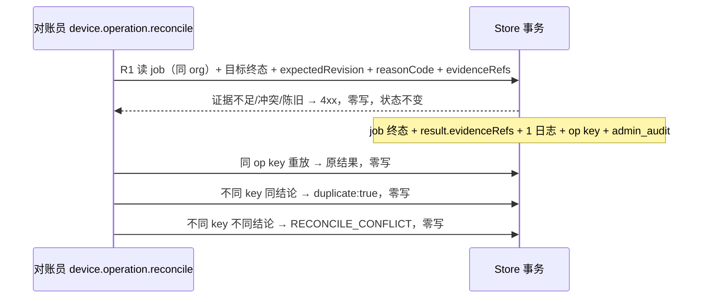

# HK-AI-04 H4 撤权、异步清理与未知结果对账契约

设计提案，待 Codex 批准。代码证据固定在 `9e5ff91b9820468c7991f7f444943aa202cc0bc2`；任务卡固定在 `8270fb5e97fb07371cff1280a179fb0a6c25e48b`；H3 已批准设计与验收证据固定在 `ccd6d087527e46e674653ffdf22b22d7390b7e3f` 与 `9e5ff91b9820468c7991f7f444943aa202cc0bc2`。

本轮只设计：不修改代码或测试、不调用 Mock 或真实 Provider、不注册 HTTP、不接生产或云数据库、不连接或写入设备、不合并 `main`。设计批准前不开始编码。

## 当前证据

- 状态机 [state.mjs](../../admin-web/lib/face-service/state.mjs) 第 19–25 行给出 grant 边（`pending→effective/revoked`、`effective→suspended/revoked/expired`、`suspended→…`、`revoked`/`expired` 为终态，且缺 `pending→expired`）；第 27–40 行给出 job 边（`sending` 无 `cancelled` 出边，第 29–34 行；`awaiting_result` 可到三种结果态，第 35 行；`queued`/`retryable_failed` 可到 `cancelled`，第 28、36 行）。第 53–63 行为唯一断言入口。第 65–82 行 `evidenceVerified` 要求 `trusted`、`kind=device_ack`、`source=device`、`evidenceScope=device_verified`。第 84–117 行 `projectAccess`：第 85–86 行 `businessAllowed` 只取 grant `effective` 与当轮资格，**不读 `validFrom`/`validUntil`**；第 97–103 行 `deviceEffective` 以 `businessAllowed` 为前提。
- DTO [dto.mjs](../../admin-web/lib/face-service/dto.mjs) 第 34–50 行冻结 grant/job 枚举；第 197–205 行凭证展示；第 208 行 `publicAccessState` 已接受 `cleanupPending` 入参；第 216–224 行给出 `revoking`/`revoked`/`failed`/`awaiting_result`/`active`/`simulated`/`pending_sync` 优先级，但**没有清理失败分支**；第 254–263 行 `publicJobResult` 读 `job.failureReason`，而 H3 job 实际写 `result`（[dispatcher.mjs](../../admin-web/lib/face-service/dispatcher.mjs) 第 113 行），故失败原因当前恒为 `null`。
- 服务层 [service.mjs](../../admin-web/lib/face-service/service.mjs) 第 561–566 行 `revoke` 仅做权限与 `grantId` 形状检查后返回 `STAGE_CLOSED`/501；第 432–433 行对**任何已存在的 slot 记录**（含 `released` 墓碑）直接返回 `GRANT_SLOT_CONFLICT`；第 437–445、446–452、453–457 行分别是 grant/job/slot 记录形状；第 481–507 行是创建原子写集；第 337–338 行固定 `deterministicLogId(jobId,"queued")` 与 `snapshotIdFor(jobId)`；第 100–128 行是 operation key 与合法重放机制。
- 集合规则 [collections.mjs](../../admin-web/lib/face-service/collections.mjs) 第 49–52 行 job `action` 已允许 `revoke`；第 411–426 行 `releaseClaim` 只适用于 `device_claims`——第 415 行断言 `record.grantId` 且第 419 行写回 `grantId`，而第 570–572 行明确禁止 slot 出现 `grantId` 字段，**故现状没有可用的 slot 释放 helper**；第 429–444 行 `isReclaimable`；第 447–452 行确定性日志 ID（`log:` 加 jobId、state 的 base64url 编码段与 occurrence）；第 455–468 行 `leasePatch`；第 493–503 行 claim/slot 字段白名单；第 533–566、568–589 行两类墓碑校验；第 65–93 行 `validateRecord` 只做必填/枚举校验，**grant 无字段白名单**。全库仅测试引用 `releaseClaim`/`isReclaimable`，生产路径未使用。
- 派发器 [dispatcher.mjs](../../admin-web/lib/face-service/dispatcher.mjs) 第 26–30 行 `JOB_FIELDS` 共 21 项；第 43–76 行 `assertJob` 要求 `action==="enroll"`（第 53 行）且字段集合精确等于该 21 项（第 57 行）；第 84–89 行 `checkFence`（含 `expired` 分支）；第 91–107 行 `transition` 硬编码 `action:"enroll"`（第 97 行）与 `evidenceScope:"simulated"`（第 100 行）；第 244–272 行 T2 要求 grant 仍为 `pending`（第 246 行）；第 280–340 行为三轮 `BLACKLIST_RETRY`；第 354–394 行 Provider 调用在事务外、10 秒超时即 `UNKNOWN_RESULT`；第 396–404 行过期转 `awaiting_result`；第 406–424 行扫描只选 `state==="sending"`（第 411–412 行）；第 426–450 行人工重排要求 `device.operation.retry` 且仅 `retryable_failed`。
- 存储 [store.mjs](../../admin-web/lib/store.mjs) 第 206–214 行可信派发时钟（单调、安全整数、回拨即 503）；第 215–218 行 `transactFaceDispatch` 限 90 refs；第 219–269 行 `LocalStore` 事务：dispatch 模式空写集直接返回（第 231 行）、**只允许写 `device_operation_jobs`/`device_operation_logs`**（第 241–244 行）、日志 create-only（第 245–248 行）、快照不可覆盖（第 238–240 行）、**不追加 `admin_audit`**（第 258 行条件是 `!dispatch`）、非 dispatch 模式自动填 `updatedAt`（第 253 行）。这是 H4 清理回写要写 grant 时的硬约束。
- 路由提案 [routes.mjs](../../admin-web/lib/face-service/routes.mjs) 第 34–39 行撤权、第 53–59 行对账均为描述表且未注册到 `server.mjs`（`server.mjs` 只有第 836–839 行的黑名单撤权）；第 57 行已冻结独立权限 `device.operation.reconcile`，第 50 行冻结 `device.operation.retry`。
- Mock [mock-provider.mjs](../../admin-web/lib/face-service/mock-provider.mjs) 第 26–34 行场景含 `revoke_fail`；第 71–77 行 `revokeFace`；第 79–86 行 `queryOperation`；第 135–183 行调用记录（第 149 行 `calls.push` 发生在任何失败判定之前）与幂等作用域（第 141 行）；第 192–201 行错误分类。派发器当前只调用 `enrollFace`（第 379 行）。
- 快照 [dispatch-snapshot.mjs](../../admin-web/lib/face-service/dispatch-snapshot.mjs) 第 4–5 行集合名与 `dispatch:<jobId>` 前缀；第 72–104 行 `snapshotIsBound` 要求 `schemaVersion===1` 与固定 18 字段，故 v2 清理快照不会被 enroll 路径误认。
- 证据工具：D 矩阵 [face-grant-d-matrix.test.mjs](../../admin-web/tests/face-grant-d-matrix.test.mjs) 第 375–392 行提供整库快照、内容级不变与 Provider 计数断言，第 1745–1756 行提供 H3 写集断言，第 1491–1505 行提供 H3 fixture。H3 验收证据 [H3 验收](HK-AI-04-H3-ACCEPTANCE-EVIDENCE-2026-11-12.md) 第 47–60 行沿用 Z/J/A/H 记号；[H3 契约](HK-AI-04-H3-LEASE-DISPATCH-DESIGN.md) 第 144 行定义其含义。
- 前置约束来源：[H3 契约](HK-AI-04-H3-LEASE-DISPATCH-DESIGN.md) 第 13 行记录 LOCK-01 第 143 行冻结「业务撤权先于异步设备清理」，以及 04A 第 37–60 行 Q04–Q09 冻结独立对账权限、三次重试与退避、保留关系与 Mock 边界。两份文档不在本仓库工作树内，按提交 `9f642bf0716f43c5cfd7c11b7e19f3a062a1da67` 与 `5e5c9676403f1efb79794c7843dae40c267b10a2` 引用，不建未经核对的本地链接。

## Q01 业务撤权

### 1.1 授权主体、可写范围与优先级

只有「显式撤权」和「内部到期扫描器」有权改变 grant 状态。资格失效只在**读取时**生效，不产生 grant 写；期限到达同样先读取时生效，是否再由内部扫描器落盘为 `expired` 见 Q07 待裁定 1。

| 主体 | 触发 | 可写 | 生效范围 | 证据 |
| --- | --- | --- | --- | --- |
| 组织成员，`device.access.manage` | 显式撤权请求 | grant 终态与撤权字段、slot 墓碑、revoke job、日志、operation key | 该 grant | service 第 561–566 行现状；第 83–89 行权限入口 |
| 内部到期扫描器，固定 `system` actor | `now ≥ grant.validUntil` | grant `expired` + 撤权字段 + revoke job | 该 grant | 新增；参照 dispatcher 第 406–424 行扫描形状 |
| 人员/实名/入住/周期/目录/主租/名单 | 任一失效 | **不可写**，只令读路径失效 | 该 grant | state 第 85–86 行；eligibility 第 41–46 行 |
| 凭证撤销 | `credential.reviewState=revoked` | **不可写** grant，只读失效；由凭证撤销入口写本凭证 | 该凭证下全部 grant | dto 第 20–26 行；service 第 241–296 行 |
| 设备归属变更或停用 | `ownerOrgId`/`orgId` 变更或 `status≠active` | 设备、owner claim、该设备全部 grant、slot | 该设备 | collections 第 520–531、591–600 行 |

同一提交点观察到多个原因时，写盘的 `revokeReason` 取固定优先级；**终态本身由提交先后决定，先提交者获胜，后到者零写拒绝**（与 grant 终态表一致）。优先级只影响原因与告警，不影响终态：

| 序 | `revokeReason` | 含义 | 备注 |
| ---: | --- | --- | --- |
| 1 | `user_revoke` | 组织成员显式撤权 | 唯一由人写入的原因 |
| 2 | `expired` | `validUntil` 到达 | 仅内部扫描器可写 |
| 3 | `device_retired` | 设备退役或归属变更 | 由归属变更事务写 |
| 4 | `credential_revoked` | 凭证被撤销 | 由凭证撤销事务写 |
| 5 | `eligibility_lost` | 资格失效被判定需要落盘 | 默认**不落盘**；见 Q07 待裁定 4 |

优先级 1 与 2 的竞争：`pending/effective/suspended → revoked` 与 `effective/suspended → expired` 都合法（state 第 20–22 行），二者对同一 grant 的 CAS 只能有一个提交；失败方返回 `INVALID_STATE`（目标已是 `revoked`/`expired`）或 `REVISION_CONFLICT`（revision 已变），零写。不允许把 `expired` 改写成 `revoked`，反之亦然。

### 1.2 业务即时失效与设备清理结果的分离

| 维度 | 业务授权（`businessAllowed`） | 设备状态（`deviceEffective` 与清理） |
| --- | --- | --- |
| 生效时点 | T-R1 提交即失效，与响应返回同一点 | 只有清理成功提交**且**存在受信设备证据后才可能为真 |
| 写入者 | 撤权事务 T-R1 | 清理 job 的 C3 fenced 回写 |
| 判定依据 | grant 终态 + 当轮资格 + 有效期 | `evidenceVerified`（state 第 65–82 行） |
| 失败后果 | 撤权不存在部分成功：事务失败即零变更，业务仍有效 | 清理失败或未知不回滚业务撤权，只能进 `awaiting_result` 并告警 |
| 合成可证性 | 完全可证 | 只能证明「已发起并记录清理」，不能证明设备已删除人脸 |

结论：`businessAllowed` 与「设备已被清理」是两个独立事实，任何代码路径不得用后者推导前者，也不得用前者宣告设备安全。

### 1.3 撤权事务 T-R1：refs、CAS、幂等键与审计写集

前置读取（事务外，仅用于生成 refs 与预期 revision）：grant、slot、该 grant 最近的 enroll job。**所有判定在事务内重做**，事务外读取只用于 refs 与快速失败。

| 槽位 | ref | 失败即整事务回滚 |
| --- | --- | --- |
| 1 | `device_access_grants/<grantId>` | 是 |
| 2 | `grant_slot_claims/<grant.slotId>` | 是 |
| 3 | `device_operation_jobs/<enrollJobId>`（存在时） | 是 |
| 4 | `device_operation_logs/<deterministicLogId(enrollJobId,"cancelled",enrollRevision+1)>`（仅取消时） | 是 |
| 5 | `device_operation_jobs/<revokeJobId>`（需要清理时） | 是 |
| 6 | `device_operation_logs/<deterministicLogId(revokeJobId,"queued")>`（同上） | 是 |
| 7 | `operation_keys/<opKey>` | 是 |
| 8–9 | `operation_key_domains/<headId>`、`<versionId>` | 是 |
| 10–11 | `organizations/<orgId>`、`org_memberships/<actor.membershipId>` | 是 |

共 11 条，远低于 90 上限（store 第 216 行、eligibility 第 17 行）。

**CAS 条件（全部满足才构造写计划）：**

1. 组织 `status==="active"`，成员 `status==="active"`、`orgId` 相符、主体 ID 相符、权限含 `device.access.manage`（沿用 service 第 143–147 行与 dispatcher 第 267–269 行判定）；
2. `grant.orgId===orgId`，`grant.revision===expectedRevision`，`grant.state∈{pending,effective,suspended}`；
3. `slot.state==="active"` 且 `slot.activeClaimId===grantId` 且 `slot.orgId===orgId`；否则 `GRANT_SLOT_CONFLICT`，**禁止按 slotId 盲写**；
4. enroll job（若存在）：`job.orgId===orgId` 且 `job.grantId===grantId`。仅当 `job.state==="queued"` 或 `"retryable_failed"` 时取消，且以事务内读到的 `job.revision` 为 CAS 基准；
5. 需要清理时，`revokeJobId` 由 `grantId`、`cleanupGeneration` 与目标 generation 确定性派生，且该 `_id` 在事务内必须不存在（create-only）。

任一读取记录损坏（`revision` 非正安全整数、未知字段、空白 ID）→ `INVALID_STATE`/`PARAM_ERROR`，零写。

**幂等键**：`operationKey({orgId, method:"face.grant.revoke", actorType, actorId, idempotencyKey, config})`（collections 第 232–239 行）；`requestDigest = SHA-256(stable({grantId, expectedRevision, reasonCode}))`（stable 排序见 service 第 52–53 行）。同键同摘要重放返回原 `result`、核心写集为空（service 第 115–128 行机制）；同键不同摘要 `CONFLICT`。

**审计写集（T-R1 恰好一次）：**

| 写 | 数量 | 说明 |
| --- | ---: | --- |
| `device_access_grants` | 1 | `state`、`revokeReason`、`revokedAt`、`revokedByActorId`、`cleanupPending`、`cleanupGeneration`、`revokeJobId`、`revision+1`、`updatedAt` |
| `grant_slot_claims` | 1 | `state:"released"`、`releasedAt`、`releasedByJobId`、`revision+1`、`updatedAt`，清除 `activeClaimId`（collections 第 583–587 行） |
| `device_operation_jobs` | 0–2 | 新建 revoke job（需要清理）与/或取消 enroll job |
| `device_operation_logs` | 1–2 | 各一条确定性日志，create-only |
| `operation_keys` | 1 | 不可变幂等记录 |
| `operation_key_domains` | 0–2 | 首次写入 head+version（collections 第 260–268 行） |
| `admin_audit` | 1 | 普通 `transact` 自动追加（store 第 258–263 行） |
| `face_credentials`/`file_assets`/`access_devices`/`device_claims`/`face_dispatch_snapshots` | 0 | 撤权事务不得写设备、凭证、文件或快照 |

### 1.4 设计与代码现状的差异

| # | 差异 | 证据 | 影响 |
| --- | --- | --- | --- |
| 1 | 投影不校验有效期，`validUntil` 到达不会自动失效 | state 第 85–86 行 | 业务撤权语义不完整；契约要求 `validFrom ≤ now < validUntil` 进入 `businessAllowed` |
| 2 | `revoke` 入口未实现，仅返回 501 | service 第 561–566 行 | H4 编码卡才能开放 |
| 3 | grant 记录没有撤权字段与 `cleanupPending` | service 第 437–445 行 | 需扩展 grant 白名单（见「字段白名单」） |
| 4 | 没有可用的 slot 释放 helper | collections 第 411–426 行与第 570–572 行冲突 | 需新增 `releaseGrantSlot`，否则 T-R1 无法释放槽位 |
| 5 | 没有到期扫描器与 `grant→expired` 写路径 | 无对应代码 | 期限到达只读失效可先落地，扫描器延后 |
| 6 | 派发事务禁止写 grant/slot | store 第 241–244 行 | 清理回写要么新增受控适配器能力，要么拆两段（见 Q02 待裁定 2） |
| 7 | 日志构造函数硬编码 `action:"enroll"` 与 `evidenceScope:"simulated"` | dispatcher 第 97、100 行 | 清理需要独立日志构造器，不得复用 |
| 8 | `assertJob` 要求 enroll 且 21 字段精确集合 | dispatcher 第 53、57 行 | revoke job 需要自己的断言函数与字段集合 |
| 9 | 同 cycle 撤权后无法重建授权 | service 第 432–433 行；[face-service-layer.test.mjs](../../admin-web/tests/face-service-layer.test.mjs) 第 498 行既有「released slot 也不得复用」 | 见 Q03 与待裁定 3 |
| 10 | 任务查询失败原因恒为 null | dto 第 254–263 行 vs dispatcher 第 113 行 | 见 Q05 与待裁定 8 |

## Q02 异步清理

### 2.1 revoke job 的建单、领取、重验、外部调用与回写

- **建单**：仅在 T-R1 内创建，`state="queued"`、`attempts=0`、`leaseGeneration=0`、`cleanupGeneration=grant.cleanupGeneration`、`snapshotId=revoke:<jobId>`、`provider="mock"`、`executionMode="test"`、`evidenceScope="simulated"`、`action="revoke"`。
- **领取（C1）**：独立短事务，`queued → sending`，写 `leasePatch`（collections 第 455–468 行）、`leaseGeneration+1`、`revision+1`、`attempts+1`，并写一条确定性 `sending` 日志；同时校验 `grant.cleanupGeneration===job.cleanupGeneration`，且该 grant 下**没有** `state==="sending"` 且 `now < leaseExpiresAt` 的 enroll job（否则 `RETRY_NOT_DUE`，不消耗 attempt）。
- **发送前重验（C2）**：独立短事务，顺序为 job/fence → grant 终态与 generation → 设备/owner claim/K1 → 快照绑定。成功只写 `dispatchAuthorizedAt` 与 `revision`，返回一次性、进程内、提交后即消费的许可。
- **事务外调用**：`revokeFace({grantId, credentialId}, context)`（mock-provider 第 71–77 行；`assertRevokeInput` 见 dto 第 167–172 行），`context.idempotencyKey` 为 `h4-v1:` 加 `[orgId, grantId, "revoke", cleanupGeneration, attempts]` 的 SHA-256，与 enroll 使用不同版本前缀。
- **fenced 回写（C3）**：按 fence 与 generation 点读 job、grant，写结果态、清租约、写确定性日志；**只有 generation 相等且结果 `succeeded` 时才把 `cleanupPending` 置 false**。

### 2.2 撤权时 enroll 各状态的行为裁定

「需要清理」的判据独立于 grant 状态：

> `cleanupRequired(grant) ⇔ ∃ enroll job e：e.grantId=grantId 且 e.state ∈ {sending, awaiting_result, succeeded}`

`queued` 不在其中：`queued` 只可能来自「从未领取」或「每次 attempt 都以**已证明未发送**的 pre-send 失败结束」（dispatcher 第 118–130、223–232 行；`UNKNOWN_RESULT` 一律进 `awaiting_result`，第 128 行），因此可证明设备未被写过。

| 撤权瞬间 enroll 状态 | 是否取消 enroll | 是否建 revoke job | revoke job 初态 | 依据与保护 |
| --- | --- | --- | --- | --- |
| 缺失 | 否 | 否 | — | 从未派发 |
| `queued`（attempts=0） | 是，`queued→cancelled` | 否 | — | state 第 28 行；CAS on `job.revision` |
| `queued`（attempts>0，结果 `RETRYABLE`） | 是，`queued→cancelled` | 否 | — | 此前 attempt 均已证明未发送；第 28、36 行 |
| `retryable_failed` | 是，`retryable_failed→cancelled` | 否 | — | 第 36 行；同上可证未发送 |
| `sending`（租约有效） | **否**（无 `sending→cancelled` 边） | 是 | `queued`，`nextAttemptAt=job.leaseExpiresAt` | state 第 29–34 行；C1 以「无活动租约」为门 |
| `sending`（租约已过期） | 否 | 是 | `queued`，`nextAttemptAt=now` | 由扫描先转 `awaiting_result`，见 2.4 |
| `awaiting_result` | 否 | 是 | `queued`，`nextAttemptAt=now` | 发送阶段可能已发生；宁可多清一次 |
| `succeeded` | 否 | 是 | `queued`，`nextAttemptAt=now` | 合成下只证明模拟写入；清理同样是模拟 |
| `terminal_failed`（`reasonCode` 为 `DEVICE_REJECTED`） | 否 | 否 | — | 设备明确拒绝，未写入 |
| `terminal_failed`（由对账裁定为「发送后未知」） | 否 | 是 | `queued`，`nextAttemptAt=now` | 保守：未知即视为可能已写入 |
| `cancelled` | 否 | 否 | — | 终态且从未发送 |

### 2.3 撤权与晚到 enroll 结果的竞态（核心裁定）

业务撤权先提交、enroll 的 T3 后提交时，T3 不会被 fence 拒绝（`checkFence` 只看 job 自身字段，dispatcher 第 84–89 行），因此必须为这条路径定义原子补偿：

1. **T3 照常写**本 job 的结果与日志（不改写 grant 的业务状态，grant 保持 `revoked`）。
2. **同一事务内重新武装清理**：若 grant 已非 `pending`，则 `grant.cleanupGeneration+1`、`cleanupPending=true`，并写入**新** revoke job（generation 取新值）与其 `queued` 日志。
3. 若同 grant 存在仍在 `queued` 的旧 revoke job，同一事务将其 `queued→cancelled` 并写日志；若旧 job 已在 `sending`，不取消——它会在 C2/C3 因 generation 不等被 `CLEANUP_SUPERSEDED` 拒绝，随后过期进入 `awaiting_result`，由扫描/对账收敛。
4. **方向原则：宁可多次清理，不可少一次清理。** 设备侧删除是幂等的；漏清则不可接受。
5. `deviceEffective` 不会因此误报：`projectAccess` 第 98 行要求 `businessAllowed`，而 `revoked` 使之为 false。

由此得到两条不变量：

- 不变量 A：`grant.state∈{revoked,expired}` 时，任何新提交的 `enroll.succeeded` 都必须在同一提交内把 `cleanupPending` 置 true。
- 不变量 B：`cleanupPending=false` 只能由 generation 相等的清理成功提交写入。

### 2.4 何时需要清理、何时可取消、重复请求如何合并

| 场景 | 裁定 |
| --- | --- |
| 需要清理 | 见 2.2 判据；另加「存在 `device_verified` 证据」时无条件需要（H5 起生效） |
| 可取消 | 仅 `queued` 且满足任一：已被更高 generation 取代；对账已裁定「从未发送」；grant 恢复到可派发状态（H4 不可达） |
| 不可取消 | `sending` 一律不可取消（结果未知）；`awaiting_result` 不可取消，只能由对账裁定 |
| 重复撤权请求 | 共享同一 `revokeJobId`；不同幂等键的重复请求返回同一 `revokeJobId` 且 `duplicate:true`，零写、零 Provider、零日志 |
| 重复清理请求 | 同 grant 的清理串行化于 `cleanupGeneration`；同 generation 多请求由 C1 的 job CAS 合并，仅一次领取 |
| 租约过期 | 扫描把 `sending` 转 `awaiting_result` 并写 `CLEANUP_UNKNOWN` 告警，双扫描仅一次提交 |

## Q03 槽位与归属

### 3.1 职责、释放条件与并发保护

| 对象 | 职责 | 创建 | 释放条件 | 并发保护 | 禁止 |
| --- | --- | --- | --- | --- | --- |
| grant slot `grant_slot_claims` | 固定 `(org, person, device, cycle)` 上唯一有效授权的绑定 | createGrant 同事务（service 第 432–433、453–457 行） | grant 撤权或到期，**仅**在 `state==="active"` 且 `activeClaimId===grantId` 时 | CAS `state`+`activeClaimId`+`revision`；T-R1 与 C3 都不得按 slotId 盲写 | 删除记录、复用 `released` 墓碑、释放他人 slot |
| owner claim `device_claims` | 设备所有权：`ownerOrgId`、`boundDeviceId`、provider/digestRealm/`keyVersion` | 设备接入（H2-b） | 设备退役、归属变更、K1 换钥；需 `releasedByAuditId` 与 `releaseReason` | 校验 `state`+`boundDeviceId`+`keyVersion`（collections 第 591–600 行） | 撤权时释放；撤权事务写入即违约 |

**关键区分**：owner claim 是设备级、跨 grant 共享；grant 撤权只释放**本 grant 的 slot**，绝不触碰 owner claim。否则同设备其他人的撤销会连坐（collections 第 591–600 行的匹配条件正是为设备级复用而设）。

### 3.2 同 cycle、跨 cycle、归属变更与旧清理触及新授权

| 情形 | 现状 | H4 裁定 |
| --- | --- | --- |
| 同 cycle 撤权后重建 | 新 grant 计算同一 `slotId`；service 第 432–433 行对**已存在的 released 墓碑**也返回 `GRANT_SLOT_CONFLICT`；`face-service-layer.test.mjs` 第 498 行已冻结「released slot 也不得复用」 | 冻结为「同 cycle 撤权后不可立即重建」，必须走新 cycle 或受控迁移；是否放开墓碑复用留待裁定 3 |
| 跨 cycle 新建 | `slotId` 含 `cycleId`（collections 第 160–165 行），新 cycle ⇒ 新 `slotId` | 允许；旧 grant/旧 slot/旧清理 job 与新授权无键重叠 |
| 设备归属变更 | 无实现 | 独立审计事务，要求该设备无活动租约、无未决 `awaiting_result`；写设备归属、owner claim 墓碑、旧 org 全部 grant 撤权、slot 墓碑（写集 O，见矩阵 S07） |
| 旧清理触及新授权 | 无实现 | 三重 fence：`grantId` + `cleanupGeneration` + `slot.assignee`；清理回写 slot 必须 CAS `activeClaimId===job.grantId`；generation 不等一律 `CLEANUP_SUPERSEDED` 零写 |

旧清理任务要能「触及」新授权，必须同时满足：slotId 相同（仅同 cycle）、`activeClaimId` 已变（说明新 grant 占位）、generation 相同。第 3 个条件把窗口压到「同一 generation 内」，而新 grant 必然带新 generation，因此不可达；即便前两个条件成立，C3 的 `activeClaimId` CAS 也会拒绝。

## Q04 未知结果对账

### 4.1 三种动作的边界

| 动作 | 权限 | 是否写 | Provider | 允许的前置状态 |
| --- | --- | --- | --- | --- |
| 只读查询 | `device.audit.read` | 零写 | 至多 1 次 `queryOperation`，仅显式人工触发 | 任意 |
| 人工终态裁定 | `device.operation.reconcile` | job 终态 + 结果 + 1 日志 + op key + `admin_audit` | 0 | 仅 `awaiting_result` |
| 重试 | `device.operation.retry` | job 回 `queued` + 1 日志 | 0 | 仅 `retryable_failed` 且已到 `nextAttemptAt` |

裁定**只允许终态**：目标严格限定 `succeeded` 或 `terminal_failed`。`awaiting_result→retryable_failed` 虽在状态机内（state 第 35 行），但 H4 明确禁止——它会把「可能已发送」重新变成可派发，等于自动重发。该收紧需要显式守卫，不能只靠状态机。

**强制输入**（缺一即拒绝，零写）：

| 输入 | 约束 | 校验点 | 依据 |
| --- | --- | --- | --- |
| 同组织 | 请求 `orgId` 必须等于 `job.orgId`；跨组织与缺失同态返回 `NOT_FOUND` | 事务内点读 | dispatcher 第 44 行、第 220 行 |
| 目标版本 | `expectedRevision` 必须等于事务内读到的 `job.revision` | 事务内 CAS | 与 `requeue` 第 441–442 行同构 |
| 原因 | `reasonCode` 取固定枚举短码，≤64 字符 | 白名单校验 | 字段白名单「对账结果」行 |
| 证据引用 | `evidenceRefs` 1–8 条，每条只含 ID 与摘要 | 存在性、同组织、摘要、一致性、顺序 | 4.2 表 |
| 不可变审计 | 确定性日志 create-only + `admin_audit` 恰好一条 + 证据记录不可变 | 日志冲突即回滚 | store 第 245–248 行、第 258 行 |

### 4.2 证据充分性、状态与可重试条件

证据以**引用**形式提交：`evidenceRefs[]` 最多 8 条，每条 `{evidenceId, kind, sourceDigest, observedState, observedAt, sequence}`；内容不复制，只存引用与摘要。

| 证据情形 | 返回值 | job 状态 | 写集 |
| --- | --- | --- | --- |
| 缺失或空数组 | `EVIDENCE_REQUIRED` 409 | 保持 `awaiting_result` | Z |
| 跨组织或不存在 | `NOT_FOUND` 404（与缺失同态） | 保持 | Z |
| `sourceDigest` 不匹配或不合法 | `EVIDENCE_INVALID` 409 | 保持 | Z |
| 多条证据 `observedState` 不一致 | `EVIDENCE_CONFLICT` 409 + `RECONCILE_EVIDENCE_CONFLICT` 告警 | 保持 | Z |
| `max(sequence) ≤ 已裁定 sequence` | `EVIDENCE_STALE` 409 | 保持 | Z |
| 充分、一致、顺序有效 | 成功 | 目标终态 | X |

「可重试」仅指：修正证据后可用**新**幂等键再次提交。原请求不自动重试，也不进入自动队列。

### 4.3 重复、乱序与冲突证据

| 情形 | 结果 | 写集 |
| --- | --- | --- |
| 同 op key 同摘要 | 返回原结果 | Z |
| 不同 op key、结论与已提交终态相同 | `duplicate:true`，返回既有终态 | Z |
| 不同 op key、结论不同 | `RECONCILE_CONFLICT` 409，保留原终态 | Z |
| job 已终态 | `INVALID_STATE` 409 | Z |
| 目标 `retryable_failed` | `TERMINAL_ONLY` 409 | Z |
| 确定性日志 ID 已存在 | 整事务回滚，原日志不变 | Z |

### 4.4 禁止自动重发 `awaiting_result`

`awaiting_result` 不得被以下任一路径推动：`#claim`（只接受 `queued`，dispatcher 第 228 行）、`scanExpired`（只选 `sending`，第 411–412 行）、`requeue`（只接受 `retryable_failed`，第 441–443 行）、任何退避或定时器。H4 重申：离开 `awaiting_result` 的唯一路径是人工对账，且只能到终态。H4 不新增自动 query、不新增轮询回调、不新增网络入口。

## Q05 结果与展示

### 5.1 迁移与写集

| 轴 | 来源 → 目标 | 条件 | 原子写集 |
| --- | --- | --- | --- |
| grant | `pending/effective/suspended → revoked` | T-R1 CAS | G / G∅ / GC（见矩阵记号） |
| grant | `effective/suspended → expired` | 到期扫描 CAS | G 变体：grant + revoke job + 日志 + op key + audit |
| grant | `pending → expired` | **当前非法**（state 第 20 行无此边） | 待裁定 1 |
| grant | `revoked/expired → *` | 终态 | 无 |
| revoke job | 无 → `queued` | T-R1 内 create-only | 含于 G |
| revoke job | `queued → sending` | C1 CAS | J |
| revoke job | `queued/retryable_failed → cancelled` | 被取代或对账判定从未发送 | J |
| revoke job | `sending → succeeded` | C3 且 generation 相等 | K |
| revoke job | `sending → retryable_failed/terminal_failed/awaiting_result` | C3 分类 | J |
| revoke job | `retryable_failed → queued` | 到期 + `device.operation.retry` | J |
| revoke job | `sending → awaiting_result` | 租约过期扫描 | J |
| revoke job | `awaiting_result → succeeded/terminal_failed` | 仅人工对账 | X |
| `cleanupPending` | `false → true` | T-R1 或晚到结果 L | 含于 G / L |
| `cleanupPending` | `true → false` | 仅 C3 且 generation 相等且 `succeeded` | K |
| `displayState` | 见 5.2 | 读时投影，零写 | Z |

### 5.2 展示投影表

除 `revoke_failed` 一行外，其余各行沿用现有实现（dto 第 216–224 行）；`revoke_failed` 为新增分支，需要新增输入（待裁定 5）。

| `cleanupPending` | grant | 清理 job | `displayState` | 备注 |
| --- | --- | --- | --- | --- |
| true | 任意 | 任意非 `terminal_failed` | `revoking` | 现有第 218 行 |
| false | `revoked`/`expired` | 无 | `revoked` | 现有第 219 行 |
| false | 任意 | `terminal_failed` | `revoke_failed` | **新增**；否则无法区分「进行中」与「已失败」 |
| false | `effective` | — | `failed`（job `terminal_failed`） | 现有第 220 行 |
| false | 任意 | — | `awaiting_result` | 现有第 221 行 |
| false | `effective` + job `succeeded` + `device_verified` | — | `active` | 现有第 222–223 行 |
| false | `effective` + job `succeeded` + `simulated` | — | `simulated` | 现有第 222–223 行 |
| false | `pending` + 其他 | — | `draft` / `pending_sync` | 现有第 224 行 |

### 5.3 告警与失败处理

| `alertCode` | 触发 | 落点 |
| --- | --- | --- |
| `RESULT_UNKNOWN` | enroll 结果未知（沿用 H3） | 迁移日志 |
| `CLEANUP_UNKNOWN` | 清理 `awaiting_result` 或租约过期 | 迁移日志 |
| `CLEANUP_FAILED` | 清理 `terminal_failed` | 迁移日志 + `displayState=revoke_failed` |
| `CLEANUP_SUPERSEDED` | generation 不等被拒 | 只记被拒方日志，不改 job 状态 |
| `REVOKE_UNFINISHED` | `cleanupPending` 超阈值未完成 | 扫描日志；阈值待裁定 6 |
| `RECONCILE_EVIDENCE_CONFLICT` / `_INSUFFICIENT` | 证据冲突/不足 | 对账被拒日志 |
| `CONFIGURATION_BLOCKED` | 适配器能力或运行配置不可用 | 终态日志 |

失败处理原则：清理失败**不**回滚业务撤权；失败只体现为 `cleanupPending` 持续为 true 与告警，绝不静默。

### 5.4 幂等重放与 simulated 约束

- 每条写路径都以 operation key 收敛：T-R1、重排、对账各自独立的 `method` 与摘要；重放返回原结果且核心写集为空。
- 日志一律 create-only（store 第 245–248 行），同 ID 即回滚。
- 合成证据恒为 `simulated`：清理成功不得写 `device_verified`、不得生成 `device_ack`、不得把 grant 置 `effective`；`displayState` 在 `simulated` 下最高为 `revoking`/`revoked`/`simulated`，永远不得为 `active`（state 第 70 行、dto 第 222–223 行）。

## Q06 数据约束

### 6.1 安全整数与 ID

- `revision`/`schemaVersion`/`keyVersion`/`cleanupGeneration` 为正或非负安全整数；时间、`attempts`、`epoch`、`sequence` 为非负安全整数；任何递增/相加在运算前检查上界（参照 dispatcher 第 48–52 行、collections 第 403–408 行）。
- 所有 ID 为有界不透明值（1–128，`[A-Za-z0-9._:-]`，参考文献 dto 第 59–67 行）；禁止空白、控制字符、路径分隔符。
- 未知字段、隐式类型转换、多余字段一律拒绝（参照 dispatcher 第 46、57 行与 collections 第 505–509 行）。

### 6.2 保留与清理关系

- 保留组：grant + 全部 revoke job + 全部迁移日志 + 证据记录 + operation key + 撤销快照。operation key 与证据不得早于其所属 job 的审计保留期删除。
- 合成数据的清理期限与真实数据的保留期限分离，具体期限待裁定 7。
- 删除/清理本身必须是可审计的受控操作，禁止级联删除改变既有 grant 终态。

### 6.3 禁止复制的内容

设备凭据与序列号、K1/K2 密钥与摘要原值、文件字节/`objectKey`/物理位置、生物识别材料与特征、原始 Provider 请求或响应、异常 message/stack、原始用户幂等键、证件号码与联系方式。仅允许：内部记录 ID、枚举短码、64 位十六进制摘要、安全整数时间戳。

## 字段白名单

| 对象 | 白名单 | 约束 |
| --- | --- | --- |
| grant（扩展后） | `_id`、`orgId`、`revision`、`credentialId`、`personId`、`deviceId`、`occupancyId`、`cycleId`、`claimId`、`slotId`、`state`、`evidenceScope`、`validFrom`、`validUntil`、`revokeReason`、`revokedAt`、`revokedByActorId`、`revokeJobId`、`cleanupPending`、`cleanupGeneration`、`createdAt`、`updatedAt` | 现状 15 字段（service 第 437–445 行）加 6 个撤权字段，连同 `_id` 共 22 项；`revokeReason` 取 5 值枚举；`revokeJobId`/`revokedAt`/`revokedByActorId` 在非终态必须为 `null` |
| revoke job | `_id`、`orgId`、`revision`、`action`（固定 `revoke`）、`grantId`、`credentialId`、`deviceId`、`state`、`executionMode`（`test`）、`provider`（`mock`）、`evidenceScope`（`simulated`）、`snapshotId`、`attempts`、`leaseGeneration`、`leaseOwner`、`leaseExpiresAt`、`dispatchAuthorizedAt`、`nextAttemptAt`、`cleanupGeneration`、`sourceEnrollJobId`、`result`、`createdAt`、`updatedAt` | 与 enroll job 同形但字段集合独立；`attempts` ≤ 4；`leaseGeneration===attempts`；仅 `sending` 有 owner/expiresAt |
| 撤销快照 v2 | `_id`（`revoke:<jobId>`）、`schemaVersion`（2）、`orgId`、`jobId`、`grantId`、`credentialId`、`personId`、`deviceId`、`claimId`、`slotId`、`sourceEnrollJobId`、`sourceEnrollRevision`、`cleanupGeneration`、`domainHeadId`、`domainVersionId`、`restriction`（固定 `face.revoke`）、`versions`、`createdAt` | 不可覆盖（store 第 238–240 行）；`versions` 每项 `{collection,id,present,revision,epoch,keyVersion}`；禁止整条源记录 |
| 清理结果 | `attempt`、`outcome`、`errorKind`、`reasonCode`、`finishedAt` | `outcome` 与 job 状态严格绑定；`errorKind` 仅 `PRE_SEND_BLOCKED`/`RETRYABLE`/`UNKNOWN_RESULT`/`TERMINAL`/`NOT_CONFIGURED`；成功时错误字段 `null` |
| 对账结果 | 上述清理结果字段 + `evidenceRefs`（≤8 个 ID）、`decidedByActorId`、`decidedAt` | 证据只存 ID，不存内容 |
| 证据记录 | `_id`、`orgId`、`jobId`、`kind`、`sourceDigest`（64 hex）、`observedState`、`observedAt`、`sequence`、`evidenceScope`、`createdAt` | 不可变；`kind` 仅 `mock_event`/`provider_query`/`operator_attestation`/`device_ack`；不含任何原始载荷 |
| operation log | 沿用 H3 形状：`_id`、`orgId`、`jobId`、`action`、`fromState`、`state`、`actorType`、`actorId`、`at`、`revision`、`attempt`、`leaseGeneration`、`evidenceScope`、`errorKind`、`reasonCode`、`alertCode` | 不新增字段；`reasonCode`/`alertCode` ≤64 字符枚举短码；日志构造器必须按 job 的 `action` 取值，不得沿用硬编码 |
| 幂等记录 `operation_keys` | `orgId`、`realm`、`keyVersion`、`requestDigest`、`result`、`createdAt` | 不可变；`result` 只含 ID 与枚举 |

## 状态迁移与事务时序

### 事务阶段

| 阶段 | 事务 | 关键写 | 禁止 |
| --- | --- | --- | --- |
| T-R1 | 普通 `transact`（自动 audit） | grant、slot、revoke job、日志、op key、domain | 写设备/凭证/文件/快照/owner claim |
| C1 | `transactFaceCleanup`（待裁定 2） | revoke job、日志 | 写 grant；消耗 attempt 而拒单 |
| C2 | `transactFaceCleanup` | 仅 `dispatchAuthorizedAt`+`revision` | 写 grant、写日志、调用 Provider |
| C3 | `transactFaceCleanup` | revoke job、日志、必要时 `cleanupPending` | 越过 generation 清 `cleanupPending` |
| L | `transactFaceCleanup` | enroll job、日志、grant 计数、新 revoke job、取消旧 queued | 复活业务授权 |
| R1 | 普通 `transact`（自动 audit） | job 终态、结果、日志、op key、domain | 复制证据内容、改 grant |

## 测试矩阵

以下均为未来合成用例。本轮只设计。写集记号：`Z` 全库内容级零变化（含 `admin_audit`、`operation_keys`、证据）；`G` grant+slot 墓碑+新 revoke job+1 queued 日志+op key+domain+1 audit；`G∅` 同 `G` 但无 revoke job；`GC` `G∅`+取消 enroll+1 cancelled 日志；`H` H2 创建写集加一条 dispatch snapshot（沿用 H3 第 144 行）；`J` 仅 job+一条确定性日志；`A` 仅 job 的 `dispatchAuthorizedAt`+revision；`K` job+日志+grant `cleanupPending`；`L` enroll job+日志+grant 计数+新 revoke job+新日志；`X` job 终态+日志+op key+domain+1 audit；`O` 设备+owner claim+旧 org 各 grant+slot+revoke job+日志+op key+1 audit。Provider 列为本阶段 `revokeFace`（R/C/S/P 组）或 `queryOperation`（X01）入口增量；`enrollFace` 另计。

### 撤权事务（Q01）

| ID | 前置 | 注入点 | 预期 | Provider | 写集 |
| --- | --- | --- | --- | ---: | --- |
| R01 | grant `pending`，enroll `succeeded` | T-R1 正常提交 | `revoked`、`cleanupPending=true`、`revokeReason=user_revoke`、revoke job `queued` | 0 | G |
| R02 | grant `pending`，无 enroll job | T-R1 正常提交 | `revoked`、`cleanupPending=false`、无 revoke job | 0 | G∅ |
| R03 | grant `pending`，enroll `queued`（attempts=0） | T-R1 正常提交 | `revoked`、enroll `cancelled`、`cleanupPending=false` | 0 | GC |
| R04 | grant `pending`，enroll `retryable_failed` | T-R1 正常提交 | `revoked`、enroll `cancelled`、无需清理 | 0 | GC |
| R05 | grant `effective` + `device_verified` 证据 | T-R1 正常提交 | `revoked` + revoke job | 0 | G |
| R06 | grant `suspended` | T-R1 正常提交 | `revoked` | 0 | G/G∅ |
| R07 | 已 `revoked` | 不同幂等键重复撤权 | `duplicate:true`，返回原 `revokeJobId` | 0 | Z |
| R08 | 已 `expired` | 请求撤权 | `INVALID_STATE` | 0 | Z |
| R09 | `revision` 已变 | `expectedRevision` 过期 | `REVISION_CONFLICT` | 0 | Z |
| R10 | 另一 org 的 `grantId` | 跨组织撤权 | `NOT_FOUND`，与缺失同态 | 0 | Z |
| R11 | 成员缺 `device.access.manage` | 权限判定 | `FORBIDDEN` | 0 | Z |
| R12 | 成员在事务内被停用 | 事务内读成员 | `FORBIDDEN` | 0 | Z |
| R13 | 同 op key 同摘要 | 合法重放 | 原 `result`，核心写集为空 | 0 | Z |
| R14 | 同 op key 不同摘要 | 摘要冲突 | `CONFLICT` | 0 | Z |
| R15 | 已有同 ID 的 revoke `queued` 日志 | 日志冲突 | 整事务回滚，原日志不变 | 0 | Z |
| R16 | grant 含未知字段或 `revision` 非安全整数 | 记录损坏 | `INVALID_STATE`/`PARAM_ERROR` | 0 | Z |
| R17 | slot `activeClaimId` 指向他人 grant | 撤权释放槽位 | `GRANT_SLOT_CONFLICT`，整事务零写 | 0 | Z |
| R18 | 同设备其他 grant 的 owner claim 处于 `active` | 撤权事务 | owner claim 内容级不变 | 0 | G/G∅ |
| R19 | grant `pending` 且 `now ≥ validUntil` | 到期扫描与人工撤权并发 | 仅一方提交，另一方 `INVALID_STATE`/`REVISION_CONFLICT` | 0 | Z 或 G |
| R20 | 撤权事务 callback 重跑 | 事务重入 | 仅一条 revoke `queued` 日志，一条 audit | 0 | G |

### 清理 job（Q02）

| ID | 前置 | 注入点 | 预期 | Provider | 写集 |
| --- | --- | --- | --- | ---: | --- |
| C01 | revoke job `queued` | C1 正常提交 | `sending`、`attempts=1`、`leaseGeneration=1` | 0 | J |
| C02 | `queued` | 两个 worker 同 revision 并发 C1 | 一胜一拒 `INVALID_JOB` | 0 | J |
| C03 | enroll 仍 `sending` 且租约未到期 | C1 领取 | `RETRY_NOT_DUE`，不消耗 attempt | 0 | Z |
| C04 | 清理 `sending`，租约到期 | 扫描 | `awaiting_result` + `CLEANUP_UNKNOWN` | 0 | J |
| C05 | 清理 `sending`，双扫描并发 | 两次扫描 | 仅一次提交 | 0 | J |
| C06 | 清理 `sending` 持有有效 fence | C2 正常提交 | 仅 `dispatchAuthorizedAt`+revision | 0 | A |
| C07 | C2 时 grant `cleanupGeneration` 已提高 | generation 校验 | `CLEANUP_SUPERSEDED` | 0 | Z |
| C08 | C2 时设备已不属本 org | 设备归属校验 | `terminal_failed`/`DEVICE_CLAIM_CONFLICT` | 0 | J |
| C09 | C2 通过，Mock `success` | C3 正常提交 | 清理 `succeeded`、`cleanupPending=false` | 1 | K |
| C10 | C2 通过，Mock `pre_send_fail` | C3 分类 | `retryable_failed` + 30 秒退避 | 1 | J |
| C11 | `attempts=4` 且 RETRYABLE | C3 分类 | `terminal_failed`/`RETRY_EXHAUSTED` | 1 | J |
| C12 | C2 通过，Mock `post_send_unknown` | C3 分类 | `awaiting_result` + `CLEANUP_UNKNOWN` | 1 | J |
| C13 | 清理 `sending` | 旧 generation 重投 | `LEASE_FENCE_REJECTED` | 0 | Z |
| C14 | 已有同 ID 结果日志 | 日志冲突 | 回滚零写 | 0 | Z |
| C15 | 清理 `queued` 且被更高 generation 取代 | 取消 | `cancelled` + 一条日志 | 0 | J |
| C16 | 清理 `retryable_failed` 已到期 | 缺 `device.operation.retry` | `FORBIDDEN` | 0 | Z |
| C17 | `retryable_failed` 未到期 | 人工重排 | `RETRY_NOT_DUE` | 0 | Z |
| C18 | C2 通过后 generation 被提高再 C3 | generation 在 C2/C3 之间变化 | 不清 `cleanupPending`，`CLEANUP_SUPERSEDED` | 1 | Z |
| C19 | 清理 `sending` | 迟到回写带错 attempt/revision | `LEASE_FENCE_REJECTED` | 0 | Z |
| C20 | 清理 `queued` | 事务 callback 重跑 | 仅一条 `sending` 日志 | 0 | J |

### 竞态与晚到结果（Q02.3）

| ID | 前置 | 注入点 | 预期 | Provider | 写集 |
| --- | --- | --- | --- | ---: | --- |
| L01 | grant `revoked`，清理 `queued` | enroll T3 提交 `succeeded` | `cleanupGeneration+1`、新 revoke job、旧 `queued` 取消 | 0 | L |
| L02 | grant `revoked`，清理 `sending` | enroll T3 提交 `succeeded` | generation+1、新 revoke job；旧 job 不取消，C2 起被拒 | 0 | L |
| L03 | grant `revoked`，清理 `succeeded`（已清 `cleanupPending`） | enroll T3 提交 `succeeded` | `cleanupPending` 重新为 true + 新 revoke job | 0 | L |
| L04 | grant `revoked` | enroll T3 提交 `UNKNOWN_RESULT` | 同样重新武装 | 0 | L |
| L05 | grant `revoked` | enroll T3 提交 `terminal_failed` | 不重新武装（设备明确拒绝） | 0 | J |
| L06 | grant `revoked`，清理 `succeeded` | 对账把 enroll 裁定为 `succeeded` | 同 L03 | 0 | L + X |
| L07 | grant `revoked` | 晚到 enroll 结果后读投影 | `businessAllowed=false`、`deviceEffective=false` | 0 | Z |
| L08 | grant `revoked`，存在两代清理 | 两代同时可领取 | 仅高 generation 可提交，低代 `CLEANUP_SUPERSEDED` | 0 | Z |
| L09 | grant `revoked`，清理 `queued` | 撤权事务 callback 重跑 | 不产生第二个 revoke job | 0 | Z |

### 槽位与归属（Q03）

| ID | 前置 | 注入点 | 预期 | Provider | 写集 |
| --- | --- | --- | --- | ---: | --- |
| S01 | slot `active` 且绑定本 grant | 撤权 | slot → `released` 墓碑，`revision+1`，清 `activeClaimId` | 0 | 含于 G |
| S02 | slot `activeClaimId` 指向他人 grant | 撤权 | `GRANT_SLOT_CONFLICT`，零写 | 0 | Z |
| S03 | 同 cycle 已撤权 | 再次 `createGrant` | `GRANT_SLOT_CONFLICT`（冻结现状） | 0 | Z |
| S04 | 新 cycle，同 person/device | `createGrant` | 新 `slotId`，成功 | 0 | H |
| S05 | 旧清理 job 回写，slot 已被新 grant 占用 | `activeClaimId` CAS | `CLEANUP_SUPERSEDED` 零写 | 0 | Z |
| S06 | 设备存在 `sending` 租约 | 设备归属变更 | 拒绝，零写 | 0 | Z |
| S07 | 设备无活动租约 | 归属变更事务 | 设备+owner claim+旧 org grant+slot+清理 job | 0 | O |
| S08 | 撤权事务 | 断言 owner claim | 内容级不变 | 0 | G |
| S09 | owner claim 释放缺 `releasedByAuditId`/`releaseReason` | 记录校验 | 校验失败，零写 | 0 | Z |
| S10 | 清理完成，设备仍属本 org | C3 回写 | owner claim 内容级不变 | 1 | K |
| S11 | slot `released` 墓碑 | 任何路径尝试再次占用同 slotId | 拒绝，墓碑保留 | 0 | Z |

### 未知结果对账（Q04）

| ID | 前置 | 注入点 | 预期 | Provider | 写集 |
| --- | --- | --- | --- | ---: | --- |
| X01 | job `awaiting_result` | 只读查询 | 返回投影，零写 | 1 | Z |
| X02 | 缺 `device.operation.reconcile` | 对账 | `FORBIDDEN` | 0 | Z |
| X03 | 另一 org 的 `jobId` | 跨组织对账 | `NOT_FOUND` | 0 | Z |
| X04 | `evidenceRefs=[]` | 证据不足 | `EVIDENCE_REQUIRED`，状态不变 | 0 | Z |
| X05 | 证据摘要不匹配 | 摘要校验 | `EVIDENCE_INVALID` | 0 | Z |
| X06 | 两条证据 `observedState` 冲突 | 一致性校验 | `EVIDENCE_CONFLICT` + 告警，状态不变 | 0 | Z |
| X07 | `sequence` 不大于已裁定值 | 顺序校验 | `EVIDENCE_STALE` | 0 | Z |
| X08 | 证据充分，裁定 `succeeded` | R1 正常提交 | job `succeeded` + `evidenceRefs` + 1 日志 + 1 audit | 0 | X |
| X09 | 证据充分，裁定 `terminal_failed` | R1 正常提交 | job `terminal_failed` + 1 日志 + 1 audit | 0 | X |
| X10 | 已裁定，同 op key 重放 | 重放 | 原结果，零写 | 0 | Z |
| X11 | 已裁定，不同 key 同结论 | 重复对账 | `duplicate:true`，零写 | 0 | Z |
| X12 | 已裁定，不同 key 不同结论 | 冲突对账 | `RECONCILE_CONFLICT`，保留原终态 | 0 | Z |
| X13 | job 已终态 | 再次对账 | `INVALID_STATE` | 0 | Z |
| X14 | `awaiting_result` | 目标 `retryable_failed` | `TERMINAL_ONLY`，状态不变 | 0 | Z |
| X15 | 对账日志 ID 已存在 | 日志冲突 | 回滚零写 | 0 | Z |
| X16 | `awaiting_result` | 任意调度/重试入口 | 拒绝，不自动重发 | 0 | Z |
| X17 | 对账与清理并发（同 grant） | 双向提交 | 至多一次清理成功，另一次 generation 被拒 | 0–1 | Z/K |

### 展示与幂等（Q05）

| ID | 前置 | 注入点 | 预期 | Provider | 写集 |
| --- | --- | --- | --- | ---: | --- |
| P01 | grant `revoked`，`cleanupPending=true` | 投影 | `revoking` | 0 | Z |
| P02 | grant `revoked`，`cleanupPending=false` | 投影 | `revoked` | 0 | Z |
| P03 | 清理 `terminal_failed` | 投影 | `revoke_failed`（新增分支） | 0 | Z |
| P04 | grant `effective` + 清理进行中 | 投影 | `revoking` 优先于等待结果 | 0 | Z |
| P05 | grant `expired` | 投影 | `revoked` | 0 | Z |
| P06 | grant `pending` + `succeeded` + `simulated` | 投影 | `simulated`，绝不为 `active` | 0 | Z |
| P07 | `evidenceScope=simulated` | 合成清理成功 | 不生成 `device_verified`/`device_ack` | 1 | K |
| P08 | 撤权后重复读取 | 多次投影 | 结果稳定、零写 | 0 | Z |

### 数据约束与内容级零写入（Q06）

| ID | 前置 | 注入点 | 预期 | Provider | 写集 |
| --- | --- | --- | --- | ---: | --- |
| D01 | 任意记录 | 注入未知字段 | 拒绝，零写 | 0 | Z |
| D02 | 任意记录 | 注入非安全整数/负数/溢出 | 拒绝，零写 | 0 | Z |
| D03 | 源记录与返回对象 | 注入序列号、文件路径、凭据、生物特征、原始 Provider 响应、异常栈、原始幂等键 | 均不进入快照/结果/日志/证据/投影 | 0–1 | Z |
| D04 | `evidenceRefs` 9 条或 ID 超 128 | 上限校验 | `PARAM_ERROR`，零写 | 0 | Z |
| D05 | 撤销快照已存在 | 重复 create | `CONFLICT`，原快照不变 | 0 | Z |
| D06 | 确定性日志已存在 | 任意写路径 | 回滚零写，原日志不变 | 0 | Z |
| D07 | `cleanupGeneration` 为 `Number.MAX_SAFE_INTEGER` | 递增 | 运算前失败关闭，零写 | 0 | Z |
| D08 | revoke job 的 `snapshotId` 不等于 `revoke:<jobId>` | 快照绑定校验 | `INVALID_JOB`，零写 | 0 | Z |
| D09 | 任意失败路径 | 全库内容级对照 | 记录、排序 ID、计数均不变（含 `admin_audit`） | 0 | Z |

## Q07 审批与分期

### 7.1 阶段边界

H4 编码卡须在本设计通过后单独发出。HTTP 注册、UI、server 接线、真实 Provider、网络回调、设备连接与写操作、真实清理确认、归属变更实现均在本轮范围外。

### 7.2 可由合成测试完全证明的语义

状态迁移与 CAS、幂等重放、日志确定性与 create-only、内容级零写、权限与跨组织同态、`cleanupGeneration` fencing、晚到结果重新武装、对账证据充分性与去重/乱序/冲突、`displayState` 优先级、白名单与敏感值不落库。上述语义的验收不依赖任何真实设备能力，编码卡可立即覆盖。

### 7.3 必须真实设备能力证据的前置条件

设备删除接口的幂等与「未找到」语义、设备离线时的清理排队上限、K1 换钥后能否清理旧摘要、`device_verified` 证据来源、真实对账的查询语义与证据可信度。任一未取得前，清理只能停留在 `simulated`，不得生成设备已删除的证明。

### 7.4 分期建议

H4a 合成清理全链路（job/租约/fence/重新武装/对账）→ H4b 展示与告警接线 → H5 真实设备证据、归属变更与对账证据源。分期以 7.3 的证据到位情况为门，不以日期为门。

### 7.5 待 Codex 裁定

请 Codex 裁定：

1. grant 轴补 `pending → expired` 边；若不加，`pending` 且已过期只能依赖读时过期，`expired` 状态在合成期不可达。
2. 清理回写需要写 grant/slot，而 `transactFaceDispatch` 只允许 job/log 且不写 `admin_audit`（store 第 241–244、258 行）。批准新增受控能力 `transactFaceCleanup`（显式 allowlist：job/log/grant/slot，可信时钟，无附带审计，日志 create-only，快照不可覆盖，90 refs），或批准两段式回写并以修复扫描兜底；后者引入不一致窗口，不推荐。
3. 同 cycle 撤权后 `released` slot 墓碑永久阻塞重建（service 第 432–433 行）。确认继续冻结，或批准「仅当 `releasedByJobId` 属于同一 grant 的清理 job 时可重新占用」，并同时定义 slot 轴状态机与 `isReclaimable` 语义。
4. 资格失效是否落盘为 `revoked`（`eligibility_lost`）。H4 默认只做读时失效；若要求落盘，需定义扫描器、频率与 refs 上限。
5. `displayState` 增加 `revoke_failed`，需要 `publicAccessState` 新增清理 job 状态入参；同时确认由此产生的对外枚举扩展。
6. `cleanupPending` 持续未完成多久升级为 `REVOKE_UNFINISHED` 告警，以及清理自动重试上限是否沿用三次。
7. 合成与真实数据的保留期限、证据记录保留期、operation key 与 job 的删除先后。
8. `publicJobResult` 是否把 `result.reasonCode` 映射到 `failureReason`（现状恒为 `null`），以及是否暴露 `cleanupPending`。
9. 新增不可变证据集合 `device_operation_evidence` 与撤销快照 v2 的 schema 冻结（含 `face_dispatch_snapshots` 是否允许 v2 共存）。
10. 真实清理的「未找到」是否归并为 `succeeded`；设备归属变更的安全处理（旧 org 人脸清理完成前是否禁止新 org 授权）需要在真实设备证据下再裁定。
